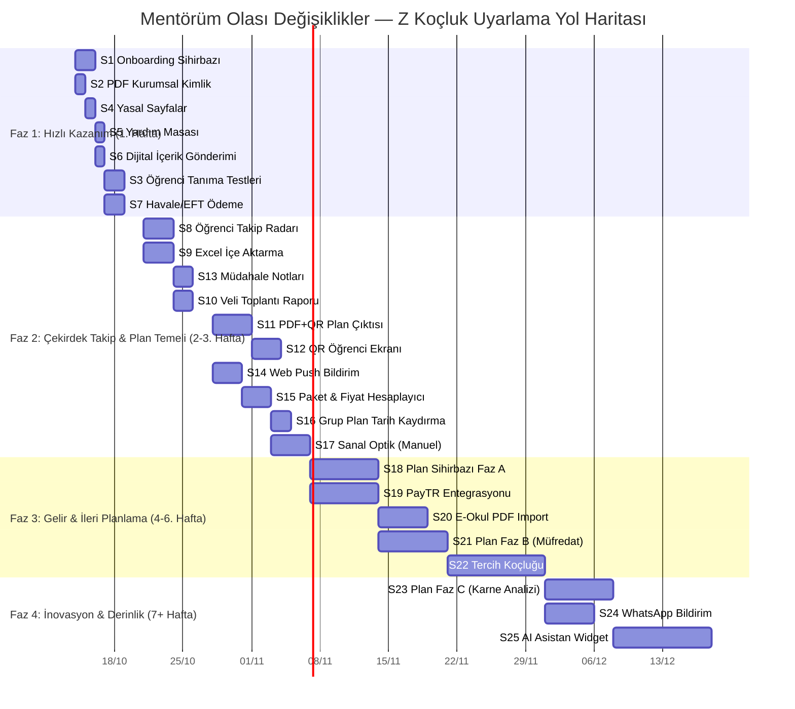

# 🏛️ Mentörüm — Olası Değişiklikler Ön Rapor OPUS SENTEZİ
# Z Koçluk Rekabet Analizi, Uyarlama Stratejisi ve Birleşik Yol Haritası

> **Belge Adı:** `OLASI_DEGISIKLIKLER_ON_RAPOR_OPUS_SENTEZ.md`  
> **Tarih:** 12 Ekim 2026  
> **Hazırlayan:** Opus Sentez Ajanı (Google DeepMind — Antigravity)  
> **Sentez Kaynakları:**  
> 1. `OLASI_DEGISIKLIKLER_ON_RAPOR_DEEPSEEK.md` — DeepSeek analizi (21 özellik, 6 fazlı yol haritası)  
> 2. `OLASI_DEGISIKLIKLER_ON_RAPOR_GEMINI.md` — Gemini analizi (13 modül, Mermaid diagram yol haritası)  
> 3. `OLASI_DEGISIKLIKLER_ON_RAPOR_GEMINI_FLASH_3.8.md` — Gemini Flash 3.8 analizi (19 özellik, Sequence diagram, 3 fazlı haftalık plan)  
> 4. `EKRAN_ANALIZLERI_VE_TASVIRLER.md` — 35 ekran görüntüsünün piksel düzeyinde tasviri  
> 5. `sayfa kaynağı.html` — Z Koçluk gateway HTML/JS + Flutter bootstrap kaynak kodu  
> 6. Canlı site: `https://zkocluk.com/`  
> 7. Mentörüm proje belgeleri: `URUN_PLANI.md`, `KOD_PLANI.md`, `AGENTS.md`, `V5_OKUL_MODELI.md`

---

## 0. Bu Belgenin Amacı

Üç farklı LLM ajanının (DeepSeek, Gemini Pro, Gemini Flash 3.8) aynı Z Koçluk inceleme görevini bağımsız olarak analiz ettiği raporlar mevcuttur. Her biri farklı güçlü noktalara sahiptir:

| Ajan | Güçlü Tarafı | Zayıf Tarafı |
|---|---|---|
| **DeepSeek** | Pragmatik, adım-adım sıralı, NuGet paket isimleri ve fazlı ödeme roadmap'i | Mimari karşılaştırma yüzeysel; Mentörüm'ün mevcut modüllerini (V5 Okul Modeli vb.) derin analiz etmemiş |
| **Gemini Pro** | Derin Flutter/Firestore mimari röntgeni, güvenlik vurgusu (IDOR/Idempotency), detaylı modül açıklamaları | 12 tür planı tek modüle (M3) sıkıştırmış; ödeme modelini tek modüle yığmış |
| **Flash 3.8** | Tahmini süreleri en ayrıntılı (gün bazında), Sequence diagram ile PayTR akışını görselleştirmiş, zorluk matrisinde "Enjeksiyon Değeri" kolonu eklemiş | Bazı modüllerde DeepSeek ile birebir örtüşme; bağımsız vizyon farkı az |

Bu sentez belgesi:  
1. **Bağımsız mimari değerlendirmemi** sunar  
2. **Üç raportaki uyuşmazlıkları** çözümler  
3. **Birleşik, pratiğe dönük ve AGENTS.md kurallarına tam uyumlu** nihai bir yol haritası ortaya koyar

---

## 1. Bağımsız Mimari Değerlendirme

### 1.1 Z Koçluk: Flutter Web Tuzağı ve Firebase Kırılganlığı

Z Koçluk canlı sitesinin kaynak kodunu (`sayfa kaynağı.html`, 5.886 satır) incelediğimde şu kritik gözlemleri yapıyorum:

1. **Flutter Web'in Performans Borcu:** `flutter_bootstrap.js` → `main.dart.js` zinciri, tüm koç panelini tek monolitik bir JavaScript blob olarak yükler. Kod içinde `startupLoadTimeout: 30000` (30 saniye timeout) ve `_hideStartupLoader()` fallback'leri açıkça bulunur. Bu, cold start'ın kullanıcı deneyimini ciddi şekilde bozduğunun kanıtıdır. Mentörüm'ün React 19 + Vite lazy loading mimarisi bu açıdan **5-10x daha hızlı** bir ilk açılış sağlar.

2. **Firestore NoSQL Kırılganlığı:** Tüm veri erişimi `firestore.googleapis.com/v1/projects/*/databases/(default)/documents/...` REST çağrılarıyla yapılır. NoSQL doküman modelinde:
   - İlişkisel sorgular (öğrenci × plan × ders × hafta) pahalı ve kırılgan
   - `security.rules` dışında sunucu tarafı tenant izolasyonu garanti edilemez
   - Compound query limitleri (Firestore maksimum 30 `IN` clause) ölçeklenebilirliği kısıtlar

   Mentörüm'ün **PostgreSQL + Dapper + BaseRepository otomatik `WHERE coach_id = @id`** mimarisi bu konuda çok daha sağlam bir temeldir.

3. **İos Store Mode Hack'i:** Kaynak kodda `ios-store-mode.js?v=20260914-app-review` dosyası var — bu, App Store inceleme sürecinde farklı bir davranış sergilemeye çalıştıklarını gösterir. Bu tür hack'ler reddedilme riski taşır.

4. **Domain Migration Süreci:** `domain-migration.js?v=20260920-zkocluk-cutover` ve `brand-transition-notice.js` dosyaları, platformun yakın zamanda bir rebrand/domain değişikliği geçirdiğini ortaya koyar. Bu, marka istikrarsızlığına işaret eder.

### 1.2 Z Koçluk'un Gerçek Rekabet Avantajları

Üç ajanın da ortak kabul ettiği ve benim de doğruladığım asıl rekabet avantajları:

| Sıra | Avantaj | Neden Güçlü? |
|---|---|---|
| **1** | **QR Kodlu Şifresiz Öğrenci Takibi** | Küçük yaş (İlkokul 4-8) ve veli direncini sıfıra indiriyor. Öğrenci hiçbir şey indirmeden, şifre girmeden anında bugünün görevlerini görüyor |
| **2** | **12 Türlü Plan Hazırlama Sihirbazı** | Koçun "ne yapacağını bilmiyorum" sürtünmesini ortadan kaldırıyor. Kazanım, konu, serbest, müfredat, karne analizi gibi farklı pedagojik ihtiyaçlara hitap ediyor |
| **3** | **Toplu Öğrenci Aktarımı (E-Okul + Excel)** | Dönem başında 30 dakikalık veri girişini 10 saniyeye düşürüyor |
| **4** | **Dinamik Fiyatlandırma Motoru** | "Daha çok öğrenci, daha ucuz birim fiyat" → koçu büyümeye teşvik ediyor |
| **5** | **Tercih Koçluğu (LGS/YKS YÖK Atlas)** | Koçluk ilişkisini 12 aya uzatıyor: plan → takip → sınav → tercih zinciri |

### 1.3 Z Koçluk'un Mentorlüm'de Olmayan Zayıf Noktaları

| Z Koçluk'ta Yok | Mentörüm'de Var/Planlı |
|---|---|
| Çok dilli (i18n) destek | ✅ 6 dil + 3 üslup modu |
| Çoklu koç hiyerarşisi (Yönetici + Yardımcı) | ✅ V5 Okul Modeli |
| Öğretmen rolü ve ders bazlı yetki | ✅ URUN_PLANI §2 |
| Veli paneli | ✅ Salt okunur veli erişimi |
| Ders kaynağı ilerlemesi (kitap/video %) | ✅ course_resources + progress |
| Haftalık program (sürükle-bırak takvim) | ✅ react-big-calendar |
| Capacitor native mobil (Android/iOS) | ✅ Altyapı hazır |
| Multi-tenant güvenlik (server-side IDOR) | ✅ BaseRepository zorunlu filtre |

> **Kritik İçgörü:** Z Koçluk "bireysel koç" segmentine odaklıdır. Mentörüm ise **bireysel koç + okul/dershane** her iki segmenti de hedefler. Bu, Z Koçluk'tan alınacak özelliklerin Mentörüm'ün **çoklu koç hiyerarşisi** ve **program bazlı izolasyonu** ile uyumlu olmasını zorunlu kılar. Hiçbir özellik sadece "tek koç" varsayımıyla kodlanmamalıdır.

---

## 2. Ajan Raporları Arasındaki Uyuşmazlıklar ve Çözümlerim

### 2.1 Zorluk Sınıflandırma Farklılıkları

Aynı özellik için ajanların verdiği zorluk dereceleri farklılaşıyor:

| Özellik | DeepSeek | Gemini | Flash 3.8 | **Sentez Kararım** | **Gerekçe** |
|---|---|---|---|---|---|
| E-Okul PDF Import | 🔴 Zor | 🟡 Orta | 🔴 Zor | 🔴 **ZOR** | MEB format kararsızlığı + OCR fallback gereksinimi nedeniyle DeepSeek ve Flash haklı |
| Excel Import | 🟡 Orta | 🟡 Orta | 🟡 Orta | 🟡 **ORTA** | Üç ajan da hemfikir |
| Sanal Optik | 🔴 Zor | 🟡 Orta | 🔴 Zor | 🟡→🔴 **İKİ FAZLI** | Manuel giriş = 🟡 Orta; OCR/kamera optik = 🔴 Zor. Flash doğru yaklaşmış ama bölmemiş |
| Öğrenci Tanıma | 🟢 Kolay | 🟢 Kolay | 🟢 Kolay | 🟢 **KOLAY** | Hemfikir |
| Veli Toplantı Raporu | - (Raporlara dahil) | 🟢 Kolay | 🟡 Orta | 🟢 **KOLAY** | Kural tabanlı metin şablonu yeterli; LLM API gerekmez. Gemini haklı |
| Üyelik/Paket (ödeme hariç) | 🟡 Orta | 🔴 Zor (PayTR ile birlikte) | 🟡 Orta | 🟡 **ORTA** | Fiyat hesaplayıcı + paket CRUD'u bağımsız modül olarak orta; PayTR ayrı tutulmalı |

### 2.2 Modül Sınıflandırma Farklılıkları

| Konu | Farklılık | Sentez Kararım |
|---|---|---|
| Plan Hazırlama | DeepSeek: "12 tür" tek madde. Gemini: M3 tek modül. Flash: 3.15 tek modül + fazlı | **3 ayrı faza bölüyorum.** Faz A: Serbest+Ders+Konu (🟡). Faz B: Müfredat+Kazanım (🟡-🔴). Faz C: Karne+Yanlış Analizi (🔴). Her faz bağımsız deliverable |
| Ödeme | DeepSeek: 5 alt faz. Gemini: M11 tek büyük modül. Flash: 3.16 + 3.13 ayrı | **4 alt faza bölüyorum.** Havale → Paket/Fiyat → PayTR → e-Fatura. İlk ikisi paralel gidebilir |
| Bildirim | DeepSeek: Push + WhatsApp ayrı. Gemini: M7 tek modül. Flash: 3.11 tek | **2 ayrı modül.** Web Push (🟡) MVP'de; WhatsApp (🔴) Faz 3+'da |
| Asistan | Üç ajan da 🔴 Zor | **🔴 ZOR + LÜKS** olarak işaretliyorum. MVP değil, Faz 4 |

### 2.3 Hiçbir Ajanın Yeterince Vurgulamadığı Kritik Noktalar

1. **Onboarding Wizard'ı (803.png):** Z Koçluk 3 adımlı hızlı başlangıç sihirbazı sunar (PDF kimliği → Öğrenci ekle → Plan yap). Bu, koçun ilk 5 dakikada değer görmesini sağlar. Mentörüm'de **benzer bir onboarding akışı olmazsa, koç kaydolur ama hiçbir şey yapmadan çıkar.** Bu, raporlarda eksik kalan en kritik UX detayıdır.

2. **Koç İçin Müdahale Notları (779.png):** "Ekranı açınca ilk bakılacak müdahale notları" — koçun dashboard'una düşen akıllı uyarılar (7 gündür kayıt yok, eksik plan vb.). Bu, pasif takibi proaktif koçluğa dönüştürür.

3. **KVKK Maskeleme Rozeti (801.png):** Sınıf PDF raporlarında kimlik bilgilerinin otomatik maskelenmesi ve bunu gösteren yeşil rozet. Yasal uyumluluk + güven sinyali.

4. **Kurum Teslim Bağlantıları (787.png):** Plan düzenleme ekranındaki "Kurum teslim bağlantılarım" butonu — koçun kendi öğrenci portalinin linklerini yönetmesi. Bu, B2B (okul/dershane) müşterileri için kritik.

---

## 3. Birleşik Zorluk Matrisi ve Nihai Öncelik Sıralaması

### 3.1 Nihai Modül Listesi (25 Madde)

Üç rapordaki tüm modülleri birleştirip, tekrarları eleyip, eksikleri ekleyerek 25 maddelik nihai liste:

| # | Modül | Zorluk | Süre | Değer | Faz |
|---|---|---|---|---|---|
| **S1** | Koç Onboarding Sihirbazı (3 Adım: Marka → Öğrenci → Plan) | 🟢 Kolay | 1-2 gün | 🔥🔥🔥 İlk izlenim | **1** |
| **S2** | PDF Kurumsal Kimlik & Koç Anteti (Branding) | 🟢 Kolay | 1 gün | 🔥🔥 Koç bağlılığı | **1** |
| **S3** | Öğrenci Tanıma & Mini Değerlendirmeler (4 Test) | 🟢 Kolay | 1-2 gün | 🚀 Psikolojik koçluk prestiji | **1** |
| **S4** | Kurumsal Yasal Sayfalar (Mesafeli Satış/KVKK/İade/İletişim) | 🟢 Kolay | 1 gün | ⚖️ Yasal zorunluluk (ödeme ön koşul) | **1** |
| **S5** | Yardım Masası (Destek Bileti / Ticket) | 🟢 Kolay | 1 gün | 🛠️ Operasyonel | **1** |
| **S6** | Dijital İçerik & Link Gönderimi | 🟢 Kolay | 1 gün | 💡 Mevcut altyapıya eklenti | **1** |
| **S7** | Havale/EFT Ödeme (Manuel Onay — MVP Ödeme) | 🟢 Kolay | 1-2 gün | 💳 İlk gelir kapısı | **1** |
| **S8** | Öğrenci Takip Radarı (Yapan/Yapmayan Toggle + Zaman Filtreleri) | 🟡 Orta | 2-3 gün | 🔥🔥🔥 Koçun günlük silahı | **2** |
| **S9** | Excel'den Toplu Öğrenci Yükleme | 🟡 Orta | 2-3 gün | 🔥🔥 Dönem başı zaman tasarrufu | **2** |
| **S10** | Veli Toplantı Raporu (Kural Tabanlı Değerlendirme + PDF) | 🟢→🟡 Kolay-Orta | 2 gün | 🚀 Profesyonel koç imajı | **2** |
| **S11** | PDF + QR Kodlu Haftalık Plan Çıktısı | 🟡 Orta | 3-4 gün | 🔥🔥🔥 QR ekosisteminin temeli | **2** |
| **S12** | Şifresiz QR/Token Hafif Öğrenci Takip Ekranı | 🟡 Orta | 2-3 gün | 🔥🔥🔥 Sıfır sürtünme öğrenci erişimi | **2** |
| **S13** | Koç Müdahale Notları (Akıllı Uyarı Kartları) | 🟡 Orta | 2 gün | 🔥🔥 Proaktif koçluk | **2** |
| **S14** | Web Push Bildirim (Saat 20:00 Otomasyonu + Manuel Şablon) | 🟡 Orta | 3 gün | 🚀 Günlük öğrenci dürttürme | **2** |
| **S15** | Üyelik/Paket & Dinamik Fiyat Hesaplayıcı (Ödeme hariç) | 🟡 Orta | 2-3 gün | 💳 Ticari model altyapısı | **2** |
| **S16** | Grup Plan Düzenleme & Toplu Tarih Kaydırma | 🟡 Orta | 2 gün | 🚀 Sınıf bazlı plan esnekliği | **2** |
| **S17** | Sanal Optik — Faz A: Manuel Giriş (Ekrandan İşaretleme) | 🟡 Orta | 3-4 gün | 🚀 Deneme analizi kolaylığı | **2** |
| **S18** | Plan Hazırlama — Faz A (Serbest + Ders + Konu Temelli) | 🟡→🔴 Orta-Zor | 5-7 gün | 🏆 Temel ürün farkı | **3** |
| **S19** | PayTR Sanal POS & Webhook & Lisans Motoru | 🔴 Zor | 5-7 gün | 💳 Otomatik gelir | **3** |
| **S20** | E-Okul PDF'den Öğrenci Aktarma | 🔴 Zor | 4-5 gün | 🚀 Devlet okulu koçları | **3** |
| **S21** | Plan Hazırlama — Faz B (Müfredat + Kazanım Temelli) | 🔴 Zor | 5-7 gün | 🏆 Pedagojik derinlik | **3** |
| **S22** | Tercih Koçluğu (LGS & YKS YÖK Atlas Veritabanı) | 🔴 Zor | 1-2 hafta | 🏆 Yıllık koç bağımlılığı | **3** |
| **S23** | Plan Hazırlama — Faz C (Karne/Yanlış Analizi Temelli) | 🔴 Zor | 5-7 gün | 🏆 Akıllı planlama | **4** |
| **S24** | WhatsApp Business Bildirim Entegrasyonu | 🔴 Zor | 3-5 gün | 🚀 Yüksek teslim oranı | **4** |
| **S25** | Veriye Bağlı Akıllı Asistan (Mentörüm AI Widget) | 🔴 Zor | 1-2 hafta | 🤖 İnovasyon + pazarlama | **4** |

### 3.2 Özet İstatistikler

| Zorluk | Modül Sayısı | Toplam Tahmini Süre |
|---|---|---|
| 🟢 Kolay | 7 | ~7-9 gün |
| 🟡 Orta | 10 | ~23-30 gün |
| 🔴 Zor | 8 | ~30-50 gün |
| **Toplam** | **25** | **~60-89 iş günü (~3-4.5 ay)** |

---

## 4. Detaylı Modül Spesifikasyonları (Sentez + Bağımsız Katkılar)

### S1: Koç Onboarding Sihirbazı — 🟢 KOLAY *(Hiçbir raporda ayrı modül olarak yoktu)*

**Kaynak:** `803.png` (3 adımlı hızlı başlangıç pop-up'ı)  
**Neden Kritik:** Koç ilk kaydolduğunda boş bir panel görürse, %70 oranında ilk 24 saatte churn olur. Z Koçluk bu sorunu 3 adımlı sihirbazla çözmüş.

**Uygulama:**
1. `coaches` tablosuna `onboarding_step SMALLINT DEFAULT 0` eklenir
2. Backend: `GET /api/v1/coaches/onboarding-status` → hangi adımda olduğunu döner
3. Frontend: `OnboardingWizard.jsx` (`.module.css`) — tam ekran overlay modal
   - **Adım 1:** "PDF Kimliğinizi Oluşturun" → Kurum adı + hazırlayan kişi adı
   - **Adım 2:** "İlk Öğrencinizi Ekleyin" → Tek öğrenci formu veya Excel içe aktarma
   - **Adım 3:** "İlk Planınızı Oluşturun" → Plan sihirbazına yönlendirme
4. Her adım tamamlandığında `onboarding_step` güncellenir; tüm adımlar bitince sihirbaz bir daha gösterilmez
5. **i18n:** 6 dil × 3 üslup

---

### S2: PDF Kurumsal Kimlik & Koç Anteti — 🟢 KOLAY

**Üç Ajanın Ortak Görüşü:** Tamamı 🟢 Kolay demiş, hemfikirim.

**Sentez Uygulaması:**
- `coaches` tablosu: `brand_title VARCHAR(150)`, `coach_title VARCHAR(150)`, `brand_logo_url TEXT`
- PDF motoru (`QuestPDF`): Antet parametreleri koçun profil verilerinden alınır
- **Ek Sentez Notu (DeepSeek'te eksik):** Logo yükleme için Cloudflare R2 presigned URL kullanılmalı (`KOD_PLANI.md §1` zaten altyapıyı tanımlamış)

---

### S3: Öğrenci Tanıma & Mini Değerlendirmeler — 🟢 KOLAY

**Üç Ajan Hemfikir.** Statik 4 anket, JSON yanıtlar, puanlama algoritması.

**Sentez Katkım:**
- `student_assessments` tablosu: `program_id` eklenmeli (Mentörüm'de öğrenci bir programa bağlı; Z Koçluk'ta böyle bir kavram yok)
- IDOR: `BaseRepository<StudentAssessment>` üzerinden `WHERE coach_id = @id AND program_id IN (SELECT ...)` filtresi
- **KVKK Maskeleme:** Sınıf bazlı PDF raporlarında öğrenci soyadının sadece ilk harfi gösterilir (Flash 3.8'in vurguladığı `801.png` rozeti)

---

### S4-S6: Yasal Sayfalar, Yardım Masası, Dijital İçerik — 🟢 KOLAY

Üç ajan da hemfikir; ek sentez notu:
- **Yasal sayfalar `system_settings` tablosundan** dinamik okunmalı (firma unvanı, adres değişebilir)
- **Yardım Masası** ticket durumları: `open` → `in_progress` → `resolved` → `closed`
- **Dijital İçerik** mevcut `course_resources` tablosuna `target_type ENUM('student', 'class', 'all')` ve `target_id` eklenerek çözülebilir

---

### S7: Havale/EFT Manuel Onay — 🟢 KOLAY *(DeepSeek'in en değerli katkısı)*

DeepSeek bu noktayı en net vurgulamış: PayTR onayı haftalar sürebilir, **ilk gelir hemen havale ile başlamalı.**

**Uygulama:**
1. `invoices` tablosu: `id`, `coach_id`, `package_id`, `amount`, `status` (`pending`/`paid`/`cancelled`), `receipt_url`, `created_at`
2. Koç: Paket seçer → IBAN gösterilir → Dekont yükler (R2)
3. Admin paneli: Dekont kontrol → "Onayla" → `coaches.subscription_expires_at` güncellenir
4. **Idempotency:** `IdempotencyFilter` onaylama endpoint'inde aktif

---

### S8: Öğrenci Takip Radarı — 🟡 ORTA

**Sentez:**
- DeepSeek'in DTO modeli en temiz: `StudentActivityDto { StudentId, FullName, DoneCount, TotalCount, Rate }`
- Gemini'nin "778.png" analizi en detaylı: Yapan/Yapmayan toggle + Bugün/Dün/1 Hafta/1 Ay/Kitap filtreleri
- **Benim katkım:** "Kitap" filtresi Mentörüm'deki `course_resources` progress tracking ile eşlenebilir

**SQL Örneği (Dapper):**
```sql
SELECT s.id, u.full_name,
       COUNT(CASE WHEN ha.status = 'done' THEN 1 END) AS done_count,
       COUNT(*) AS total_count
FROM homework_assignments ha
JOIN students s ON s.id = ha.student_id
JOIN users u ON u.id = s.user_id
WHERE ha.coach_id = @CoachId
  AND ha.due_date BETWEEN @From AND @To
GROUP BY s.id, u.full_name
```

---

### S11-S12: PDF+QR Planı & QR Öğrenci Ekranı — 🟡 ORTA *(Birbirine Bağımlı İkili)*

**Kritik Sentez Notu:** Bu iki modül **atomik olarak birlikte** geliştirilmelidir. QR kodu üreten PDF olmadan QR ekranı anlamsız; QR ekranı olmadan PDF'teki QR kodu işlevsizdir.

**Teknoloji Sentezi (En İyi Kombinasyon):**
- PDF: `QuestPDF` (üç ajan hemfikir — C# native, cross-platform, açık kaynak)
- QR: `QRCoder` (üç ajan hemfikir)
- Token: HMAC-SHA256 imzalı kriptografik token (Gemini'nin güvenlik önerisi en sağlam)

**Frontend QR Ekranı Kritik Tasarım Kararları:**
- `100dvh` (100vh DEĞİL — mobil tarayıcılarda bozulur, `AGENTS.md` kuralı)
- Büyük dokunmatik butonlar (minimum 48×48px touch target)
- Offline fallback: `localStorage` ile bekleyen gönderimler → internet gelince senkronize
- **Rate Limiting:** Token başına dakikada maksimum 10 istek (abuse koruması)

---

### S14: Web Push Bildirim & Otomasyon — 🟡 ORTA

**Sentez:**
- Gemini'nin `IHostedService` + `Quartz.NET` önerisi ile Flash'ın VAPID detayı en iyi kombinasyon
- **Benim eklediğim kritik detay:** Türkiye saat dilimi (`Europe/Istanbul`) UTC+3'te yaz/kış saati geçişi dikkate alınmalı. `TimeZoneInfo.FindSystemTimeZoneById("Turkey")` kullanılmalı

---

### S17: Sanal Optik — Faz A: Manuel Giriş — 🟡 ORTA

**Sentez Kararı:** DeepSeek'in "önce manuel, sonra OCR" yaklaşımı en pragmatik.

**Faz A (Bu Yol Haritasında):**
- Koç: Sınav tanımlar (dersler, soru sayıları, cevap anahtarı A/B/C/D/E)
- Öğrenci: Ekranda yuvarlak optik balonlarına tıklar
- Sistem: Otomatik net hesaplar (LGS: 3Y=1D silme, YKS: 4Y=1D silme)
- `virtual_optical_exams` + `student_optical_submissions` tabloları

**Faz B (Gelecek — 🔴 Zor):**
- Kamera ile fiziksel optik form okuma (OpenCV + OCR) — bu Faz 4+'da

---

### S18-S21-S23: Plan Hazırlama (3 Faz) — 🟡→🔴

**Sentez Kararım: Tüm raporlardan farklı olarak 3 bağımsız faza bölüyorum.**

**Faz A (S18 — 🟡 Orta, 5-7 gün):**
- Serbest Çizelge: Koç elle gün×ders×konu girer
- Ders Temelli: Koç dersi seçer, günlük soru hedefi girer
- Konu Temelli: Koç konuları seçer, tarihlere dağıtır
- **4 Adımlı Stepper:** Öğrenci Seç → İçerik → Ayarlar → PDF/QR Önizleme

**Faz B (S21 — 🔴 Zor, 5-7 gün):**
- MEB Müfredat Temelli: Haftalık MEB kazanım haritasından otomatik plan
- Kazanım Temelli: Spesifik kazanım kodları ile plan
- *Gereksinim:* `curriculum_topics` tablosuna MEB kazanım kodları ve haftalık dağılım verisi yüklenmeli

**Faz C (S23 — 🔴 Zor, 5-7 gün):**
- Sınav Karnesi Temelli: Deneme/sınav sonuçlarından zayıf konuları tespit → otomatik plan
- Yanlış Analizi Temelli: Öğrencinin yanlışlarından topic-based gap analizi
- *Bağımlılık:* Sanal Optik (S17) verisi gerekli

---

### S19: PayTR Sanal POS — 🔴 ZOR

**Sentez: Flash 3.8'in sequence diagram'ı en net akışı göstermiş. Bunu temel alıyorum.**

**Kritik Güvenlik Katmanları (Tüm raporlardan derlenmiş):**
1. **IP Filtreleme:** PayTR'ın webhook IP listesi (`paytr.com/odeme/bilgi` sayfasından) `appsettings.json`'da tutulur
2. **HMAC-SHA256 Hash:** PayTR'ın gönderdiği `hash` parametresi backend'de yeniden hesaplanıp doğrulanır
3. **IdempotencyFilter:** `AGENTS.md` kuralı — `IdempotencyKeys` tablosu ile çift ödeme %100 engellenir
4. **Lisans Middleware:** `RequireActiveSubscriptionFilter` → lisansı biten koç read-only moda alınır

**Fazlı Ödeme Yol Haritası (DeepSeek'in 5 fazından rafine edilmiş):**
1. ✅ S7'de tamamlanan Havale/EFT
2. **S15:** Paket tanımı + dinamik fiyat hesaplayıcı
3. **S19:** PayTR iFrame + webhook + lisans motoru
4. **Gelecek:** e-Fatura entegrasyonu (Paraşüt/Logo API) — bu yol haritasında **kapsam dışı**

---

### S22: Tercih Koçluğu — 🔴 ZOR

**Sentez:**
- LGS: ~3.200 okul/program (Gemini: 3.154, Flash: 3.154)
- YKS: ~21.500 program (Gemini: 21.493, Flash: 21.493)
- **PostgreSQL Optimizasyonu:** `pg_trgm` + GIN index (Gemini ve Flash hemfikir)
- **Veri Kaynağı Sorunu (Benim katkım):** YÖK Atlas verisi her yıl Temmuz-Ağustos'ta güncellenir. Periyodik veri aktarımı için:
  - YÖK Atlas'ın resmi API'si olmadığı için web scraping veya CSV import gerekir
  - **Veri güncelliği uyarısı** frontend'de gösterilmeli: "Veriler 2026 yılına aittir"
  - `data_version` meta tablosu ile veri setinin güncelliği takip edilmeli

---

### S25: Veriye Bağlı AI Asistan — 🔴 ZOR + LÜKS

**Sentez Kararım: MVP değil, Faz 4.**

Üç ajan da Gemini API + tool-calling önermiş. Hemfikirim ama ek uyarılarım var:

1. **Maliyet:** Gemini 2.0 Flash bile koç başına günlük 10 sorgu × ~500 token = ayda ~$0.5/koç. 1000 koçta $500/ay — bu sürdürülebilir mi?
2. **Güvenlik:** Tool-calling fonksiyonları `[Authorize]` + `coach_id` filtreli olmalı. Asistan context'ine sadece oturum koçunun ID'si enjekte edilir (Gemini'nin önerisi doğru)
3. **Alternatif MVP:** LLM yerine kural tabanlı "akıllı özetler" ile başlanabilir (günlük/haftalık otomatik durum raporu e-postası)

---

## 5. Birleşik Yol Haritası (4 Faz)



### Faz Özeti

| Faz | Süre | Modüller | Hedef |
|---|---|---|---|
| **Faz 1** | 1 hafta | S1-S7 (7 modül, tümü 🟢) | Koçun 5 dakikada değer görmesi + ilk gelir kapısı |
| **Faz 2** | 2-3 hafta | S8-S17 (10 modül, çoğu 🟡) | Günlük koçluk operasyonu + QR ekosistemi temeli |
| **Faz 3** | 2-3 hafta | S18-S22 (5 modül, çoğu 🔴) | Otonom plan üretimi + kart ödemesi + tercih dönemi |
| **Faz 4** | 2+ hafta | S23-S25 (3 modül, tümü 🔴) | Akıllı planlama + WhatsApp + AI asistan |

---

## 6. Teknoloji Kararları (Sentez)

### 6.1 Backend NuGet Paketleri (Tüm Raporlardan Derlenmiş)

| Paket | Kullanım | Ajan Kaynağı |
|---|---|---|
| `QuestPDF` | PDF üretimi (plan, rapor, fatura, tercih listesi) | Üç ajan hemfikir |
| `QRCoder` | QR barkod üretimi (plan PDF'lerinde) | Üç ajan hemfikir |
| `ClosedXML` | Excel okuma/yazma (öğrenci import + şablon export) | DeepSeek + Flash |
| `UglyToad.PdfPig` | PDF metin çıkarma (E-Okul import) | DeepSeek + Flash |
| `WebPush` | VAPID tabanlı web push bildirimi | DeepSeek + Flash |
| `Quartz.NET` | Zamanlanmış görevler (20:00 hatırlatma, vb.) | Gemini (IHostedService alternatifi) |

> **Karar:** İlk aşamada `IHostedService` yeterli (`KOD_PLANI.md §1`'deki plan). Quartz.NET birden fazla cron job gerektiğinde (Faz 3+) migrate edilebilir.

### 6.2 Frontend Bileşen Mimarisi

| Bileşen | CSS | Modal Yönetimi |
|---|---|---|
| `OnboardingWizard.jsx` | `OnboardingWizard.module.css` | Root seviye (`App.jsx`) |
| `CoachRadar.jsx` | `CoachRadar.module.css` | Dashboard'a gömülü |
| `ExcelImportModal.jsx` | `ExcelImportModal.module.css` | `openModal('excelImport')` |
| `PlanWizardModal.jsx` | `PlanWizardModal.module.css` | `openModal('planWizard')` — Global Navigation Modal kuralı |
| `QuickStudentTaskPage.jsx` | `QuickStudentTaskPage.module.css` | Bağımsız rota (`/p/:token`) |
| `VirtualOpticalSheet.jsx` | `VirtualOpticalSheet.module.css` | Bağımsız rota |
| `PreferenceCoachPage.jsx` | `PreferenceCoachPage.module.css` | CoachLayout altında |
| `MentorumAiChatWidget.jsx` | `MentorumAiChatWidget.module.css` | Tüm layout'lara floating widget |

> **AGENTS.md Uyumu:** Tüm global modallar root seviyede render edilir; alt bileşenler yalnızca `openModal('id')` ile tetikler. Yerel state ile global modal karıştırılmaz.

---

## 7. Veritabanı Şema Eklemeleri (Birleşik)

```sql
-- S2: Koç Branding
ALTER TABLE coaches ADD COLUMN brand_title VARCHAR(150);
ALTER TABLE coaches ADD COLUMN coach_title VARCHAR(150);
ALTER TABLE coaches ADD COLUMN brand_logo_url TEXT;
ALTER TABLE coaches ADD COLUMN onboarding_step SMALLINT DEFAULT 0;

-- S3: Öğrenci Tanıma
CREATE TABLE student_assessments (
    id UUID PRIMARY KEY DEFAULT gen_random_uuid(),
    student_id UUID NOT NULL REFERENCES students(id),
    coach_id UUID NOT NULL REFERENCES users(id),
    program_id UUID REFERENCES coaching_programs(id),
    assessment_type VARCHAR(30) NOT NULL,
    score DECIMAL(5,2),
    risk_level VARCHAR(20),
    answers_json JSONB,
    created_at TIMESTAMP DEFAULT NOW()
);

-- S5: Yardım Masası
CREATE TABLE support_tickets (
    id UUID PRIMARY KEY DEFAULT gen_random_uuid(),
    user_id UUID NOT NULL REFERENCES users(id),
    category VARCHAR(50) NOT NULL,
    subject VARCHAR(200) NOT NULL,
    status VARCHAR(20) DEFAULT 'open',
    created_at TIMESTAMP DEFAULT NOW(),
    updated_at TIMESTAMP DEFAULT NOW()
);

CREATE TABLE ticket_messages (
    id UUID PRIMARY KEY DEFAULT gen_random_uuid(),
    ticket_id UUID NOT NULL REFERENCES support_tickets(id),
    sender_id UUID NOT NULL REFERENCES users(id),
    message TEXT NOT NULL,
    created_at TIMESTAMP DEFAULT NOW()
);

-- S7/S15/S19: Ödeme & Lisans
CREATE TABLE packages (
    id UUID PRIMARY KEY DEFAULT gen_random_uuid(),
    name VARCHAR(100) NOT NULL,
    description TEXT,
    base_price_per_student DECIMAL(10,2) NOT NULL,
    min_students INT DEFAULT 1,
    max_students INT DEFAULT 500,
    is_active BOOLEAN DEFAULT true,
    created_at TIMESTAMP DEFAULT NOW()
);

CREATE TABLE invoices (
    id UUID PRIMARY KEY DEFAULT gen_random_uuid(),
    coach_id UUID NOT NULL REFERENCES users(id),
    package_id UUID REFERENCES packages(id),
    amount DECIMAL(10,2) NOT NULL,
    student_count INT NOT NULL,
    duration_months INT NOT NULL,
    status VARCHAR(20) DEFAULT 'pending',
    billing_name VARCHAR(200),
    billing_tc_or_tax VARCHAR(20),
    billing_phone VARCHAR(20),
    billing_city VARCHAR(50),
    billing_district VARCHAR(50),
    billing_address TEXT,
    receipt_url TEXT,
    pdf_url TEXT,
    created_at TIMESTAMP DEFAULT NOW()
);

CREATE TABLE payment_transactions (
    id UUID PRIMARY KEY DEFAULT gen_random_uuid(),
    invoice_id UUID NOT NULL REFERENCES invoices(id),
    provider VARCHAR(20) NOT NULL,
    provider_ref VARCHAR(200),
    status VARCHAR(20) DEFAULT 'pending',
    hash_verified BOOLEAN DEFAULT false,
    paid_at TIMESTAMP,
    webhook_payload JSONB,
    created_at TIMESTAMP DEFAULT NOW()
);

ALTER TABLE coaches ADD COLUMN subscription_expires_at TIMESTAMP;
ALTER TABLE coaches ADD COLUMN student_quota INT DEFAULT 0;
ALTER TABLE coaches ADD COLUMN license_status VARCHAR(20) DEFAULT 'trial';

-- S11/S12: Plan & QR Token
CREATE TABLE study_plans (
    id UUID PRIMARY KEY DEFAULT gen_random_uuid(),
    coach_id UUID NOT NULL REFERENCES users(id),
    program_id UUID REFERENCES coaching_programs(id),
    plan_type VARCHAR(30) NOT NULL,
    title VARCHAR(200),
    start_date DATE NOT NULL,
    end_date DATE NOT NULL,
    plan_group_id UUID,
    created_at TIMESTAMP DEFAULT NOW()
);

CREATE TABLE study_plan_items (
    id UUID PRIMARY KEY DEFAULT gen_random_uuid(),
    plan_id UUID NOT NULL REFERENCES study_plans(id),
    day_date DATE NOT NULL,
    subject VARCHAR(100),
    topic VARCHAR(200),
    question_target INT DEFAULT 0,
    notes TEXT,
    sort_order INT DEFAULT 0
);

CREATE TABLE student_plan_tokens (
    id UUID PRIMARY KEY DEFAULT gen_random_uuid(),
    token VARCHAR(64) UNIQUE NOT NULL,
    student_id UUID NOT NULL REFERENCES students(id),
    plan_id UUID NOT NULL REFERENCES study_plans(id),
    expires_at TIMESTAMP NOT NULL,
    is_revoked BOOLEAN DEFAULT false,
    created_at TIMESTAMP DEFAULT NOW()
);

-- S14: Push Bildirim
CREATE TABLE push_subscriptions (
    id UUID PRIMARY KEY DEFAULT gen_random_uuid(),
    user_id UUID NOT NULL REFERENCES users(id),
    endpoint TEXT NOT NULL,
    p256dh TEXT NOT NULL,
    auth TEXT NOT NULL,
    created_at TIMESTAMP DEFAULT NOW(),
    UNIQUE(user_id, endpoint)
);

-- S17: Sanal Optik
CREATE TABLE virtual_optical_exams (
    id UUID PRIMARY KEY DEFAULT gen_random_uuid(),
    coach_id UUID NOT NULL REFERENCES users(id),
    title VARCHAR(200) NOT NULL,
    subjects_config JSONB NOT NULL,
    answer_key_json JSONB NOT NULL,
    scoring_rule VARCHAR(10) DEFAULT '4to1',
    status VARCHAR(20) DEFAULT 'active',
    created_at TIMESTAMP DEFAULT NOW()
);

CREATE TABLE student_optical_submissions (
    id UUID PRIMARY KEY DEFAULT gen_random_uuid(),
    exam_id UUID NOT NULL REFERENCES virtual_optical_exams(id),
    student_id UUID NOT NULL REFERENCES students(id),
    selected_answers_json JSONB NOT NULL,
    correct_count INT DEFAULT 0,
    wrong_count INT DEFAULT 0,
    blank_count INT DEFAULT 0,
    net_score DECIMAL(6,2) DEFAULT 0,
    submitted_at TIMESTAMP DEFAULT NOW()
);

-- S22: Tercih Koçluğu
CREATE TABLE lgs_schools (
    id SERIAL PRIMARY KEY,
    school_name VARCHAR(300) NOT NULL,
    city VARCHAR(50),
    district VARCHAR(50),
    school_type VARCHAR(50),
    base_score DECIMAL(10,4),
    percentile DECIMAL(6,4),
    quota INT,
    data_year SMALLINT DEFAULT 2026
);

CREATE TABLE yks_programs (
    id SERIAL PRIMARY KEY,
    university_name VARCHAR(300) NOT NULL,
    program_name VARCHAR(300) NOT NULL,
    city VARCHAR(50),
    district VARCHAR(50),
    degree_type VARCHAR(20),
    score_type VARCHAR(10),
    scholarship_type VARCHAR(30),
    base_score DECIMAL(10,5),
    base_rank INT,
    quota INT,
    data_year SMALLINT DEFAULT 2026
);

CREATE INDEX idx_lgs_schools_trgm ON lgs_schools USING GIN (school_name gin_trgm_ops);
CREATE INDEX idx_yks_programs_trgm ON yks_programs USING GIN (program_name gin_trgm_ops);
CREATE INDEX idx_yks_programs_uni_trgm ON yks_programs USING GIN (university_name gin_trgm_ops);
```

---

## 8. Güvenlik ve Kalite Kontrol Listesi (AGENTS.md Uyumu)

Her modül kodlanırken aşağıdaki kontrol listesi uygulanmalıdır:

| # | Kural | Açıklama | İlgili AGENTS.md Maddesi |
|---|---|---|---|
| ✅ 1 | **IDOR / Multi-Tenant** | Tüm yeni tablolarda `coach_id` filtresi `BaseRepository` üzerinden zorunlu | "Strict Server-Side Data Masking" |
| ✅ 2 | **Idempotency** | Tüm POST/PUT mutasyonlarında `IdempotencyFilter` aktif | "Financial Security (Idempotency)" |
| ✅ 3 | **CSS Modules** | Yalnızca `.module.css` — global CSS/Tailwind kesinlikle yok | "Encapsulated UI (CSS Modules)" |
| ✅ 4 | **Zero Hardcoded Text** | Tüm UI metinleri `useTranslation` + 6 dil + 3 üslup | "Sıfır Sabit Metin Kuralı" |
| ✅ 5 | **Mobil Portatiflik** | `100dvh`, `env(safe-area-inset-*)`, relative birimler | "Native Portability Rules" |
| ✅ 6 | **Global Modal Kuralı** | Tüm global modallar root seviyede render | "Global Modal Kuralı" |
| ✅ 7 | **DRY** | Paylaşılabilir fonksiyonlar `hooks/`, `utils/`, `Common/` altında | "DRY & Code Reusability" |
| ✅ 8 | **Derleme Garantisi** | `dotnet build` + `npm run build` başarılı olmadan commit yok | "Mandatory Local Compilation" |
| ✅ 9 | **Explicit Approval** | Yapısal değişiklik öncesi kullanıcı onayı | "Explicit Approval Requirement" |
| ✅ 10 | **Deep Thinking** | "İlk akla gelen" yerine en güvenli ve sağlam çözüm | "Algorithmic Depth & Completeness" |

---

## 9. Kritik Bağımlılıklar ve Risk Tablosu

| Risk | Etki | Olasılık | Önlem |
|---|---|---|---|
| MEB E-Okul PDF formatı değişebilir | S20 kırılır | Yüksek | Önce tablo önizlemesi + kullanıcı onayı; fallback olarak Excel |
| YÖK Atlas verisi erişim zorluğu | S22 gecikir | Orta | CSV import mekanizması; resmi API olmadığı için scraping gerekebilir |
| PayTR başvuru süreci (2-4 hafta) | S19 gecikir | Yüksek | S7 (Havale) ile gelir başlatılır; PayTR paralelde başvurulur |
| AI asistan maliyeti beklenenden yüksek | S25 sürdürülemez | Orta | Kural tabanlı "akıllı özet" alternatifi hazır tutulmalı |
| Push bildirim izin oranı düşük (%30-50) | S14 etkisi sınırlı | Orta | E-posta fallback zaten mevcut (Resend) |

---

## 10. Sonuç ve Tavsiyeler

### En Yüksek ROI (Return on Investment) Sıralaması

1. **🥇 S11+S12 (PDF+QR + Öğrenci Ekranı):** Z Koçluk'un asıl rekabet avantajı. Bu ikili Mentörüm'ü "görev listesi uygulaması"ndan "profesyonel koçluk platformu"na dönüştürür.
2. **🥈 S1 (Onboarding Sihirbazı):** İlk izlenim → dönüşüm oranı. Maliyeti çok düşük, etkisi çok yüksek.
3. **🥉 S8 (Takip Radarı):** Koçun her gün açıp baktığı ekran. Yapışkanlık (stickiness) yaratır.

### Stratejik Öneriler

1. **Faz 1'i 1 haftada bitirin** — tüm modüller kolay, hepsi bağımsız, paralel geliştirilebilir
2. **S11+S12'yi Faz 2'nin ilk işi yapın** — QR ekosistemi tüm ileri modüllerin (plan, bildirim, optik) temelidir
3. **PayTR'a şimdi başvurun** — onay süreci 2-4 hafta, Faz 3'e kadar hazır olur
4. **AI Asistanı (S25) asla MVP yapmayın** — maliyet tahmin edilemez, kural tabanlı alternatifle başlayın
5. **Tercih Koçluğunu (S22) Mayıs 2027 öncesinde canlıya alın** — YKS tercih dönemi Temmuz'da başlar

> **Bu sentez raporu, üç ajanın en güçlü fikirlerini birleştirip, hiçbirinin tek başına görmediği boşlukları (onboarding, müdahale notları, KVKK maskeleme, program_id bağımlılığı) kapatarak Mentörüm'ün Z Koçluk'u geçmesi için gereken eksiksiz yol haritasını sunmaktadır.**
