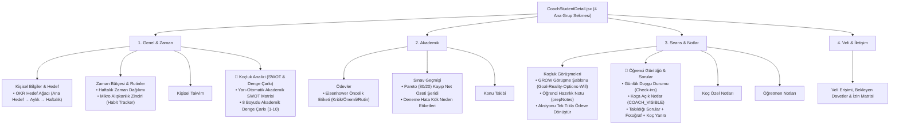

# 🧭 Mentörüm — V16 Analiz Raporu, Hata Teşhisi, Koçluk Araçları Mimarisi ve Görev Listesi

> **Hazırlayan Model:** Gemini 4 Argon (High)  
> **Tarih:** 29 Ekim 2026  
> **Kapsam:**  
> 1. Paylaşılan **9 ekran görüntüsündeki** (4 Öğrenci Mobil + 5 Koç Masaüstü) çalışmayan özelliklerin, işlevsiz butonların, veri/sorgu kopukluklarının ve UX kusurlarının kök nedenleriyle tespiti ve çözümü,  
> 2. **Öğrenci** ekranlarının "Bugün Ne Yapacağım?" odağıyla sadeleştirilmesi,  
> 3. **Koç ↔ Öğrenci ↔ Öğretmen ↔ Veli** iletişim döngüsünün ve izin matrisinin uçtan uca kapatılması,  
> 4. **Profesyonel Koçluk Araçlarının (`SWOT`, `GROW`, `OKR Hedef Ağacı`, `Pareto 80/20`, `Deneme Hata Kök Neden`, `Akademik Denge Çarkı`, `Alışkanlık Zinciri`, `Eisenhower`)** koçun öğrenci detay sekmesinde (`CoachStudentDetail.jsx`) sadelik ve kullanışlılık ilkeleriyle konumlandırılması.  
> **Görev Durum Kuralı:** Henüz uygulanmamış maddeler `[ ]`, tamamlananlar `[x]`.

---

## 🚨 GEMINI 3.8 FLASH İÇİN ZORUNLU KODLAMA REHBERİ VE HATA ÖNLEME KURALLARI (GUARDRAILS)

> **DİKKAT (Gemini 3.8 Flash):** Kodlamaya başlamadan önce bu 10 altın kuralı mutlaka oku. V15 sırasında yapılan hataların tekrarlanmaması için aşağıdaki kurallar **kesinlikle çiğnenemez**:

1. **Veritabanı Tablo ve Kolon İsimlerini Asla Tahmin Etme (Ezberden Yazma Yasağı):**
   - `exam_scores` tablosundaki kolon adları `correct`, `wrong`, `blank`, `question_count`, `net`, `score`, `max_score` şeklindedir (**ASLA** `correct_count`, `wrong_count`, `blank_count` yazma!).
   - Öğretmen notları tablosunun adı **`teacher_notes`**'tur (**ASLA** `teacher_student_notes` yazma!).
   - `student_parents` tablosundaki izin kolonları `INTEGER` tipindedir (`0` veya `1`; `boolean` değildir!). Her zaman `AND COALESCE(can_view_*, 0) = 1` kullan.
2. **Dapper + PostgreSQL `JSONB` Okuma/Yazma Kuralı (`B6` için Kritik):**
   - Dapper, PostgreSQL `jsonb` kolonunu doğrudan `string` veya C# objesine map edemez (`DataException` fırlatır).
   - **Okurken (`SELECT`):** Mutlaka `::text` cast kullan: `swot_data::text AS SwotData, wheel_data::text AS WheelData, habits_data::text AS HabitsData`.
   - **Yazarken (`INSERT / UPDATE`):** Parametreyi `string?` olarak gönder ve SQL içinde `CAST(@SwotData AS jsonb)` veya `@SwotData::jsonb` kullan (Örnek: `ApprovalRepository.cs:19, 72`).
3. **Authorization Policy İsimlerini Birebir Kullan (`Program.cs:133-139`):**
   - Projede tanımlı policy adları şunlardır: `"RequireCoachRole"`, `"RequireStudentRole"`, `"RequireParentRole"`, `"RequireTeacherRole"`, `"RequireAdminRole"`.
   - **ASLA** `"RequireCoach"` veya `"RequireStudent"` yazma (`InvalidOperationException: The AuthorizationPolicy named ... was not found` hatası verir!).
   - `StudentEndpoints.cs` içinde `group` zaten `"RequireCoachRole"` ve `self` zaten `"RequireStudentRole"` grubuna bağlıdır; yeni uçları bu mevcut gruplara (`group.MapGet(...)`, `self.MapGet(...)`) ekle.
4. **Kalıtım (`StudentDetailDto : StudentListDto`) ve `CS0108` Uyarısı Yasağı (`B1`):**
   - `StudentDetailDto` sınıfı `StudentListDto` sınıfından türemektedir (`StudentDtos.cs:29`).
   - `GroupName`, `HasIndividualCourse`, `ThisWeekStudyMinutes`, `ThisWeekQuestionCount`, `Grade`, `Track`, `TargetUniversity`, `ProgramId` alanları **zaten `StudentListDto` içinde mevcuttur**. Bu alanları `StudentDetailDto` içine **tekrar yazma**; yalnızca `GetStudentDetailAsync` SQL sorgusuna ekle!
5. **`CoachStudentDetail.jsx` Düzenlemesinde Cerrahi Müdahale Kuralı (`F4`–`F8`):**
   - `CoachStudentDetail.jsx` içinde V15'te eklenen **`ExamScoreRow` (`satır 49–165`), `handleSaveExam` (`satır 191–315`), `Sınavlar` (`satır 756–982`) ve `Konu Takibi` (`satır 1009–1172`) kodlarına KESİNLİKLE DOKUNMA / SİLME!**
   - `CoachStudentDetail.jsx` içine yeni büyük JSX blokları yığma! Her yeni aracı `Frontend/src/features/coach/student-detail/components/` altında ayrı bir `.jsx` dosyası olarak oluştur ve `CoachStudentDetail.jsx` içinden yalnızca `<ComponentName ... />` olarak çağır.
6. **Var Olmayan CSS Sınıfları ve DTO Alanları Uydurma Yasağı (`F4`):**
   - `CoachStudentDetail.module.css` içinde `.tabs` veya `.tab` adında sınıf **YOKTUR**; gerçek sınıflar **`.subPills`**, **`.subPill`** ve **`.subPillActive`**'dir!
   - `StudentDetailDto` içinde `student.schoolName` veya `student.isGroupStudent` adında alan **YOKTUR**! Öğrencinin grupta olup olmadığını kontrol etmek için **`Boolean(student.groupName)`** kullan!
7. **SWOT Gizlilik Kuralı (`Y1` — Kırmızı Çizgi):**
   - Koçun yazdığı `swotData` strateji notları **yalnızca koç uçlarında** (`/api/v1/students/{id}/coaching-tools`) dönebilir.
   - Öğrenci ucunda (`/api/v1/student/coaching-tools`) `swotData` alanı **KESİNLİKLE DÖNDÜRÜLMEYECEKTİR** (`StudentCoachingHabitsDto` içinde `SwotData` property'si olmayacak!).
8. **Yeni Backend Servis/Repository Kaydı (`Program.cs`):**
   - Eğer yeni bir Repository sınıfı oluşturursan `Program.cs` (`satır 74–103`) içine `builder.Services.AddScoped<...>();` eklemeyi unutma. Mevcut `StudentRepository` veya `StudentQuestionsRepository` içine metot eklersen yeni DI kaydı gerekmez.
9. **Test Dosyası Konumu ve Şablonu (`B9`):**
   - Test projesinde alt klasör yoktur; tüm test dosyaları doğrudan `Backend/MentorumApi.Tests/` kök dizinindedir.
   - Yeni test dosyasını **`Backend/MentorumApi.Tests/V16UxAndCoachingToolsTests.cs`** olarak oluştur ve `ProfileVisibilityTests.cs:12-46` içindeki `IClassFixture<IntegrationTestFixture>, IClassFixture<WebApplicationFactory<Program>>` + `ConfigurableTestAuthHandler.DefaultScheme` (`X-Test-User-Id`, `X-Test-Role`) yapısını birebir kullan!
10. **Adım Adım Doğrulama ve İşaretleme:**
    - Her ana adımı (`M1-M3` → `B1-B9` → `F1-F11`) bitirdiğinde derleme (`dotnet build`, `npm run build`) alarak ilerle ve bitirdiğin her maddeyi bu dosyada `[x]` olarak işaretle.

---

## 0. Kapsamlı Mimari, Hata ve UX Analiz Raporu

### 0.1 Konsol Hatası ve PWA Service Worker (`sw.js`) Teşhisi

**Bildirilen Konsol Hatası:**
```text
The FetchEvent for "https://static.cloudflareinsights.com/beacon.min.js/vce701823e78c4301a35b7e07294d87301792088814092" resulted in a network error response: the promise was rejected.
sw.js:42 Uncaught (in promise) TypeError: Failed to fetch at sw.js:42:22
profile:1 Uncaught (in promise) Error: A listener indicated an asynchronous response by returning true, but the message channel closed before a response was received
```

- **Kök Neden (`Frontend/public/sw.js:20-58`):**
  1. `sw.js` 25. satırda yalnızca `if (!url.protocol.startsWith('http')) return;` kontrolü yapmakta, ancak **`if (url.origin !== self.location.origin) return;`** kontrolü yapmamaktadır.
  2. Cloudflare Web Analytics (`static.cloudflareinsights.com/beacon.min.js`) gibi üçüncü parti script istekleri Service Worker tarafından yakalanmakta (`event.respondWith`), tarayıcı reklam/izleyici engelleyicisi bu isteği reddettiğinde `fetch(request)` Promise'i reject olmakta ve 53. satırdaki `if (!cached) throw err;` yakalanmamış Promise hatası (`sw.js:42 Uncaught (in promise) TypeError: Failed to fetch`) fırlatmaktadır.
- **Çözüm (`F1`):** `sw.js` içine `if (url.origin !== self.location.origin) return;` eklenerek cross-origin isteklerin Service Worker tarafından yakalanması engellenecek ve `CACHE_NAME` versiyonu yükseltilecektir.

---

### 0.2 Koç Paneli Ekran Görüntüleri (5 Resim) — Çalışmayan Özellikler, İşlevsiz Butonlar ve Kalite Kusurları (Ana Görev 1.A)

Kullanıcının paylaştığı 5 Koç Paneli ekran görüntüsü gerçek kaynak kodla (`CoachLayout.jsx`, `CoachStudents.jsx`, `CoachStudentDetail.jsx`, `EditStudentModal.jsx`, `ParentPermissionsPanel.jsx`, `WeeklyTimeBudgetCard.jsx`, `StudentRepository.cs`, `ReportsRepository.cs`, `InviteEndpoints.cs`) satır satır karşılaştırılmış ve **13 somut hata / işlevsiz buton** tespit edilmiştir:

#### 📌 Resim 1 (`CoachStudents.jsx` & `CoachLayout.jsx` — "Öğrenciler & Programlar")

| # | Tespit Edilen Hata / İşlevsizlik | Dosya ve Satır Kanıtı | Kök Neden ve Etkisi |
|---|---|---|---|
| **K1** | **Üst Bardaki Global Arama Kutusu (`⌘K`) Tamamen İşlevsiz ve Görsel Olarak Bozuk** | `CoachLayout.jsx:155-159, 309-320` & `CoachStudents.jsx:25` | `handleSearchSubmit` fonksiyonu `/coach/students?search=...` adresine yönlendiriyor; fakat `CoachStudents.jsx` içinde `useSearchParams()` **hiç kullanılmıyor** (`searchTerm` yalnızca yerel `useState('')` okuyor). Üst bardan arama yapmak listeyi hiç filtrelemiyor. Ayrıca `⌘K` rozeti placeholder yazısının üstüne biniyor (`🔍 Öğren[⌘K]`). |
| **K2** | **Üst Bardaki Mor `+ Ödev Ata` Butonu İşlevsiz** | `CoachLayout.jsx:367-375` | Butonun `onClick` olayında yalnızca `navigate('/coach/students')` yazıyor. Koç zaten `/coach/students` veya `/coach/students/:id` sayfasındayken bu butona bastığında **hiçbir modal açılmıyor ve hiçbir işlem gerçekleşmiyor.** |
| **K3** | **Öğrenci Kartındaki `Ödev Ata` Butonu Ödev Modalı Açmıyor (`Profili Gör` ile Birebir Aynı)** | `CoachStudents.jsx:565-566` | 565. satırdaki `Profili Gör` butonu da 566. satırdaki `Ödev Ata` butonu da aynı kodu (`navigate(\`/coach/students/${student.id}\`)`) çalıştırıyor. Karttaki `Ödev Ata` butonuna basıldığında ne ödev modalı açılıyor ne de detay sayfasına `?action=assignHomework` parametresi gönderiliyor. |
| **K4** | **`👥 Bireysel Programlar` Sekmesi Grup Öğrencilerini de Gösteriyor** | `CoachStudents.jsx:171-177, 213-230` | Aktif sekme `Bireysel Programlar` olmasına rağmen `filtered` listesi grup öğrencilerini (`Burak Aydın — 11-A Eşit Ağırlık Grubu`, `Ceren Koç — 11-A Eşit Ağırlık Grubu`) ayıklamıyor. Sekme adı ile içerik çelişiyor. |
| **K5** | **Öğrenci Kartı Alt Butonları (`cardFooter`) Taşıyor ve Kesiliyor** | `CoachStudents.jsx:564-583` & `CoachStudents.module.css` | Ali Kaya kartında alt butonlar kartın alt kenarından dışarı taşıp kesilmiş; Burak ve Ceren kartlarında `🗑️ Sil` butonu ikinci satıra düşerek kart yüksekliklerini bozmuş. |
| **K6** | **E-posta ile Davet Formunda Seçili Görünen Programın State'te Boş Kalması** | `CoachStudents.jsx:47, 140, 387` | `<select value={inviteProgramId || programs?.[0]?.id || ''}>` ekranda ilk programı seçili gösteriyor, ancak `inviteProgramId` state'i `''` kaldığı için kullanıcı dropdown'a dokunmadan `Davet Gönder` derse 140. satırdaki `if (!inviteProgramId)` kontrolü `"E-posta ve program seçimi zorunludur."` hatası fırlatıyor. |

#### 📌 Resim 2 (`CoachStudentDetail.jsx` — `Genel & Zaman` Sekmesi)

| # | Tespit Edilen Hata / İşlevsizlik | Dosya ve Satır Kanıtı | Kök Neden ve Etkisi |
|---|---|---|---|
| **K7** | **`🎓 Hedef girilmemiş` ve `Telefon: -` Alanları Hiçbir Yerden Girilemiyor / Düzenlenemiyor** | `CoachStudentDetail.jsx:636-655`, `EditStudentModal.jsx:7-114`, `StudentDtos.cs:170-176`, `StudentRepository.cs:474-520` | Ekranda `Telefon: -` ve `🎓 Hedef girilmemiş` kartları gösteriliyor; ancak üstteki **`✏️ Düzenle`** butonunun açtığı `EditStudentModal.jsx` içinde yalnızca `Ad`, `Soyad`, `Sınıf` ve `Alan` (`SAY/EA/SOZ/ORTAOKUL`) var! **Hedef Üniversite (`targetUniversity`), Hedef Bölüm (`targetDepartment`), Hedef Puan/Net (`targetScore`) ve Telefon (`phone`)** alanları ne modalda ne de `UpdateStudentRequest` (`StudentDtos.cs:170`) içinde mevcut. Koç öğrencinin hedefini veya telefonunu hiçbir yerden giremiyor. (Ayrıca V15 düzenlemesi sırasında `CoachStudentDetail.jsx` içindeki `Akademik Hedef` ve `İletişim` kartları yanlışlıkla silinip yerine DTO'da olmayan `student.schoolName` yazılmış ve alt hap sekmelerin `styles.subPills` sınıfı CSS'te olmayan `styles.tabs` ile değiştirilmiştir.) |
| **K8** | **`Grup / Bireysel Yönetimi` Kartında `Bireysele Çek` Butonu ve `0` Ödev Sayacı Hatası** | `CoachStudentDetail.jsx:657-718` (`HEAD:367-370`), `StudentRepository.cs:36-54, 386-418`, `AssignHomeworkModal.jsx:203`, `HomeworkRepository.cs:84-105` | 1) `StudentRepository.GetStudentDetailAsync` (`satır 38-45`) öğrencinin `GroupName`, `GroupId` ve `HasIndividualCourse` alanlarını **hiç sorgulamıyor** (bu alanlar yalnızca liste sorgusunda var, detay sorgusunda unutulmuş!).<br>2) Öğrenci zaten Bireysel (`Ali Kaya`) iken `Bireysele Çek` butonu aktif duruyor; tıklandığında `MoveToIndividualAsync` kontrolsüzce mükerrer `Bireysel Koçluk` (`OZEL_DERS`) dersi açıyor.<br>3) `HomeworkItemDto` (`HomeworkDtos.cs:60`) ve `GetStudentHomeworksAsync` (`HomeworkRepository.cs:141`) `CourseType` alanını döndürüyor; **ancak** koç `AssignHomeworkModal.jsx:203` üzerinden ders seçmeden (`"-- Genel Koçluk Ödevi (Derse Bağlı Değil) --"`) bireysel ödev atadığında `homework_assignments.course_id` **`NULL`** kalıyor ve `CourseType = null` dönüyor. `CoachStudentDetail.jsx` (`HEAD:368-369`) ise `h.courseType === 'OZEL_DERS'` kontrolü yaptığı için bu bireysel ödevleri **0** sayıyor ve `h.courseType !== 'OZEL_DERS'` (`null !== 'OZEL_DERS'`) yüzünden yanlışlıkla **"Geçmiş Grup Ödevi"** olarak sayıyor! |
| **K9** | **`Zaman Bütçesi` Sekmesinde Uyku, Okul, Spor, Sosyal Sürelerinin Daima `0.0 Saat` Görünmesi** | `WeeklyTimeBudgetCard.jsx:34-43` vs `ReportsRepository.cs:165-223` | Backend `GetWeeklyTimeBudgetAsync` (`ReportsRepository.cs:185-200`) veriyi `budget.categories` dizisi (`[{ category: "SLEEP", totalMinutes: ... }]`) olarak döndürüyor; fakat `WeeklyTimeBudgetCard.jsx:35-40` doğrudan `budget.sleepMinutes`, `budget.schoolMinutes`, `budget.sportMinutes` gibi **hiç var olmayan** alanları okuyor! Ayrıca öğrencinin `school_schedules` (okul saatleri) ve `schedule_slots` (dershane/özel ders saatleri) verileri hesaba katılmıyor. |
| **K10** | **Sekme Çubuğunun (`groupTabs`) Sağ Kenarında Çirkin Dikey Scrollbar (`\|`)** | `CoachStudentDetail.module.css:63-110` | `.groupTabs` üzerinde `overflow-x: auto` tanımlıyken `.groupTabActive::after` seçicisi `bottom: -6px` ile kutunun altından dışarı taştığı için tarayıcı sekme çubuğunun sağında dikey scrollbar (`overflow-y`) çıkarıyor. |

#### 📌 Resim 3 & Resim 4 (`CoachStudentDetail.jsx` — `Akademik` ve `Seans & Notlar` Sekmeleri)

| # | Tespit Edilen Hata / İşlevsizlik | Dosya ve Satır Kanıtı | Kök Neden ve Etkisi |
|---|---|---|---|
| **K11** | **`Akademik -> Ödevler` Sekmesinde Boş Durum Aksiyonu, Öğretmen İncelemesi ve Dosya Ekleri Yok** | `CoachStudentDetail.jsx:985-1007` | Ödev listesinde öğretmenin verdiği inceleme durumu (`teacherStatus`), inceleme notu (`teacherReviewNote`) ve öğrencinin yüklediği ödev dosyaları (`attachments`) gösterilmiyor; koçun ödevi doğrudan bu listeden onaylama/tamamlama butonu yok. |
| **K12** | **`Seans & Notlar -> Koçluk Görüşmeleri` Sekmesinde Öğrencinin Hazırlık Notu (`prepNotes`), Check-in ve Soruları Görünmüyor** | `CoachStudentDetail.jsx:1180-1232` & `StudentEndpoints.cs:347-372` | Öğrencinin görüşme öncesi yazdığı `prepNotes` veritabanından (`GetCoachingSessionsAsync`) geldiği halde ekranda **hiç render edilmiyor**. Ayrıca öğrencinin gönderdiği günlük durum (`checkins`), koça açık notlar (`student-notes`) ve takıldığı sorular (`questions`) için backend uçları var ama koç ekranında hiç gösterilmiyor. |

#### 📌 Resim 5 (`CoachStudentDetail.jsx` — `Veli & İletişim` Sekmesi)

| # | Tespit Edilen Hata / İşlevsizlik | Dosya ve Satır Kanıtı | Kök Neden ve Etkisi |
|---|---|---|---|
| **K13** | **`Veli & İletişim` Sekmesi Baştan Sona Bozuk (5 Alt Hata Birden)** | `StudentRepository.cs:36-54`, `StudentDtos.cs:29-35`, `CoachStudentDetail.jsx` (`working tree:574-633`, `HEAD:376-425`), `InviteEndpoints.cs:28, 73-109, 234`, `InviteSharePanel.jsx:4` | **1) `Kayıtlı veli bulunamadı` Hatası:** `GetStudentDetailAsync` (`StudentRepository.cs:36-54`) ve `StudentDetailDto` (`StudentDtos.cs:29-35`) içinde `Parents` (`student_parents` sorgusu) **hiç yok!** Öğrencinin kabul edilmiş velisi olsa bile `student.parents` daima `undefined` geliyor.<br>**2) Yetki Paneli (`ParentPermissionsPanel`) 404 Hatası:** `CoachStudentDetail.jsx` (`working tree:576`) içinde `<ParentPermissionsPanel studentId={id} />` çağrısına `parentId` prop'u verilmemiş (`parentId = undefined`).<br>**3) İşlevsiz `Düzenle` Butonu:** Veli kartındaki `Düzenle` butonunda (`HEAD:395`) hiçbir `onClick` işleyicisi yok.<br>**4) Veli Davetinde `400 Bad Request` ve Yanlış Prop:** `CoachStudentDetail.jsx` (`working tree:607`) içinde `role: 'PARENT'` (büyük harf) gönderiliyor; `InviteEndpoints.cs:28` ise `req.Role != "Parent"` kontrolü yaptığı için isteği **`400 Bad Request`** ile reddediyor! Ayrıca `sendEmail: inviteSendEmail` gönderilmiyor ve `InviteSharePanel` bileşenine `code, link, expiresAt` yerine yanlışlıkla `inviteData={inviteResult}` prop'u geçiliyor.<br>**5) Bekleyen Veli Davetlerinin Görünmemesi & 2. Kardeş Hatası:** Gönderilen ama henüz kabul edilmemiş veli davetleri bu sekmede listelenmiyor; ayrıca aynı veli 2. çocuğa davet edildiğinde `InviteEndpoints.cs:107` `409 Conflict` fırlatıyor ve `InviteEndpoints.cs:234` (`isPasswordReset`) mevcut veli davet kabulünde `student_parents` kaydı eklemiyor. |

---

### 0.3 Öğrenci Mobil Ekran Görüntüleri (4 Resim) Analizi ve "Bugün Ne Yapacağım?" Kurgusu (Ana Görev 1.B)

1. **Ekran 1 (`StudentHome.jsx` — Ana Sayfa): Bilgi Hiyerarşisi Tersliği**
   - Varsayılan `studentHomeLayout = 'compact'` modunda (`StudentHome.jsx:248-267`) mobil ekranın tamamını **Canlı Kronometre (`00:00`)**, **Bugün Nasılsın?** ve **Kişisel Notlarım / Sorular** formu kaplamaktadır.
   - Öğrencinin ilk görmesi gereken **Bugünkü Ders Programı (`schedule_slots`)**, **Yaklaşan Ödevler**, **Yaklaşan Koçluk Görüşmesi**, **Paylaşılan Dosyalar / Öğretmen Notları** ve **4'lü KPI + Seri Özeti** sayfanın en altına itilmiş ve sabit alt navigasyon barının (`bottomNav`) altında kalmıştır.
2. **Ekran 2 (`StudentCalendarPage.jsx` — Takvim): Mobilde Okunaksız Ay Görünümü**
   - Varsayılan `Views.MONTH` (`satır 30`) dar mobil ekranda 7 sütunlu boş kutulara dönüşmekte, etkinlik yazıları okunamamaktadır. Mobilde (`< 768px`) varsayılan görünüm **`Views.AGENDA` (Ajanda)** olmalıdır.
3. **Ekran 3 (`StudentCoursesPage.jsx` — Derslerim & Müfredat): Mükerrer `Bireysel Koçluk` Kayıtları, Ham Enum (`OZEL_DERS`) ve Sekme Taşması**
   - `MoveToIndividualAsync` hatası yüzünden alt alta 4 adet `Bireysel Koçluk` kartı oluşmuş; kartlarda Türkçe etiket yerine ham `OZEL_DERS` ve `DERS` enum metinleri (`satır 144`) basılmış; üstteki 2. sekme (`🎯 Müfredat & ...`) `white-space: nowrap` yüzünden ekranın sağından dışarı taşmıştır.
4. **Ekran 4 (`StudentHomework.jsx` — Ödevlerim): Eksik Öğretmen Geri Bildirimi ve Dosya Ekleri**
   - Öğretmenin ödeve verdiği `teacher_status` (`APPROVED`, `REVISION_REQUIRED`), `teacher_review_note` ve ödev dosya ekleri (`uploads.homework_id`) ödev kartlarında gösterilmemektedir.

---

### 0.4 Rol ve İzin Matrisi İhlalleri (Güvenlik & Mahremiyet)

1. **`ParentEndpoints.cs:111` (`GET /api/v1/parents/children/{studentId}/exams`):** `AND COALESCE(can_view_exams, 0) = 1` kontrolü eksik.
2. **`HomeworkEndpoints.cs:246` (`GET /api/v1/homework/children/{studentId}`):** `AND COALESCE(can_view_homework, 0) = 1` kontrolü eksik.
3. **`ScheduleEndpoints.cs:140` ve `ScheduleRepository.cs:344-346`:** `AND COALESCE(can_view_calendar, 0) = 1` kontrolü eksik.
4. **`CalendarRepository.cs:91, 155` (`role == "Parent"`):** `OR sp.can_view_calendar = 1` mantık hatası yüzünden ödev veya sınav izni kapalı olan veli takvim üzerinden ödev ve sınavları görebiliyor (`AND sp.can_view_calendar = 1 AND sp.can_view_homework = 1` ve `AND sp.can_view_calendar = 1 AND sp.can_view_exams = 1` olmalı).
5. **`ParentSummary.jsx:16, 35-84`:** `student.canViewHomework` ve `student.canViewExams` bayraklarını kontrol etmeden ödev ve sınav özet kartlarını gösteriyor; `student.canViewStudyStats` ve öğretmen notlarını (`teacher-notes`) ise hiç göstermiyor.

---

### 0.5 Koçluk Araçlarının Koç Öğrenci Detay Sekmesinde (`CoachStudentDetail.jsx`) Konumlandırma ve Bileşen Ayrıştırma Mimarisi (Ana Görev 2)

> **Temel Prensip (Sadelik, Kullanışlılık ve İnce Orkestratör Mimarisi):**  
> 1. **Sekme Sadelik Kuralı:** `CoachStudentDetail.jsx` içindeki mevcut **4 Ana Grup Sekmesi** (`🕒 Genel & Zaman`, `📖 Akademik`, `💬 Seans & Notlar`, `👥 Veli & İletişim`) **kesinlikle artırılmayacak** (5. veya 6. ana sekme eklenmeyecek). Tüm koçluk araçları, koçun doğal iş akışına göre mevcut 4 ana grubun alt hap sekmelerine (`subPills`) ve mevcut kartların içine **veritabanındaki mevcut verilerden otomatik beslenecek şekilde** yerleştirilecektir.  
> 2. **Kod Sadelik Kuralı (İnce Orkestratör & İzole Küçük Bileşenler — `v0_1` Prensibi):** Zaten 1.286 satıra ulaşmış olan `CoachStudentDetail.jsx` içine **inline JSX yığılmayacaktır.** Her bir koçluk aracı `Frontend/src/features/coach/student-detail/components/` dizini altında **~100–180 satırlık bağımsız, tek sorumluluklu bileşenler** (`OkrGoalTreeCard.jsx`, `HabitTrackerCard.jsx`, `SwotAndWheelPanel.jsx`, `ParetoFocusBanner.jsx`, `GrowSessionsPanel.jsx`, `StudentPulsePanel.jsx`) olarak yazılacak; `CoachStudentDetail.jsx` yalnızca sekme geçişlerini yöneten **ince bir orkestratör (thin orchestrator)** olarak kalacaktır.



#### 1. `🕒 Genel & Zaman` Grubu İçindeki Konumlandırma
- **Alt Hap 1.1 — `Kişisel Bilgiler & Hedef` → OKR / Kırılımlı Hedef Ağacı:**
  - Mevcut sağdaki `Akademik Hedef` kartı işlevselleştirilir. Kartta 3 katman yer alır:
    1. **Ana Hedef (Objective):** Hedef Üniversite, Bölüm ve Hedef Puan/Net (`students.target_university`, `target_department`, `target_score`).
    2. **Aylık Kilometre Taşı (Milestone):** Bu ay ulaşılmak istenen somut hedef (Örn: *"Kasım sonu TYT 75+ Net"*).
    3. **Haftalık Taahhüt (Key Result):** Haftalık hedeflenen çalışma süresi (dk) ve soru sayısı. Sistem `study_sessions` tablosundaki bu haftaki gerçekleşen dakika ve soru sayısını otomatik çekerek **tek bir ilerleme çubuğu (`Gerçekleşen / Hedef`)** olarak gösterir.
- **Alt Hap 1.2 — `Zaman Bütçesi & Rutinler` → Mikro Alışkanlık Zinciri ("Zinciri Kırma"):**
  - Üstte düzeltilmiş `Haftalık Zaman Bütçesi` kartı, hemen altında ise **"Günlük Rutin & Alışkanlık Zinciri"** kartı yer alır.
  - Koç öğrenciye en fazla 4 günlük mikro alışkanlık tanımlar (Örn: *"20 Paragraf"*, *"20 Problem"*, *"Telefonu Odaya Almama"*). Öğrenci kendi Ana Sayfa'sından her gün kutucuğu işaretler; koç ise bu kartta son 7 günün zincirini (`Pzt..Paz` yeşil/gri halkalar) görür.
- **Alt Hap 1.4 (Yeni Alt Hap) — `🧭 SWOT & Denge Çarkı`:**
  - Üst sekme çubuğuna dokunmadan `Genel & Zaman` altına 4. hap (`subPill`) olarak eklenir. İki sade karttan oluşur:
    1. **Hibrit Akademik SWOT Kartı (2x2):**
       - Her kutunun üst kısmında **Sistem Otomatik Tespitleri** (salt-okunur rozetler), alt kısmında **Koçun Strateji Notu** (`textarea`) bulunur:
         - **Güçlü Yönler (S):** `curriculum` / `exam_scores` verisinden başarı oranı $\ge \%75$ olan konular + mevcut `streak` serisi.
         - **Zayıf Yönler (W):** `exam_scores` verisinden en çok yanlış/boş yapılan 3 konu + `OVERDUE` ödev sayısı.
         - **Fırsatlar (O):** Müfredatta henüz `UNASSIGNED` olan öncelikli konular + haftalık boş çalışma kapasitesi.
         - **Tehditler (T):** Son 14 günde `student_checkins` tablosundaki `Yorgun` / `Stresli` bildirim sayısı.
    2. **Akademik Denge Çarkı Kartı (8 Boyut — 1'den 10'a Puanlama):**
       - `Konu Hakimiyeti`, `Soru Pratiği`, `Deneme/Süre Yönetimi`, `Plan/Ödev Sadakati`, `Motivasyon`, `Stres/Kaygı Kontrolü`, `Uyku/Enerji`, `Dijital Disiplin`.
       - Koç (veya öğrenciyle birlikte seans sırasında) 1–10 arası puanlar; tek tıkla kaydedilir (`student_coaching_tools` JSONB tablosu).

#### 2. `📖 Akademik` Grubu İçindeki Konumlandırma
- **Alt Hap 2.1 — `Ödevler` → Eisenhower Öncelik Etiketi:**
  - Yeni bir menü açılmaz; `AssignHomeworkModal` içine ve ödev kartlarına 3 seviyeli öncelik etiketi (`HIGH: 🔥 Kritik / Acil`, `NORMAL: ⭐ Önemli`, `LOW: 📌 Rutin`) eklenir.
- **Alt Hap 2.2 — `Sınav Geçmişi` → Pareto (80/20) Kayıp Net Şeridi & Deneme Hata Kök Neden Analizi:**
  - **Üst Şerit (Pareto 80/20):** Öğrencinin sınavlarındaki `exam_scores` verilerinden en çok net kaybettiren (`wrong + blank` toplamı en yüksek) ilk 3 ders/konuyu otomatik hesaplayıp **"🎯 Pareto 80/20 Odak Konuları: En Çok Net Kaybettiren 3 Alan"** başlığıyla en üstte gösterir; her konunun yanında tek tıkla **`+ Ödev Ver`** butonu yer alır.
  - **Sınav Ekleme Formu (Hata Kök Neden Etiketleri):** Sınav kaydedilirken yanlışların kök nedenini seçmek için 4 hızlı etiket (`Bilgi Eksikliği`, `Dikkat / İşlem Hatası`, `Süre Yetişmedi`, `Sınav Kaygısı`) ve sınav değerlendirme notu (`notes`) eklenir.

#### 3. `💬 Seans & Notlar` Grubu İçindeki Konumlandırma
- **Alt Hap 3.1 — `Koçluk Görüşmeleri` → GROW Görüşme Şablonu & Aksiyonu Ödeve Dönüştürme:**
  - Mevcut görüşme formu ve görüşme kartları **GROW** yapısına kavuşturulur:
    - **G (Goal — Hedef):** Görüşme başlığı ve bu haftanın ana hedefi.
    - **R (Reality — Mevcut Gerçeklik):** Formun üstünde sistem otomatik olarak öğrencinin son 7 günlük verisini (`Bu hafta çalışılan dakika, çözülen soru, bekleyen ödev, son check-in durumu`) bilgi şeridi olarak gösterir.
    - **O (Options — Öğrenci Hazırlık Notu & Seçenekler):** Öğrencinin görüşme öncesi yazdığı `prepNotes` görünür; koç görüşme notlarını (`notes`) girer.
    - **W (Will — Karar & Aksiyonlar):** `actionItems` alanı. Kaydedilmiş her görüşme kartındaki `actionItems` satırının yanında **`➕ Ödeve Dönüştür`** butonu yer alır; tıklandığında `AssignHomeworkModal` aksiyon metni başlığa otomatik doldurulmuş olarak açılır.
- **Alt Hap 3.2 (Yeni Alt Hap) — `🙋 Öğrenci Günlüğü & Sorular`:**
  - `Seans & Notlar` grubu altına 2. hap olarak eklenir (`[Koçluk Görüşmeleri] [🙋 Öğrenci Günlüğü & Sorular] [Koç Özel Notları] [Öğretmen Notları]`).
  - Öğrencinin gönderdiği **Günlük Check-in (Duygu Durumu)** geçmişi, **"Koçum da Görsün" Notları (`COACH_VISIBLE`)** ve **Takıldığı Sorular (`student_questions`)** tek ekranda toplanır; koç sorunun fotoğrafını açabilir, altına çözüm/ipucu yanıtı (`coach_reply`) yazabilir ve `"Çözüldü"` olarak işaretleyebilir.

---

## 1. Veritabanı Değişiklikleri ve Veri Temizliği (Migration 027)

> **Tek Dosya Kuralı:** `M1`, `M2` ve `M3` değişikliklerinin tamamı **`Backend/MentorumApi/Data/Migrations/027_v16_ux_communications_and_coaching_tools.sql`** adlı tek bir idempotent migration dosyasına yazılacaktır.

### [x] M1 — Mükerrer `Bireysel Koçluk` (`OZEL_DERS`) Kayıtlarının Birleştirilmesi ve Temizlenmesi
- **Dosya:** `Backend/MentorumApi/Data/Migrations/027_v16_ux_communications_and_coaching_tools.sql`
- **Nasıl Yapılacak (Adım Adım SQL):**
  ```sql
  DO $$
  DECLARE
      rec RECORD;
  BEGIN
      FOR rec IN
          WITH ranked_courses AS (
              SELECT
                  cs.student_id,
                  c.program_id,
                  c.id AS course_id,
                  FIRST_VALUE(c.id) OVER (
                      PARTITION BY cs.student_id, c.program_id
                      ORDER BY c.created_at ASC, c.id ASC
                  ) AS canonical_course_id,
                  ROW_NUMBER() OVER (
                      PARTITION BY cs.student_id, c.program_id
                      ORDER BY c.created_at ASC, c.id ASC
                  ) AS rn
              FROM courses c
              JOIN course_students cs ON cs.course_id = c.id
              WHERE c.type = 'OZEL_DERS'
                AND c.is_active = 1
          )
          SELECT student_id, program_id, course_id AS dup_course_id, canonical_course_id
          FROM ranked_courses
          WHERE rn > 1
      LOOP
          UPDATE homework_assignments SET course_id = rec.canonical_course_id WHERE course_id = rec.dup_course_id;
          UPDATE schedule_slots SET course_id = rec.canonical_course_id WHERE course_id = rec.dup_course_id;
          UPDATE exam_results SET course_id = rec.canonical_course_id WHERE course_id = rec.dup_course_id;
          UPDATE course_resources SET course_id = rec.canonical_course_id WHERE course_id = rec.dup_course_id;
          UPDATE teacher_notes SET course_id = rec.canonical_course_id WHERE course_id = rec.dup_course_id;
          UPDATE uploads SET course_id = rec.canonical_course_id WHERE course_id = rec.dup_course_id;

          UPDATE course_students SET is_active = 0 WHERE course_id = rec.dup_course_id AND student_id = rec.student_id;
          UPDATE courses SET is_active = 0, updated_at = NOW() WHERE id = rec.dup_course_id;
      END LOOP;
  END $$;
  ```

### [x] M2 — Öğrenci İletişim (`phone`), Soru Yanıtı (`coach_reply`), Ödev Önceliği (`priority`), Ödev Atanma Kaynağı (`assigned_via`) ve Sınav Hata Kök Neden (`error_reasons`) Kolonları
- **Dosya:** `Backend/MentorumApi/Data/Migrations/027_v16_ux_communications_and_coaching_tools.sql`
- **Nasıl Yapılacak (Adım Adım SQL):**
  ```sql
  -- 1. students tablosuna telefon ve kırılımlı hedef (OKR) kolonları
  ALTER TABLE students
      ADD COLUMN IF NOT EXISTS phone TEXT NULL,
      ADD COLUMN IF NOT EXISTS monthly_milestone TEXT NULL,
      ADD COLUMN IF NOT EXISTS weekly_target_minutes INTEGER NULL,
      ADD COLUMN IF NOT EXISTS weekly_target_questions INTEGER NULL;

  -- 2. student_questions tablosuna koç yanıtı kolonları
  ALTER TABLE student_questions
      ADD COLUMN IF NOT EXISTS coach_reply TEXT NULL,
      ADD COLUMN IF NOT EXISTS replied_by UUID NULL REFERENCES users(id) ON DELETE SET NULL,
      ADD COLUMN IF NOT EXISTS replied_at TIMESTAMP WITH TIME ZONE NULL;

  -- 3. homework_assignments tablosuna Eisenhower öncelik etiketi ve atanma kaynağı (INDIVIDUAL / GROUP)
  ALTER TABLE homework_assignments
      ADD COLUMN IF NOT EXISTS priority TEXT NOT NULL DEFAULT 'NORMAL'
          CHECK (priority IN ('HIGH', 'NORMAL', 'LOW')),
      ADD COLUMN IF NOT EXISTS assigned_via TEXT NOT NULL DEFAULT 'INDIVIDUAL'
          CHECK (assigned_via IN ('INDIVIDUAL', 'GROUP'));

  -- Mevcut grup kurslarına bağlı ödevler için assigned_via backfill
  UPDATE homework_assignments
  SET assigned_via = 'GROUP'
  WHERE course_id IN (SELECT course_id FROM course_groups)
    AND assigned_via = 'INDIVIDUAL';

  -- 4. exam_results tablosuna hata kök neden etiketleri
  ALTER TABLE exam_results
      ADD COLUMN IF NOT EXISTS error_reasons TEXT NULL;
  ```

### [x] M3 — Koçluk Araçları (`student_coaching_tools`) Tablosu (SWOT, Akademik Denge Çarkı ve Günlük Rutinler İçin)
- **Dosya:** `Backend/MentorumApi/Data/Migrations/027_v16_ux_communications_and_coaching_tools.sql`
- **Amaç:** Her öğrenci için koçun güncellediği **SWOT strateji notlarını** (yalnızca koça özel), **8 boyutlu Akademik Denge Çarkı puanlarını** ve **Günlük Mikro Rutin (Habit Tracker) tanımlarını + günlük işaretlerini** saklamak (`program_id` kolonu öğrenci başka programa taşındığında bayatlamaması için tutulmaz; tenant izolasyonu `students.program_id` üzerinden doğrulanır).
- **Nasıl Yapılacak (Adım Adım SQL):**
  ```sql
  CREATE TABLE IF NOT EXISTS student_coaching_tools (
      student_id UUID PRIMARY KEY REFERENCES students(id) ON DELETE CASCADE,
      swot_data JSONB NOT NULL DEFAULT '{}'::jsonb,
      wheel_data JSONB NOT NULL DEFAULT '{}'::jsonb,
      habits_data JSONB NOT NULL DEFAULT '[]'::jsonb,
      updated_by UUID NULL REFERENCES users(id) ON DELETE SET NULL,
      updated_at TIMESTAMP WITH TIME ZONE NOT NULL DEFAULT CURRENT_TIMESTAMP
  );
  ```

---

## 2. Backend Görevleri (`B1`–`B9`)

### [x] B1 — `StudentRepository.GetStudentDetailAsync`, `UpdateStudentAsync` ve `MoveToIndividualAsync` Hatalarının Düzeltilmesi (`K7`, `K8`, `K13`)
- **Dosyalar:**
  - `Backend/MentorumApi/DTOs/StudentDtos.cs`
  - `Backend/MentorumApi/Data/StudentRepository.cs` (satır 36–54, 386–418, 474–520)
- **Nasıl Yapılacak:**
  1. `StudentDtos.cs` içindeki `StudentDetailDto` sınıfına şu alanları ekle:
     ```csharp
     public string? Phone { get; set; }
     public Guid? GroupId { get; set; }
     public string? MonthlyMilestone { get; set; }
     public int? WeeklyTargetMinutes { get; set; }
     public int? WeeklyTargetQuestions { get; set; }
     public List<CoachStudentParentDto> Parents { get; set; } = new();
     public List<PendingParentInviteDto> PendingParentInvites { get; set; } = new();
     ```
     Ve yardımcı DTO'ları tanımla:
     ```csharp
     public class CoachStudentParentDto
     {
         public Guid Id { get; set; }
         public string FullName { get; set; } = string.Empty;
         public string? Email { get; set; }
         public string? Phone { get; set; }
         public string? Relation { get; set; }
     }

     public class PendingParentInviteDto
     {
         public Guid Id { get; set; }
         public string Email { get; set; } = string.Empty;
         public string Code { get; set; } = string.Empty;
         public DateTime? ExpiresAt { get; set; }
     }
     ```
  2. `UpdateStudentRequest` (`StudentDtos.cs:170-176`) içine `Phone`, `TargetUniversity`, `TargetDepartment`, `TargetScore`, `MonthlyMilestone`, `WeeklyTargetMinutes`, `WeeklyTargetQuestions` alanlarını ekle; `StudentRepository.UpdateStudentAsync` (`satır 504-510`) sorgusunda bu kolonları da güncelle.
  3. `StudentRepository.GetStudentDetailAsync` (`satır 36-54`) sorgusunu aşağıdaki gibi tam ve eksiksiz güncelle (`Not: GroupName, HasIndividualCourse, ThisWeekStudyMinutes ve ThisWeekQuestionCount zaten StudentListDto base sınıfında tanımlı olduğu için StudentDetailDto'da tekrar tanımlanmaz`):
     ```csharp
     public virtual async Task<StudentDetailDto?> GetStudentDetailAsync(Guid coachId, Guid studentId)
     {
         var sql = @"
             SELECT u.id, u.full_name AS FullName, u.email, u.avatar_url AS AvatarUrl, 
                    s.grade, s.track, s.target_university AS TargetUniversity, s.is_active AS IsActive,
                    s.coaching_start_date AS CoachingStartDate, s.target_department AS TargetDepartment,
                    s.target_score AS TargetScore, s.program_id AS ProgramId,
                    s.phone AS Phone, s.monthly_milestone AS MonthlyMilestone,
                    s.weekly_target_minutes AS WeeklyTargetMinutes, s.weekly_target_questions AS WeeklyTargetQuestions,
                    (SELECT g.id FROM student_group_members m JOIN student_groups g ON g.id = m.group_id WHERE m.student_id = u.id AND m.is_active = 1 LIMIT 1) AS GroupId,
                    (SELECT g.name FROM student_group_members m JOIN student_groups g ON g.id = m.group_id WHERE m.student_id = u.id AND m.is_active = 1 LIMIT 1) AS GroupName,
                    (SELECT COUNT(1) FROM course_students cs JOIN courses c ON c.id = cs.course_id WHERE cs.student_id = u.id AND cs.is_active = 1 AND c.type = 'OZEL_DERS') > 0 AS HasIndividualCourse,
                    COALESCE((SELECT SUM(minutes) FROM study_sessions ss WHERE ss.student_id = u.id AND (ss.started_at >= date_trunc('week', CURRENT_DATE) OR (ss.started_at IS NULL AND ss.created_at >= date_trunc('week', CURRENT_DATE)))), 0) AS ThisWeekStudyMinutes,
                    COALESCE((SELECT SUM(question_count) FROM study_sessions ss WHERE ss.student_id = u.id AND (ss.started_at >= date_trunc('week', CURRENT_DATE) OR (ss.started_at IS NULL AND ss.created_at >= date_trunc('week', CURRENT_DATE)))), 0) AS ThisWeekQuestionCount
             FROM users u 
             JOIN students s ON u.id = s.id 
             /**where**/";
         
         var detail = await QuerySingleOrDefaultWithTenantAsync<StudentDetailDto>(sql, new { StudentId = studentId }, coachId, "s.id = @StudentId AND s.is_active = 1", tableAlias: "s");
         if (detail != null)
         {
             var exams = await GetStudentExamsAsync(studentId);
             detail.ExamResults = exams.ToList();

             using var conn = _connectionFactory.CreateConnection();
             var parents = await conn.QueryAsync<CoachStudentParentDto>(@"
                 SELECT u.id AS Id, u.full_name AS FullName, u.email AS Email, p.phone AS Phone, sp.relation AS Relation
                 FROM student_parents sp
                 JOIN users u ON u.id = sp.parent_id
                 LEFT JOIN parents p ON p.id = sp.parent_id
                 WHERE sp.student_id = @StudentId AND sp.is_accepted = 1",
                 new { StudentId = studentId });
             detail.Parents = parents.ToList();

             var pendingInvites = await conn.QueryAsync<PendingParentInviteDto>(@"
                 SELECT id AS Id, email AS Email, code AS Code, expires_at AS ExpiresAt
                 FROM invite_tokens
                 WHERE related_id = @StudentId AND role = 'Parent' AND is_used = 0 AND expires_at > NOW()
                 ORDER BY created_at DESC",
                 new { StudentId = studentId });
             detail.PendingParentInvites = pendingInvites.ToList();
         }
         return detail;
     }
     ```
  4. `StudentRepository.MoveToIndividualAsync` (`satır 386-418`) içinde mükerrer `OZEL_DERS` açılmasını engellemek için mevcut dersi kontrol et:
     ```csharp
     var existingCourseId = await conn.QuerySingleOrDefaultAsync<Guid?>(@"
         SELECT c.id
         FROM courses c
         JOIN course_students cs ON cs.course_id = c.id
         WHERE cs.student_id = @StudentId AND c.program_id = @ProgramId AND c.type = 'OZEL_DERS'
         ORDER BY c.is_active DESC, c.created_at ASC
         LIMIT 1",
         new { StudentId = studentId, ProgramId = programId }, tx);

     var courseId = existingCourseId ?? Guid.NewGuid();
     if (existingCourseId == null)
     {
         await conn.ExecuteAsync(@"
             INSERT INTO courses (id, program_id, name, type, is_active)
             VALUES (@Id, @ProgramId, 'Bireysel Koçluk', 'OZEL_DERS', 1)",
             new { Id = courseId, ProgramId = programId }, tx);
     }
     else
     {
         await conn.ExecuteAsync("UPDATE courses SET is_active = 1, updated_at = NOW() WHERE id = @Id", new { Id = courseId }, tx);
     }
     ```

### [x] B2 — Veli Davet Uç Noktası (`InviteEndpoints.cs`) Kardeş Öğrenci Daveti, Kabulde `student_parents` Kaydı ve Rol Normalizasyonu (`K13`)
- **Dosya:** `Backend/MentorumApi/Endpoints/InviteEndpoints.cs` (satır 28–110, 234–268)
- **Nasıl Yapılacak:**
  1. `req.Role` değerini başında normalize et (`"STUDENT" -> "Student"`, `"PARENT" -> "Parent"`, `"TEACHER" -> "Teacher"`, `"COACH" -> "Coach"`). Böylece istemci `'PARENT'` veya `'Parent'` gönderdiğinde `400 Bad Request` oluşmaz.
  2. Satır 73–109 (`if (existingUser != null)`) bloğunda:
     - `else if (req.Role == "Parent" && existingUser.Role == "Parent")` durumunda `409 Conflict` fırlatma ve onaysız doğrudan bağlama da yapma; akışın devam edip **standart davet kodu (`invite_tokens`) üretmesine** izin ver (böylece hem veli rızası korunur hem de e-posta numaralandırma açığı oluşmaz) ve mevcut veliye uygulama içi bildirim (`notifications`) gönder.
  3. Satır 234–268 (`POST /api/v1/invites/{token}/accept`) bloğunda:
     - Mevcut veli (`isPasswordReset == true` ve `invite.Role == "Parent"`) daveti kabul ettiğinde `parents` (`ON CONFLICT DO NOTHING`) ve `student_parents` (`is_accepted = 1`, `can_view_exams = 1, can_view_homework = 1, can_view_calendar = 1, can_view_study_stats = 1, can_view_payments = 0`) kaydının oluşturulmasını sağla (yeni veli kabulünde de aynı varsayılan görünürlük izinlerini ata).

### [x] B3 — Haftalık Zaman Bütçesi (`ReportsRepository.GetWeeklyTimeBudgetAsync`) Okul ve Ders Programı Entegrasyonu (`K9`)
- **Dosya:** `Backend/MentorumApi/Data/ReportsRepository.cs` (satır 165–223)
- **Mevcut Eksik:** Öğrencinin `school_schedules` tablosuna girdiği haftalık okul blokları ve `schedule_slots` tablosundaki haftalık ders/etüt blokları zaman bütçesine dahil edilmemektedir.
- **Nasıl Yapılacak:**
  - `GetWeeklyTimeBudgetAsync` içinde `school_schedules` tablosundaki haftalık toplam dakikayı hesaplayıp `SCHOOL` kategorisine ekle; böylece hem kişisel etkinlikler (`SLEEP`, `SPORT`, `SOCIAL`, `REST`, `OTHER`) hem okul şablonu (`SCHOOL`) hem de çalışma oturumları (`STUDY`) eksiksiz dönsün.

### [x] B4 — Ödev Atama (`AssignHomeworkAsync`) `assigned_via` Kaydı ve Ödev Sorgularına `CourseName`, `Priority`, `AssignedVia`, `TeacherStatus`, `TeacherReviewNote`, `Attachments` Eklenmesi (`K8`, `K11`)
- **Dosyalar:**
  - `Backend/MentorumApi/DTOs/HomeworkDtos.cs`
  - `Backend/MentorumApi/Data/HomeworkRepository.cs` (satır 78–155)
  - `Backend/MentorumApi/Endpoints/HomeworkEndpoints.cs` (satır 20–95, 160–262)
- **Nasıl Yapılacak:**
  1. `HomeworkRepository.AssignHomeworkAsync` (`satır 78-105`) içinde: `course_id` kullanıcının seçtiği gibi (`req.CourseId`, boşsa `null`) bırakılır; buna ek olarak `assigned_via` kolonuna `req.GroupId.HasValue ? "GROUP" : "INDIVIDUAL"` değeri kaydedilir.
  2. `AssignHomeworkRequest` ve `HomeworkItemDto` (`HomeworkDtos.cs`) içine `Priority` (`HIGH` / `NORMAL` / `LOW`), `AssignedVia` (`INDIVIDUAL` / `GROUP`), `CourseId`, `CourseName`, `TeacherStatus`, `TeacherReviewNote` ve `List<HomeworkAttachmentDto> Attachments` alanlarını ekle (`CourseType` zaten `HomeworkItemDto:60` içinde mevcuttur; `HomeworkEndpoints.cs` içindeki `/me` ve `/children/{studentId}` sorgularına da `c.type AS CourseType, h.assigned_via AS AssignedVia` ekle).
  3. `HomeworkRepository.GetStudentHomeworksAsync`, `HomeworkEndpoints.cs` (`/me` ve `/children/{studentId}`) sorgularında `LEFT JOIN courses c ON c.id = h.course_id` ve `LEFT JOIN subjects subj ON subj.id = COALESCE(h.subject_id, c.subject_id)` kullanarak tüm bu kolonları ve `uploads` (`WHERE homework_id = ANY(@HomeworkIds) AND deleted_at IS NULL`) eklerini doldur.

### [x] B5 — Koç ↔ Öğrenci Soru Yanıtlama (`PATCH /api/v1/students/{id}/questions/{questionId}`) ve Sınav `ErrorReasons` Desteği (`K12`)
- **Dosyalar:**
  - `Backend/MentorumApi/DTOs/StudentUxDtos.cs` (satır 46)
  - `Backend/MentorumApi/Data/StudentQuestionsRepository.cs`
  - `Backend/MentorumApi/Endpoints/StudentEndpoints.cs` (satır 365–373)
  - `Backend/MentorumApi/DTOs/ExamDtos.cs`, `Backend/MentorumApi/Data/ExamRepository.cs`, `Backend/MentorumApi/Data/StudentRepository.cs`
- **Nasıl Yapılacak:**
  1. `StudentUxDtos.cs` içindeki `StudentQuestionDto` sınıfına `CoachReply`, `RepliedAt`, `SubjectName` alanlarını ekle; `StudentQuestionsRepository` içine IDOR korumalı (`program_coaches` kontrolüyle) `ReplyByCoachAsync(Guid studentId, Guid questionId, Guid coachId, string? reply, string? status)` metodunu ve `StudentEndpoints.cs` içine `PATCH /api/v1/students/{id:guid}/questions/{questionId:guid}` uç noktasını ekle.
  2. `CreateExamResultRequest` ve `StudentExamDto` içine `public string? ErrorReasons { get; set; }` ve `public string? Notes { get; set; }` alanlarını ekle; `ExamRepository.AddExamResultAsync` ve `StudentRepository.GetStudentExamsAsync` içinde `error_reasons` ve `notes` kolonlarını kaydet/oku.

### [x] B6 — Koçluk Araçları (`SWOT`, `Denge Çarkı`, `Alışkanlık Zinciri`) Uç Noktaları, SWOT Gizliliği ve Kısmi Güncelleme (`Ana Görev 2`)
- **Dosyalar:**
  - `Backend/MentorumApi/DTOs/StudentUxDtos.cs`
  - `Backend/MentorumApi/Endpoints/StudentEndpoints.cs` (Koç uçları mevcut `group` (`satır 15`), öğrenci uçları mevcut `self` (`satır 375`) grubuna eklenecek)
- **Nasıl Yapılacak (Dapper `JSONB` Kurallarına Dikkat!):**
  1. `StudentUxDtos.cs` içine DTO'ları ekle (JSON alanlarını Dapper uyumu için `JsonElement?` yerine `string` veya `System.Text.Json` ile serialize/deserialize edilen tipler olarak tut):
     ```csharp
     public class CoachStudentToolsResponseDto
     {
         public string SwotData { get; set; } = "{}";
         public string WheelData { get; set; } = "{}";
         public string HabitsData { get; set; } = "[]";
         public AutoSwotSummaryDto AutoSwot { get; set; } = new();
     }

     public class AutoSwotSummaryDto
     {
         public List<string> StrongTopics { get; set; } = new();
         public List<string> WeakTopics { get; set; } = new();
         public int OverdueHomeworkCount { get; set; }
         public int StressOrTiredCheckinCount { get; set; }
         public int CurrentStreak { get; set; }
     }

     public class UpdateCoachingToolsRequest
     {
         public string? SwotData { get; set; }
         public string? WheelData { get; set; }
         public string? HabitsData { get; set; }
     }

     // DİKKAT (Y1 Gizlilik Kuralı): Öğrenci DTO'sunda SwotData KESİNLİKLE YOKTUR!
     public class StudentCoachingHabitsDto
     {
         public string HabitsData { get; set; } = "[]";
         public int? WeeklyTargetMinutes { get; set; }
         public int? WeeklyTargetQuestions { get; set; }
         public int ThisWeekStudyMinutes { get; set; }
         public int ThisWeekQuestionCount { get; set; }
     }

     public class ToggleHabitRequest
     {
         public string HabitId { get; set; } = "";
         public string Date { get; set; } = ""; // YYYY-MM-DD
         public bool Done { get; set; }
     }
     ```
  2. **Koç için (`StudentEndpoints.cs` içinde `group.MapGet("/{id:guid}/coaching-tools", ...)` ve `group.MapPut("/{id:guid}/coaching-tools", ...)`):**
     - İlk satırda `await guard.EnsureCoachOwnsStudentAsync(coachId, id);` ile IDOR kontrolü yap (`UnauthorizedAccessException` yakalanırsa `403` dön).
     - `SELECT swot_data::text AS SwotData, wheel_data::text AS WheelData, habits_data::text AS HabitsData FROM student_coaching_tools WHERE student_id = @StudentId` ile oku (`::text` cast zorunludur!).
     - `PUT` ucunda kısmi güncelleme kullan:
       ```sql
       INSERT INTO student_coaching_tools (student_id, swot_data, wheel_data, habits_data, updated_by, updated_at)
       VALUES (
           @StudentId,
           COALESCE(CAST(@SwotData AS jsonb), '{}'::jsonb),
           COALESCE(CAST(@WheelData AS jsonb), '{}'::jsonb),
           COALESCE(CAST(@HabitsData AS jsonb), '[]'::jsonb),
           @CoachId,
           NOW()
       )
       ON CONFLICT (student_id) DO UPDATE SET
           swot_data = COALESCE(CAST(@SwotData AS jsonb), student_coaching_tools.swot_data),
           wheel_data = COALESCE(CAST(@WheelData AS jsonb), student_coaching_tools.wheel_data),
           habits_data = COALESCE(CAST(@HabitsData AS jsonb), student_coaching_tools.habits_data),
           updated_by = @CoachId,
           updated_at = NOW();
       ```
  3. **Öğrenci için (`StudentEndpoints.cs` içinde `self.MapGet("/coaching-tools", ...)` ve `self.MapPatch("/coaching-tools/habits", ...)`):**
     - `GET /api/v1/student/coaching-tools`: `StudentCoachingHabitsDto` döndürür (**`swotData` kesinlikle yoktur!**).
     - `PATCH /api/v1/student/coaching-tools/habits`: Mevcut `habits_data::text` JSON dizisini okuyup (`System.Text.Json.Nodes.JsonNode.Parse`), ilgili `habitId` öğesinin `completedDates` dizisine `req.Date` değerini ekler/çıkarır ve `CAST(@HabitsData AS jsonb)` ile yalnızca `habits_data` kolonunu günceller.

### [x] B7 — Veli İzin Matrisinin (`can_view_*`) Tüm Backend Uçlarında Zorunlu Tutulması
- **Dosyalar ve Tam Satır Değişiklikleri:**
  1. `Backend/MentorumApi/Endpoints/ParentEndpoints.cs` (`satır 111`):
     - **Mevcut:** `"SELECT 1 FROM student_parents WHERE parent_id = @ParentId AND student_id = @StudentId AND is_accepted = 1"`
     - **Yeni:** `"SELECT 1 FROM student_parents WHERE parent_id = @ParentId AND student_id = @StudentId AND is_accepted = 1 AND COALESCE(can_view_exams, 0) = 1"`
  2. `Backend/MentorumApi/Endpoints/HomeworkEndpoints.cs` (`satır 245`):
     - **Mevcut:** `"SELECT 1 FROM student_parents WHERE parent_id = @ParentId AND student_id = @StudentId AND is_accepted = 1"`
     - **Yeni:** `"SELECT 1 FROM student_parents WHERE parent_id = @ParentId AND student_id = @StudentId AND is_accepted = 1 AND COALESCE(can_view_homework, 0) = 1"`
  3. `Backend/MentorumApi/Endpoints/ScheduleEndpoints.cs` (`satır 140`):
     - **Mevcut:** `"SELECT 1 FROM student_parents WHERE parent_id = @ParentId AND student_id = @StudentId AND is_accepted = 1"`
     - **Yeni:** `"SELECT 1 FROM student_parents WHERE parent_id = @ParentId AND student_id = @StudentId AND is_accepted = 1 AND COALESCE(can_view_calendar, 0) = 1"`
  4. `Backend/MentorumApi/Data/ScheduleRepository.cs` (`satır 344–346`):
     - Üç alt sorgunun her birindeki `WHERE parent_id = @ParentId AND is_accepted = 1` ifadesini `WHERE parent_id = @ParentId AND is_accepted = 1 AND COALESCE(can_view_calendar, 0) = 1` yap.
  5. `Backend/MentorumApi/Data/CalendarRepository.cs` (`satır 91` ve `155`):
     - Satır 91: `AND (sp.can_view_homework = 1 OR sp.can_view_calendar = 1)` → **`AND sp.can_view_calendar = 1 AND sp.can_view_homework = 1`**
     - Satır 155: `AND (sp.can_view_exams = 1 OR sp.can_view_calendar = 1)` → **`AND sp.can_view_calendar = 1 AND sp.can_view_exams = 1`**

### [x] B8 — Öğrenci Ders Listesi Sorgusunun Zenginleştirilmesi ve Savunma Amaçlı Tekilleştirilmesi (`/api/v1/student/courses`)
- **Dosya:** `Backend/MentorumApi/Data/SchoolAccessRepository.cs` (`satır 198–214`)
- **Nasıl Yapılacak (`GetStudentCoursesAsync`):**
  ```csharp
  public async Task<IEnumerable<dynamic>> GetStudentCoursesAsync(Guid studentId)
  {
      using var conn = _connectionFactory.CreateConnection();
      return await conn.QueryAsync(@"
          SELECT DISTINCT ON (CASE WHEN c.type = 'OZEL_DERS' THEN 'OZEL_DERS_' || c.program_id::text ELSE c.id::text END)
                 c.id AS Id,
                 c.name AS Name,
                 c.type AS Type,
                 u.full_name AS TeacherName,
                 s.name AS SubjectName
          FROM courses c
          LEFT JOIN users u ON u.id = c.teacher_id
          LEFT JOIN subjects s ON s.id = c.subject_id
          WHERE c.is_active = 1
            AND c.id IN (
                SELECT cs.course_id FROM course_students cs WHERE cs.student_id = @StudentId AND cs.is_active = 1
                UNION
                SELECT cg.course_id FROM course_groups cg
                JOIN student_group_members sgm ON sgm.group_id = cg.group_id AND sgm.is_active = 1
                WHERE sgm.student_id = @StudentId
            )
          ORDER BY (CASE WHEN c.type = 'OZEL_DERS' THEN 'OZEL_DERS_' || c.program_id::text ELSE c.id::text END),
                   c.created_at ASC",
          new { StudentId = studentId });
  }
  ```

### [x] B9 — V16 Backend Entegrasyon ve Güvenlik Testleri (`MentorumApi.Tests`)
- **Yeni Dosya:** `Backend/MentorumApi.Tests/V16UxAndCoachingToolsTests.cs` (`DİKKAT: Alt klasör açma! ProfileVisibilityTests.cs ile aynı dizinde ve aynı ConfigurableTestAuthHandler yapısında oluştur.`)
- **Test Sabitleri (`CrossTenantSecurityTests.cs` içinde hazır seed edilen veriler):**
  - `CoachA = "11111111-1111-1111-1111-111111111111"`, `ProgramA = "aaaaaaaa-aaaa-aaaa-aaaa-aaaaaaaaaaaa"`
  - `StudentB = "55555555-5555-5555-5555-555555555555"` (`ProgramA` öğrencisi — `CoachA`'ya ait)
  - `StudentA = "33333333-3333-3333-3333-333333333333"` (`ProgramB` öğrencisi — `CoachA`'ya ait DEĞİL)
- **Yazılacak 5 Test Metodu (`[Fact]`):**
  1. `Student_CoachingTools_DoesNotLeakSwotData`: `CoachA` ile `PUT /api/v1/students/{StudentB}/coaching-tools` çağırıp `swotData: "{\"threat\":\"Gizli Koç Notu\"}"` kaydet; ardından `StudentB` (`Role: "Student"`) ile `GET /api/v1/student/coaching-tools` çağır → `200 OK` ve yanıt metninde `"Gizli Koç Notu"` veya `"swotData"` **geçmediğini** (`Assert.DoesNotContain`) doğrula.
  2. `MoveToIndividual_CalledTwice_DoesNotCreateDuplicateOzelDers`: `CoachA` ile `POST /api/v1/programs/{ProgramA}/students/{StudentB}/move-to-individual` ucunu üst üste 2 kez çağır; ardından `StudentB` ile `GET /api/v1/student/courses` çağır → `OZEL_DERS` sayısının `1` olduğunu doğrula.
  3. `Invite_UppercaseParentRole_ReturnsOk`: `CoachA` ile `POST /api/v1/invites` ucuna `{ email: "v16parent@test.com", role: "PARENT", relatedId: StudentB, sendEmail: false }` gönder → `400` değil `200 OK` döndüğünü doğrula.
  4. `Coach_CannotReplyToOtherProgramStudentQuestion_ReturnsForbidden`: `CoachA` ile `PATCH /api/v1/students/{StudentA}/questions/{Guid.NewGuid()}` çağır → `403 Forbidden` döndüğünü doğrula.
  5. `Coach_StudentDetail_ReturnsWeeklyStatsAndParents`: `CoachA` ile `GET /api/v1/students/{StudentB}` çağır → `200 OK` ve JSON içinde `"parents"`, `"pendingParentInvites"`, `"thisWeekStudyMinutes"` alanlarının bulunduğunu doğrula.

---

## 3. Frontend Görevleri (`F1`–`F11`)

### [x] F1 — `Frontend/public/sw.js` Cross-Origin Fetch Hatasının Düzeltilmesi
- **Dosya:** `Frontend/public/sw.js`
- **Nasıl Yapılacak:** `CACHE_NAME` değerini `'mentorum-static-v3'` yap; 25. satırdaki protokol kontrolünün hemen altına `if (url.origin !== self.location.origin) return;` ekle ve ağ hatası durumunda yakalanmamış Promise reddi oluşmasını engelle.

### [x] F2 — `CoachLayout.jsx` Global Arama (`⌘K`) ve Üst Bar `+ Ödev Ata` Butonunun Çalışır Hale Getirilmesi (`K1`, `K2`)
- **Dosyalar:**
  - `Frontend/src/components/layout/CoachLayout/CoachLayout.jsx`
  - `Frontend/src/components/layout/CoachLayout/CoachLayout.module.css`
- **Nasıl Yapılacak:**
  1. `.searchInput` için `padding-right: 48px` tanımlayarak `⌘K` rozetinin placeholder metniyle üst üste binmesini engelle.
  2. Üst bardaki `+ Ödev Ata` butonuna basıldığında:
     - Eğer koç `/coach/students/:id` sayfasındaysa URL'ye `?action=assignHomework` ekleyerek (veya doğrudan modal açarak) o öğrencinin ödev atama modalını aç.
     - Diğer sayfalardaysa `/coach/students?action=assignHomework` rotasına yönlendirip öğrenci seçimiyle doğrudan `AssignHomeworkModal` açılmasını sağla (`AssignHomeworkModal` içinde `selectedStudent` prop'u yoksa en üstte öğrenci seçme `<select>` kutusu göster).

### [x] F3 — `CoachStudents.jsx` ve `AssignHomeworkModal.jsx` Arama Parametresi, `Ödev Ata` Butonu, Öğrenci Seçici, Sekme Filtresi, Kart Alt Butonları ve Davet Formu Düzeltmeleri (`K1`, `K3`, `K4`, `K5`, `K6`, `O2`)
- **Dosyalar:**
  - `Frontend/src/features/coach/students/CoachStudents.jsx`
  - `Frontend/src/features/coach/students/CoachStudents.module.css`
  - `Frontend/src/features/coach/homework/AssignHomeworkModal.jsx`
- **Nasıl Yapılacak:**
  1. `useSearchParams()` ile URL'deki `?search=` parametresini `searchTerm` state'ine bağla; `?action=assignHomework` geldiğinde `AssignHomeworkModal`'ı aç.
  2. Öğrenci kartındaki **`Ödev Ata`** butonuna (`satır 566`) basıldığında `navigate` etmek yerine doğrudan seçili öğrenci için `AssignHomeworkModal`'ı aç (`setHomeworkTargetStudent(student)`).
  3. `AssignHomeworkModal.jsx` (`O2` düzeltmesi):
     - Ders listesini (`useCourses`) sabit `programs[0]?.id` yerine `targetStudent?.programId || programs[0]?.id` üzerinden çek.
     - `selectedStudent` prop'u verilmemişse modalın en üstünde öğrenci seçme `<select>` kutusu göster; seçilen öğrenci değiştiğinde `level`, `subject`, `unit`, `topic`, `courseId` state'lerini sıfırla ve hedef öğrenci seçilmeden `Ödevi Ata` butonunu `disabled` tut.
  4. Sekme yapısını netleştir: İlk sekme adını `👥 Öğrenciler` yap ve filtre çubuğuna `Tüm Öğrenciler | Bireysel Öğrenciler | Grup Öğrencileri` filtresi ekle.
  5. `handleInvite` (`satır 140`) içinde `const targetProgramId = inviteProgramId || programs?.[0]?.id;` kullanarak seçili görünen programın boş düşmesi hatasını düzelt.
  6. `.cardFooter` (`CoachStudents.module.css`) içinde butonların tek satırda hizalı ve eşit boşluklu durmasını sağla, karttan taşmayı engelle.

### [x] F4 — `CoachStudentDetail.jsx` V15 Regresyonlarının Giderilmesi ve `OkrGoalTreeCard.jsx` + `HabitTrackerCard.jsx` Bileşenlerinin Ayrıştırılması (`K7`, `K8`, `K9`, `K10` + `Ana Görev 2`)
- **Dosyalar:**
  - `Frontend/src/features/coach/student-detail/CoachStudentDetail.jsx` (İnce orkestratör: Çalışma ağacı satır `488–580` ve `636–720`; V15'te eklenen `ExamScoreRow` `49–165`, `exams` `756–982` ve `topics` `1009–1172` bölümleri korunacak)
  - `Frontend/src/features/coach/student-detail/CoachStudentDetail.module.css`
  - `Frontend/src/features/coach/student-detail/EditStudentModal.jsx`
  - `Frontend/src/features/coach/student-detail/WeeklyTimeBudgetCard.jsx`
  - **Yeni İzole Bileşen:** `Frontend/src/features/coach/student-detail/components/OkrGoalTreeCard.jsx`
  - **Yeni İzole Bileşen:** `Frontend/src/features/coach/student-detail/components/HabitTrackerCard.jsx`
- **Nasıl Yapılacak:**
  1. `CoachStudentDetail.module.css`: `.groupTabs` için `overflow-y: hidden;` ekle, `.groupTabActive::after` için `bottom: -4px` yap (sağ kenardaki dikey scrollbar kaybolur). `CoachStudentDetail.jsx` çalışma ağacı `satır 488–580`'de V15 sırasında yanlışlıkla `.tabs` / `.tab` olarak değiştirilen alt sekme çubuğunu yeniden `HEAD:224-303`'teki `.subPills` ve `.subPill` / `.subPillActive` sınıflarına döndür.
  2. `EditStudentModal.jsx`: Form içine **Telefon (`phone`)**, **Hedef Üniversite (`targetUniversity`)**, **Hedef Bölüm (`targetDepartment`)**, **Hedef Puan/Net (`targetScore`)**, **Bu Ayın Hedefi (`monthlyMilestone`)**, **Haftalık Hedef Süre (`weeklyTargetMinutes`)** ve **Haftalık Hedef Soru (`weeklyTargetQuestions`)** alanlarını ekle.
  3. `OkrGoalTreeCard.jsx` (~120 satır izole bileşen): Tıklanabilir (`onEditClick`) hedef başlığı + **Ana Hedef (`targetUniversity`, `targetDepartment`, `targetScore`)**, **Aylık Kilometre Taşı (`student.monthlyMilestone`)** ve **Haftalık Taahhüt İlerleme Çubuğu** (`student.thisWeekStudyMinutes / student.weeklyTargetMinutes` dk ve `student.thisWeekQuestionCount / student.weeklyTargetQuestions` soru) gösterimini bu bileşende kapsülle.
  4. `CoachStudentDetail.jsx` çalışma ağacı `satır 636–720` (`activeTab === 'info'`) içinde:
     - **İletişim & Temel Bilgiler Kartı:** Ad Soyad, Sınıf/Alan, Telefon (`student.phone || '-'`), E-posta (`student.email || '-'`).
     - **Akademik Hedef & OKR Kartı:** `<OkrGoalTreeCard student={student} onEditClick={() => setIsEditModalOpen(true)} />` çağrısı.
     - **Grup / Bireysel Yönetimi Kartı:** DTO'da olmayan `student.isGroupStudent` yerine `student.groupName` kontrolü kullan; `student.groupName` doluysa `"Mevcut Grup: {student.groupName}"` göster ve `Bireysele Çek` butonunu aktif et; `student.groupName` boşsa `"Mevcut Durum: Bireysel Öğrenci"` göster ve `Bireysele Çek` butonunu devre dışı (`disabled`) bırak. Kartın altına `HEAD:367-370`'teki `.groupStatsNote` ödev sayacını geri ekle ve `Bireysel Ödevler` sayacını `(h.assignedVia !== 'GROUP')`, `Grup Ödevleri` sayacını `(h.assignedVia === 'GROUP')` filtresiyle doğru hesapla.
  5. `WeeklyTimeBudgetCard.jsx` & `HabitTrackerCard.jsx` (~140 satır izole bileşen): `WeeklyTimeBudgetCard.jsx` içinde `budget.categories` dizisini (`STUDY`, `SLEEP`, `SCHOOL`, `SPORT`, `SOCIAL`, `REST`, `OTHER`) okuyacak şekilde veri eşlemesini düzelt; hemen altında `<HabitTrackerCard studentId={id} />` bileşenini render ederek **Günlük Rutin & Alışkanlık Zinciri (Habit Tracker)** yönetim ve 7 günlük halka takibini ayrı dosyada tut.

### [x] F5 — İzole `SwotAndWheelPanel.jsx` Bileşeninin Oluşturulması ve `🧭 SWOT & Denge Çarkı` Alt Sekmesine Bağlanması (`Ana Görev 2`)
- **Dosyalar:**
  - `Frontend/src/features/coach/coachApi.js`
  - **Yeni İzole Bileşen:** `Frontend/src/features/coach/student-detail/components/SwotAndWheelPanel.jsx`
  - `Frontend/src/features/coach/student-detail/CoachStudentDetail.jsx` (Yalnızca alt sekme butonu ve `<SwotAndWheelPanel studentId={id} />` çağrısı)
- **Nasıl Yapılacak:**
  1. `coachApi.js` içine `useStudentCoachingTools(studentId)` (`GET /students/${studentId}/coaching-tools`) ve `useUpdateStudentCoachingTools(studentId)` (`PUT /students/${studentId}/coaching-tools`) hook'larını ekle.
  2. `SwotAndWheelPanel.jsx` (~180 satır izole bileşen):
     - **Hibrit Akademik SWOT Kartı:** 2x2 grid (`Güçlü Yönler`, `Zayıf Yönler`, `Fırsatlar`, `Tehditler`). Üstte sistemin sınav/ödev/check-in verisinden otomatik ürettiği maddeler, altta koçun düzenleyip kaydedebildiği metin alanı.
     - **Akademik Denge Çarkı Kartı:** 8 boyut (`Konu Hakimiyeti`, `Soru Pratiği`, `Deneme/Süre Stratejisi`, `Plan Sadakati`, `Motivasyon`, `Stres Kontrolü`, `Uyku/Enerji`, `Dijital Disiplin`) için 1–10 arası puan seçici + yatay bar özeti + `Kaydet` butonu.
  3. `CoachStudentDetail.jsx` içinde `Genel & Zaman` grubu altına 4. alt hap (`subPill`) olarak **`🧭 SWOT & Denge Çarkı`** (`activeTab === 'coachingTools'`) ekle ve içerikte yalnızca `<SwotAndWheelPanel studentId={id} />` render et.

### [x] F6 — İzole `ParetoFocusBanner.jsx` ve `HomeworkStatusBadges.jsx` Bileşenleri, Ödev Önceliği, Öğretmen İncelemesi ve Deneme Hata Kök Neden Etiketleri (`K11` + `Ana Görev 2`)
- **Dosyalar:**
  - `Frontend/src/features/coach/homework/AssignHomeworkModal.jsx`
  - **Yeni Ortak Bileşen:** `Frontend/src/components/common/HomeworkStatusBadges/HomeworkStatusBadges.jsx`
  - **Yeni İzole Bileşen:** `Frontend/src/features/coach/student-detail/components/ParetoFocusBanner.jsx`
  - `Frontend/src/features/coach/student-detail/CoachStudentDetail.jsx`
- **Nasıl Yapılacak:**
  1. `AssignHomeworkModal.jsx`: Öncelik seçimi (`🔥 Kritik / Acil (HIGH)`, `⭐ Önemli (NORMAL)`, `📌 Rutin (LOW)`) ekle.
  2. `HomeworkStatusBadges.jsx` (~80 satır ortak bileşen): Ödev satırında öncelik rozetini (`priority`), ders adını (`courseName`), öğretmenin inceleme durumunu (`teacherStatus`: `Onaylandı` / `Düzeltme İstendi`), öğretmen inceleme notunu (`teacherReviewNote`) ve ekli dosyaları (`attachments`) hem Koç (`F6`) hem Öğrenci (`F10`) hem Veli (`F11`) ekranlarında tekrar kullanılacak şekilde kapsülle.
  3. `Akademik -> Ödevler` sekmesi: `<HomeworkStatusBadges homework={h} />` bileşenini ve koç için hızlı `"Tamamlandı Onayla"` butonunu göster. Boş durumda (`Henüz ödev atanmamış`) doğrudan `+ İlk Ödevi Ata` butonu koy.
  4. `ParetoFocusBanner.jsx` (~110 satır izole bileşen): `examResults` içindeki `scores` verisinden en çok yanlış/boş yapılan ilk 3 konuyu/dersi hesaplayan **"🎯 Pareto 80/20 — En Çok Net Kaybettiren Odak Alanları"** şeridini ve yanındaki hızlı `+ Ödev Ver` (`onAssignTopic`) butonunu ayrı bileşen olarak yaz.
  5. `Akademik -> Sınav Geçmişi` sekmesi: En üstte `<ParetoFocusBanner examResults={student.examResults} onAssignTopic={...} />` bileşenini çağır; yeni sınav ekleme formuna **"Temel Net Kaybı Nedenleri"** (`📚 Bilgi Eksikliği`, `👀 Dikkat / İşlem Hatası`, `⏳ Süre Yetişmedi`, `😰 Sınav Kaygısı`) seçim butonlarını (`errorReasons`) ekle ve sınav kartlarında bu etiketleri göster.

### [x] F7 — İzole `GrowSessionsPanel.jsx` ve `StudentPulsePanel.jsx` Bileşenlerinin Oluşturulması (`K12` + `Ana Görev 2`)
- **Dosyalar:**
  - `Frontend/src/features/coach/coachApi.js`
  - **Yeni İzole Bileşen:** `Frontend/src/features/coach/student-detail/components/GrowSessionsPanel.jsx`
  - **Yeni İzole Bileşen:** `Frontend/src/features/coach/student-detail/components/StudentPulsePanel.jsx`
  - `Frontend/src/features/coach/student-detail/CoachStudentDetail.jsx` (İnce orkestratör: mevcut inline `sessions` bloğu kaldırılıp `<GrowSessionsPanel />` ve `<StudentPulsePanel />` çağrılacak)
- **Nasıl Yapılacak:**
  1. `GrowSessionsPanel.jsx` (~170 satır izole bileşen):
     - Mevcut görüşme kartlarında öğrencinin yazdığı **Hazırlık Notu (`s.prepNotes`)** kutusunu görünür yap.
     - Görüşme kartındaki `Aksiyon Öğeleri (`s.actionItems`)` yanına **`➕ Ödeve Dönüştür`** (`onConvertActionToHomework`) butonu ekle.
     - `Yeni Görüşme Ekle` formunu **GROW** adımlarıyla etiketle (`G: Görüşme Hedefi / Başlık`, `R: Bu Haftanın Otomatik Gerçeklik Özeti`, `O: Görüşme Notları & Seçenekler`, `W: Karar & Aksiyon Öğeleri`).
  2. `StudentPulsePanel.jsx` (~170 satır izole bileşen):
     - `useCoachStudentCheckins(studentId)`, `useCoachStudentSharedNotes(studentId)`, `useCoachStudentQuestions(studentId)` ve `useReplyStudentQuestion(studentId)` hook'larını bağla.
     - Öğrencinin günlük duygu durumlarını, `"Koçum da Görsün"` notlarını ve fotoğrafıyla birlikte gönderdiği soruları listele; koçun soruya yanıt yazıp `"Çözüldü"` işaretleyebilmesini sağla.
  3. `CoachStudentDetail.jsx` içinde `Seans & Notlar` grubu altına **`🙋 Öğrenci Günlüğü & Sorular`** (`activeTab === 'studentPulse'`) alt hap sekmesini ekle; `activeTab === 'sessions'` için `<GrowSessionsPanel />`, `activeTab === 'studentPulse'` için `<StudentPulsePanel />` render et (böylece `CoachStudentDetail.jsx` içinden ~80 satırlık inline görüşme kodu da dışarı taşınarak dosya küçültülür). `Öğretmen Notları` alt sekmesinde `visibility` rozetini ve `summary` alanını eksiksiz göster.

### [x] F8 — İzole `ParentAccessPanel.jsx` Bileşeninin Oluşturulması ve `Veli & İletişim` Sekmesi Tamiratı (`K13`)
- **Dosyalar:**
  - **Yeni İzole Bileşen:** `Frontend/src/features/coach/student-detail/components/ParentAccessPanel.jsx`
  - `Frontend/src/features/coach/student-detail/CoachStudentDetail.jsx` (Çalışma ağacı satır `574–633` kaldırılıp `<ParentAccessPanel studentId={id} student={student} />` çağrılacak)
- **Nasıl Yapılacak:**
  1. `ParentAccessPanel.jsx` (~130 satır izole bileşen):
     - `student.parents?.length > 0` ise her veli için veli bilgi kartını (`fullName`, `relation`, `email`, `phone`) ve o velinin `parent.id` değeriyle `<ParentPermissionsPanel studentId={studentId} parentId={parent.id} />` bileşenini render et (işlevsiz `Düzenle` butonunu kaldır).
     - `student.pendingParentInvites?.length > 0` ise **"Bekleyen Veli Davetleri"** kartında davet kodunu ve `Linki Kopyala` butonunu göster.
     - `Veli Davet Et` kartında `sendInviteMutation.mutate({ email: inviteEmail.trim(), role: 'Parent', relatedId: studentId, sendEmail: inviteSendEmail })` çağrısını (`role: 'Parent'` ve `sendEmail` ile) düzelt; `InviteSharePanel` bileşenine `code={inviteResult.code} link={inviteResult.link} expiresAt={inviteResult.expiresAt}` prop'larını doğru geçir.

### [x] F9 — Öğrenci Ana Sayfasının (`StudentHome.jsx`) "Bugün Ne Yapacağım?" Odağıyla ve İzole Alt Bileşenlerle Sadeleştirilmesi
- **Dosyalar:**
  - `Frontend/src/features/student/home/StudentHome.jsx` (İnce orkestratör)
  - `Frontend/src/features/student/home/StudentHome.module.css`
  - **Yeni İzole Bileşen:** `Frontend/src/features/student/home/components/TodayAgendaCard.jsx`
  - **Yeni İzole Bileşen:** `Frontend/src/features/student/home/components/CoachFeedbackCard.jsx`
- **Nasıl Yapılacak:**
  1. En üstte **4'lü Kompakt KPI Şeridi** + **Seri & OKR Haftalık Taahhüt İlerleme Şeridi (`GoalStreakCard`)** yer alsın.
  2. `TodayAgendaCard.jsx` (~140 satır izole bileşen): **"📅 Bugünkü Programım & Yapılacaklar"** kartı olarak bugünün ders/etüt slotlarını (`/api/v1/student/schedule`), yaklaşan koçluk görüşmesini (hazırlık notu girişiyle), günlük mikro rutin kutucuklarını (`habitsData`) ve bekleyen ödevleri (Eisenhower öncelik sırasıyla) listelesin.
  3. `CoachFeedbackCard.jsx` (~120 satır izole bileşen): **"💬 Koç & Öğretmen Geri Bildirimleri ve Dosyalar"** kartı olarak öğretmenin `STUDENT_VISIBLE` notlarını, düzeltme istenen ödev uyarılarını, koçun yanıtladığı soruları (`coachReply`) ve öğrenciye gönderilen son dosyaları (`/api/v1/uploads`) tek bakışta göstersin.
  4. `StudentHome.jsx` içinde **Kompakt Kronometre** ve **Günlük Check-in / Not & Soru** kartları alt bölümde temiz ve alt navigasyon çubuğuna (`padding-bottom: 5.5rem`) çarpmayacak şekilde konumlandırılsın.

### [x] F10 — Öğrenci `Derslerim` (`StudentCoursesPage.jsx`), `Takvim` (`StudentCalendarPage.jsx`), `Ödevlerim` (`StudentHomework.jsx`) ve Tema Dekoru (`ThemeDecorContainer`) Düzeltmeleri
- **Dosyalar:**
  - `Frontend/src/features/student/courses/StudentCoursesPage.jsx` & `StudentCoursesPage.module.css`
  - `Frontend/src/features/student/calendar/StudentCalendarPage.jsx`
  - `Frontend/src/features/student/homework/StudentHomework.jsx`
  - `Frontend/src/components/common/ThemeDecor/ThemeDecorContainer.module.css`
- **Nasıl Yapılacak:**
  1. `StudentCoursesPage.jsx`: `OZEL_DERS` → `'Bireysel Koçluk'`, `DERS` → `'Akademik Ders'` etiket haritasını uygula; öğretmen adını göster; üst sekme çubuğunun mobilde sağdan taşmasını `.topTabBtn { flex: 1; white-space: normal; }` ile gider.
  2. `StudentCalendarPage.jsx`: Mobil ekranlarda (`window.innerWidth < 768`) varsayılan görünümü `Views.AGENDA` yap.
  3. `StudentHomework.jsx`: Ödev kartlarında `priority` rozeti, `courseName`, `teacherStatus` (`Onaylandı` / `Düzeltme İstendi`), `teacherReviewNote` geri bildirim kutusu ve tıklanabilir `attachments` dosya listesini göster.
  4. `ThemeDecorContainer.module.css`: Mobilde sağ üst dekorasyonun opaklığını düşürerek başlık ve butonların okunabilirliğini artır.

### [x] F11 — Veli Ekranlarında (`ParentSummary.jsx`, `ParentHomework.jsx`, `ParentLayout.jsx`) İzin Matrisi ve Öğretmen Notu Entegrasyonu
- **Dosyalar:**
  - `Frontend/src/features/parent/parentApi.js`
  - `Frontend/src/features/parent/summary/ParentSummary.jsx`
  - `Frontend/src/features/parent/homework/ParentHomework.jsx`
- **Nasıl Yapılacak:**
  - `ParentSummary.jsx` içinde `student.canViewHomework === 1`, `student.canViewExams === 1`, `student.canViewStudyStats === 1` kontrollerini zorunlu kıl; izin kapalıysa ilgili KPI/kartları gizle ve API çağrısını devre dışı bırak.
  - `canViewStudyStats === 1` ise haftalık çalışma dakikasını ve çözülen soru sayısını göster; ayrıca öğretmenlerin `STUDENT_VISIBLE` değerlendirme notlarını (`useParentTeacherNotes`) özet sayfasına ekle.
  - `ParentHomework.jsx` içinde öğretmen inceleme durumunu (`teacherStatus`) ve notunu (`teacherReviewNote`) göster.

---

## 4. Doğrulama, Uygulama Sırası ve Ölçülebilir Kabul Kriterleri

### Önerilen Uygulama Sırası (Risk Azaltma)
1. **Adım 1 (Veritabanı & Çekirdek Backend):** `M1` + `M2` + `M3` → `B1`, `B2`, `B3`, `B4`, `B5`, `B6`, `B7`, `B8` → `B9` (Yeni entegrasyon ve güvenlik testleri).
2. **Adım 2 (Kırık Çalışma Ağacı Onarımı & Koç Paneli Hataları):** `F1` (`sw.js`) → `F2` & `F3` (`CoachLayout` + `CoachStudents` + `AssignHomeworkModal`) → `F4` & `F8` (`CoachStudentDetail` V15 regresyon onarımı + `OkrGoalTreeCard`, `HabitTrackerCard`, `ParentAccessPanel`).
3. **Adım 3 (Yeni Koçluk Araçları & Öğrenci/Veli Ekranları):** `F5` (`SwotAndWheelPanel`) → `F6` (`ParetoFocusBanner` + `HomeworkStatusBadges`) → `F7` (`GrowSessionsPanel` + `StudentPulsePanel`) → `F9`, `F10`, `F11`.

### Ölçülebilir Kabul Kriterleri
- [x] `dotnet build mentörüm/Backend/Mentorum.sln` → `0 Error`
- [x] `dotnet test mentörüm/Backend/Mentorum.sln` → Mevcut 67 test + `B9` kapsamındaki 5 yeni V16 entegrasyon/güvenlik testi dahil **tüm testler başarılı (`Passed`)**
- [x] `npm --prefix mentörüm/Frontend run build` → `0 Error`
- [x] **Kriter 1 (PWA):** `sw.js` içinde cross-origin (`url.origin !== self.location.origin`) isteklerin yakalanmadığının ve `sw.js:42 Failed to fetch` hatasının oluşmadığının doğrulanması
- [x] **Kriter 2 (SWOT Gizliliği — `Y1`):** Öğrenci token'ı ile `GET /api/v1/student/coaching-tools` çağrıldığında yanıt içinde `swotData` alanının **kesinlikle yer almadığının** ve veli uçlarında koçluk araçları verisinin açılmadığının test ile doğrulanması
- [x] **Kriter 3 (Veri Doğruluğu — `Y2`, `Y3`, `K8`, `K9`):** `GET /api/v1/students/{id}` yanıtında `thisWeekStudyMinutes`, `thisWeekQuestionCount`, `groupName`, `hasIndividualCourse`, `parents` ve `pendingParentInvites` alanlarının dolu geldiğinin; ödev sayacının `assignedVia` üzerinden doğru hesaplandığının doğrulanması
- [x] **Kriter 4 (İnce Orkestratör & İzole Bileşenler — `Tur 3`):** `OkrGoalTreeCard.jsx`, `HabitTrackerCard.jsx`, `SwotAndWheelPanel.jsx`, `ParetoFocusBanner.jsx`, `GrowSessionsPanel.jsx`, `StudentPulsePanel.jsx`, `ParentAccessPanel.jsx`, `TodayAgendaCard.jsx`, `CoachFeedbackCard.jsx` ve `HomeworkStatusBadges.jsx` bileşenlerinin ayrı dosyalarda izole çalıştığının doğrulanması
- [x] **Kriter 5 (Veli İzin Matrisi — `B7`, `F11`):** `can_view_exams = 0`, `can_view_homework = 0`, `can_view_calendar = 0` olan bir velinin hem doğrudan API uçlarından hem de takvim ve özet ekranlarından ilgili verileri göremediğinin doğrulanması
