# 🧹 Mentörüm — V17 Görev Listesi (Kod Sadelik & Spagetti Temizliği)

> **Tarih:** 30 Ekim 2026 · **Hazırlayan:** DeepSeek - Cline · **Gözden Geçiren & Düzenleyen:** Claude Opus 5.5 & Gemini (Antigravity)
> **Kaynak:** `docs/KOD_SADELESTIRME_DENETIM_RAPORU.md` (Gemini + DeepSeek + Opus 3 turlu ortak denetim).
> **Amaç:** Aktif sözleşme (contract) hatalarını ve veri ezilme risklerini düzeltmek, yetki/veri sızıntısına yol açan eksik `is_active` filtrelerini kapatmak, ölü kodu temizlemek, migration'ları tek şemada birleştirmek ve God-object dosyaları sadeleştirmek.
> **Görev Durum Kuralı:** Henüz uygulanmamış maddeler `[ ]`, tamamlananlar `[x]`.

---

## Mutabakat Özeti ve Önerilen Uygulama Sırası

- **Faz 1 (Acil — P0):** `M2` (Yıkıcı `024` seed dosyasının `Data/Migrations/` dışına taşınması) → `B2` (7 eksik `is_active=1` filtresi + grup-kurs takvim yolu) → `B1` (6 sözleşme/veri-kaybı hatası + `coaching_sessions.grow_data` kolonu) → `B3` (ölü kod ve `oxlint` temizliği).
- **Faz 2 (Veritabanı & Migration — P1):** `M3` (`MigrationRunner.cs` ayrıştırması + test fixture entegrasyonu) → `M1` (`001`–`027` şemasının tek idempotent `001_schema.sql`'de birleştirilmesi + canlı DB V17 senkronizasyonu) → `S7` (`vw_active_course_students` SQL View + Roster SQL tekilleştirme).
- **Faz 3 (God-Object & Mimari Sadeleştirme — P1/P2):** `S1` (`ClaimsPrincipalExtensions.GetUserId` + `NetCalculator` sabitleri) → `S2` (`StudentEndpoints` bölünmesi) → `S4` & `S8` (`coachApi.js` barrel bölünmesi + 6 çakışan hook adı + `queryKeys.js`) → `S5` (`CoachStudentDetail.jsx` sekme bileşenleri + lazy query) → `S6` (`useStudyTimer.js`) → `S3` (`AuthRepository` & `InviteRepository` — en son ve izole adım).

> **Not:** `TeacherRepository.cs:48` iddiası yanlış çıktı — filtre 2 satır alttaki `WHERE` bloğunda zaten var. Gerçek eksikler aşağıdaki 7 sorgudur.

---

## 1. Faz 1 — Acil Hatalar (Güvenlik + Contract + Yetki + Ölü Kod)

### [x] B1 — 6 Sözleşme (Contract) ve Veri Kaybı Hatasının Düzeltilmesi (`P0`)

1. **Koçluk araçları kaydı (`useUpdateCoachingTools`):**
   - `coachApi.js:506` hook `{ studentId, toolsData }` bekliyor; `CoachStudentDetail.jsx:751,1302,1316` `{ studentId: id, data: ... }` gönderiyor → `toolsData` undefined, boş gövde. Hook'u hem `{ studentId, toolsData }` hem `{ studentId, data }` kabul edecek şekilde normalize et ve çağrıları standartlaştır.
   - `habitsData` dizi gönderiliyor; backend JSON string (`SwotData`/`WheelData`/`HabitsData`) bekliyor → `typeof !== 'string'` ise `JSON.stringify` uygula.
2. **SWOT & Denge Çarkı veri ezilmesi koruması (`SwotAndWheelPanel.jsx:18-39` — Opus Y2):**
   - `SwotAndWheelPanel` state'i yalnızca ilk mount anında kuruluyor; `useStudentCoachingTools` verisi sonradan geldiğinde state güncellenmiyor ve "Kaydet"e basılırsa mevcut SWOT verisi boş diziyle ezilebiliyor.
   - `JSON.parse` çağrılarını güvenli `try/catch` yardımcısına al ve `toolsData` yüklendiğinde (`useEffect` veya `key={coachingTools?.updatedAt || 'loaded'}`) state'in senkronize olmasını sağla.
3. **Soru yanıtlama (`useReplyStudentQuestion` + Yanlış Invalidate Anahtarı — Opus Y4):**
   - `coachApi.js:518` `{ studentId, questionId, reply, status }` bekliyor; `CoachStudentDetail.jsx:1330` `{ questionId, coachAnswer }` gönderiyor → `studentId` eksik → `/students/undefined/questions/...`.
   - `CoachStudentDetail.jsx:1330` çağrısını `{ studentId: id, questionId, reply: coachAnswer, status: 'RESOLVED' }` olarak düzelt ve `1335.` satırdaki yanlış `['coach', 'questions', id]` invalidate çağrısını kaldır (`coachApi.js:522` zaten doğru `['coach', 'student', studentId, 'questions']` anahtarını geçersiz kılıyor).
4. **GROW seans veri kaynağı ve şema desteği (`GrowSessionsPanel` ↔ `coaching_sessions` — Opus Y1):**
   - `coaching_sessions` tablosuna `grow_data JSONB NULL` kolonu ekle; `CoachingSessionDto` ve `CreateCoachingSessionRequest` (`CalendarDtos.cs:50-64`) içine `string? GrowData` alanını dahil et; `CalendarRepository` (`GetStudentSessionsAsync` / `CreateCoachingSessionAsync`) sorgularını güncelle (`Will` alanı doluysa ve `ActionItems` boşsa `ActionItems`'a da yaz).
   - `GrowSessionsPanel` bileşenini `coachingTools.growSessionsData` yerine doğrudan `useCoachStudentSessions(id)` ve `useCreateCoachingSession(id)` hook'larına bağla (`grow_data` NULL olan eski görüşmelerde `notes` / `actionItems` yedek olarak gösterilsin).
   - `CoachStudentDetail.jsx:1242-1295` arasındaki ulaşılamayan **55 satırlık ölü `{activeTab === 'sessions'}` bloğunu**, bu bloğa ait ölü `sessionTitle`, `sessionDate`, `sessionNotes`, `sessionActions` state'lerini (`satır 200-203`) ve `handleCreateSession` fonksiyonunu (`satır 296-305`) kaldır.
5. **Alışkanlık işaretleme (`TodayAgendaCard.jsx:58`):**
   - `done: !isDone` → `completed: !isDone` olarak düzelt (backend `ToggleHabitRequest.Completed` ile birebir uyum).
6. **Duygu durumu kodları (`StudentPulsePanel.jsx:8-14`):**
   - `MOOD_MAP` sözlüğüne `ENERGETIC` (`Çok Verimli / Enerjik`) ve `NORMAL` (`Normal / Dengeli`) anahtarlarını ekle (öğrenci tarafındaki `MoodCheckinCard.jsx:6-11` bu kodları gönderiyor).

### [x] B2 — 7 Eksik `is_active = 1` Filtresinin ve Takvim Grup-Kurs Yolunun Kapatılması (Yetki / Veri Sızıntısı)

| # | Dosya:Satır | Metod | Etki |
|---|---|---|---|
| 1 | `ProgramAccessGuard.cs:130-131` | `IsStudentInCourseAsync` | **IDOR/Yetki açığı** — gruptan çıkan öğrenci ders guard'ından geçiyor |
| 2 | `HomeworkRepository.cs:63` | `AssignHomeworkAsync` | Gruptan ayrılana ödev atanmaya devam |
| 3 | `NotificationRepository.cs:66-69` | `NotifyCourseStudentsAsync` | Ayrılana bildirim gitmeye devam |
| 4 | `CourseResourceRepository.cs:102-103` | `UpsertProgressAsync` | Gruptan ayrılan öğrenci ders kaynağı ilerlemesi yazabiliyor |
| 5 | `CalendarRepository.cs:206` | `GetUnifiedCalendarAsync` (**koç** görünümü) | Ayrılanın takviminde eski grup dersi görünüyor |
| 6 | `CalendarRepository.cs:223` | `GetUnifiedCalendarAsync` (**öğrenci** görünümü) | Aynı |
| 7 | `CalendarRepository.cs:231` | `GetUnifiedCalendarAsync` (**veli** görünümü) | Aynı |

- **Yap:**
  1. Yukarıdaki 7 `student_group_members` alt sorgusunun tamamına `AND sgm.is_active = 1` (veya `AND is_active = 1`) ekle.
  2. **(Opus Y5):** `CalendarRepository.cs:205-206, 222-223, 230-231` içinde gruba bağlı kursların (`course_groups cg JOIN student_group_members sgm ON sgm.group_id = cg.group_id AND sgm.is_active = 1`) ders slotlarının da takvimde görünmesini sağla.
- **Kabul:** Gruptan çıkarılan öğrenci hiçbir yetki kontrolünde, ödev atamada, bildirimde ve takvimde aktif sayılmaz; aktif grup öğrencisi ise grubuna bağlı kurs slotlarını takvimde eksiksiz görür.

### [x] B3 — Ölü Kod ve Kullanılmayan Değişken Temizliği

- Hiçbir yerde çağrılmayan **8 React Query hook'unu** tanımlandıkları dosyalardan kaldır:
  - `useAddProgramCoach`, `useCurriculumProgress` (`coachSchoolApi.js`)
  - `useCompleteTeacherCourse` (`teacherApi.js`)
  - `useDeliverUpload`, `useUpdateCoachStorage`, `useUpdateTeacherFileSharing` (`storageApi.js`)
  - `useParentChildPermissions` (`parentApi.js`)
  - `useStudentStudySessions` (`studentApi.js`)
- **(Opus Ç2 Düzeltmesi):** `studentApi.js:308` içindeki mükerrer `useStudentSchedule` tanımını kaldır (`studentSchoolApi.js:4` içindeki asıl tanım korunur) ve `TodayAgendaCard.jsx:8` import'unu `../../studentSchoolApi`'ye yönlendir (veya `studentApi.js`'ten re-export et).
- `CoachStudents.jsx` içindeki ölü `AddStudentModal` import'unu ve `showAddStudent` state'ini kaldır.
- `TeacherCoursesPage.jsx:63-66` içindeki kullanılmayan `showCompleteModal`, `completeSummary`, `completeCoachNote`, `completeSuccessMsg` state'lerini kaldır.
- **(Opus Y6):** `CoachStudentDetail.jsx` içindeki kullanılmayan `useEffect`, `InviteSharePanel`, `ParentPermissionsPanel`, `GraduationCap`, `ShieldAlert` import'larını ve `sendInviteMutation`, `inviteEmail`, `inviteResult`, `inviteSendEmail` state'lerini (`satır 279-282`) temizle; tüm `Frontend/src` genelinde kullanılmayan değişkenleri temizle.
- **Kabul:** `npm --prefix Frontend run build` 0 hata ve `npx oxlint -A all -W no-unused-vars src` **0 uyarı** ile geçer.

---

## 2. Faz 2 — Migration Birleştirme (27 Dosya → Tek Şema)

### [x] M2 — Yıkıcı `024_cleanup_and_seed_test_ecosystem.sql` Seed'ini Taşı (`İlk Adım`)
- **Mevcut:** `024` (295 satır) `canoser@gmail.com` dışındaki **tüm kullanıcıları/programları/ödevleri/sınavları/ödemeleri silen 39 `DELETE`** + `123456` şifreli test hesapları içeriyor.
- **Tehlike:** Üretimde yanlışlıkla çalışırsa veri kaybı.
- **Yap:** `Data/Migrations/` dışına → `docs/seeds/dev_seed_ecosystem.sql` altına taşı; `--migrate-only` akışından tamamen çıkar.
- **Kabul:** Migration klasöründe hiçbir yıkıcı `DELETE` / test seed dosyası kalmaz.

### [x] M3 — `--migrate-only` Mantığını `MigrationRunner.cs`'e Çıkar ve Test Fixture'ı Bağla
- **Mevcut:** `Program.cs` (145–184) içinde ~40 satırlık migration döngüsü var ve `CrossTenantSecurityTests.cs:65-71` bu döngüyü `_schema_migrations` olmadan kopyalıyor (Opus Y8).
- **Yap:**
  1. `Data/MigrationRunner.cs` sınıfını oluştur; `Program.cs` yalnızca `MigrationRunner.Run(connectionString)` çağırsın.
  2. `CrossTenantSecurityTests.cs` içindeki manuel dosya döngüsünü `MigrationRunner.Run(connectionString)` çağrısıyla değiştir.
- **Kabul:** `Program.cs` 312 → ~270 satıra iner; hem canlı ortam hem entegrasyon testleri birebir aynı `MigrationRunner` kod yolunu kullanır.

### [x] M1 — `001`–`027` (`024` hariç) + V17 Eklerini Tek İdempotent `001_schema.sql`'de Birleştir
- **Mevcut durum:** 27 dosya; `001_schema.sql` (774 satır) V1–V6 squashed monolit (`coach_id` oluşturup sonra silen geçiş blokları dahil). `002`–`025` arası 17 dosya 1–20 satırlık `ALTER TABLE` kırıntısı.
- **Yap (Opus Ç4 & Y9 Düzeltmesiyle):**
  1. `001`–`027` (`024` hariç) içindeki tüm tablo, kolon, indeks, constraint tanımları ile **zorunlu sistem referans verilerini** (`subjects`, `curriculum_years`, `curriculum_topics`, `rate_limit_rules`, `system_settings`) ve V17 şema eklerini (`coaching_sessions.grow_data JSONB NULL` ve `vw_active_course_students` view'ı) tek, temiz ve %100 idempotent **`001_schema.sql`** dosyasında birleştir; `002`–`027` dosyalarını `Data/Migrations/` dizininden kaldır.
  2. **Canlı DB (`mentorum-api.dersmatris.com`) Uyumluluğu:** Canlı DB'de `'001_schema.sql'` zaten `_schema_migrations` tablosunda kayıtlı olduğu için, `MigrationRunner` içine idempotent `001_schema.sql` dosyasının V17 birleşik sürümünü mevcut veritabanlarında da bir kez doğrulayan (`'v17_consolidated_schema_sync'` anahtarıyla) güvenli geçiş kontrolü ekle. Böylece canlı DB'de `grow_data` kolonu ve `vw_active_course_students` görünümü de otomatik oluşur, yarım kalmış eski bir geliştirme DB'si varsa eksik kolonlar idempotent olarak tamamlanır.
- **Kabul:** `Data/Migrations/` altında yalnızca `001_schema.sql` kalır; Testcontainers üzerinde hem sıfır DB kurulumu hem de mevcut DB üzerinde V17 senkronizasyonu 73+ testin tamamından yeşil geçer.

---

## 3. Faz 3 — God-Object & Tekrar Sadeleştirme

### [x] S7 — Roster SQL Tekilleştirme (`vw_active_course_students` View + `GetCourseStudentIdsAsync` — Opus Ç5 & Y7)
- **Mevcut:** Kurs öğrenci kümesi (`course_students cs WHERE cs.is_active = 1 UNION course_groups cg JOIN student_group_members sgm WHERE sgm.is_active = 1`) kod tabanında ~15 kez kopyalanmış; ayrıca `GroupRepository.cs:101` ve `CourseRepository.cs:196` hard `DELETE` yaparken `StudentRepository.cs:418,478,485` soft `is_active = 0` yapıyor.
- **Yap:**
  1. Veritabanında `CREATE OR REPLACE VIEW vw_active_course_students AS SELECT course_id, student_id, program_id FROM course_students WHERE is_active = 1 UNION SELECT cg.course_id, sgm.student_id, c.program_id FROM course_groups cg JOIN courses c ON c.id = cg.course_id JOIN student_group_members sgm ON sgm.group_id = cg.group_id WHERE sgm.is_active = 1 AND c.is_active = 1;` görünümünü tanımla.
  2. `SchoolAccessRepository`, `CourseRepository`, `TeacherRepository`, `ScheduleRepository`, `NotificationRepository`, `CourseResourceRepository`, `ProgramAccessGuard` ve `CalendarRepository` içindeki tekrarlanan `UNION` alt sorgularını `vw_active_course_students` kullanacak şekilde sadeleştir.
  3. Grup ve kurs üyelik çıkarma işlemlerini (`GroupRepository.RemoveMemberAsync`, `CourseRepository.RemoveStudentAsync`) `is_active = 0` (soft-delete) ve yeniden eklemede `ON CONFLICT DO UPDATE SET is_active = 1` olarak standartlaştır.
- **Kabul:** Kurs öğrenci kümesi SQL'i tek `vw_active_course_students` görünümünden beslenir; `is_active = 1` unutma riski kalıcı olarak ortadan kalkar.

### [x] S1 — `ClaimsPrincipalExtensions.GetUserId()` ve `NetCalculator` Sabitleri (Opus Ç6)
- **Mevcut:** 12 endpoint dosyasında `GetUserId` / `GetCoachId` / `GetStudentId` kopyalanmış ve endpoint'lerde 61 satırda `FindFirst(ClaimTypes.NameIdentifier)` tekrarı var. Ayrıca `NetCalculator.cs` içinde `"Okul"`, `"Diğer"`, `"LGS"` sihirli string'leri bulunuyor.
- **Yap:** `Extensions/ClaimsPrincipalExtensions.cs` içine `user.GetUserId()` extension metodu ekle; tüm endpoint dosyalarındaki 12 yerel metodu ve 61 inline `FindFirst(ClaimTypes.NameIdentifier)` çağrısını `user.GetUserId()` ile değiştir. `NetCalculator.cs` sabitlerini merkezileştir.
- **Kabul:** `git grep "FindFirst(ClaimTypes.NameIdentifier)" -- Backend/MentorumApi/Endpoints` → **0 sonuç**; `git grep "static Guid? Get\w*Id(ClaimsPrincipal"` → **0 sonuç**.

### [x] S2 — `StudentEndpoints.cs` (49 uç / 852 satır) Bölünmesi
- **Mevcut:** Satır 17–495 arası Koç uçlarını (`/api/v1/students`), satır 498–852 arası Öğrenci uçlarını (`/api/v1/student`) ve 15 ham SQL sorgusunu (6 adet `SELECT program_id FROM students WHERE id = @Id` dahil) barındırıyor.
- **Yap:** `StudentEndpoints.cs` (Koç) + `StudentPortalEndpoints.cs` (Öğrenci) olarak ikiye ayır; `/coaching-tools` ham SQL'lerini ve `GetProgramIdAsync(studentId)` sorgusunu `StudentRepository`'ye taşı.
- **Kabul:** Her iki dosya <450 satır olur ve `StudentEndpoints` / `StudentPortalEndpoints` içinde ham SQL kalmaz.

### [x] S4 & S8 — `coachApi.js` (41 Hook) Barrel Bölünmesi, Hook İsim Çakışmaları ve `queryKeys.js`
- **Yap:**
  1. `src/api/queryKeys.js` oluşturarak React Query anahtarlarını merkezileştir.
  2. `coachApi.js` dosyasını `src/features/coach/api/` altında `coachStudentsApi.js`, `coachExamsHomeworkApi.js`, `coachReportsCalendarApi.js`, `coachApprovalsPaymentsApi.js`, `coachToolsQuestionsApi.js` modüllerine ayır; `coachApi.js` dosyasını **barrel re-export** (`export * from ...`) olarak koru ki mevcut import'lar kırılmasın.
  3. `studentApi.js` ile isim çakışması olan 6 koç hook'una (`useCoachStudentNotes`, `useCoachCompleteHomework`, `useCoachStudentTeacherNotes`, `useCoachStudentSubjectStats`, `useCoachStudentTimeBudget`, `useCoachStudentCoachingTools`) net isimler ver (eski isimleri geriye dönük alias olarak koru).
- **Kabul:** Her alt API dosyası <150 satır olur; hiçbir bileşen import'u kırılmaz.

### [x] S5 — `CoachStudentDetail.jsx` (1.394 satır) → Sekme Bileşenleri + Lazy Query (Opus Ç7)
- **Mevcut:** 12 sekmenin en büyük gövdeleri (`exams` ~310 satır `ExamScoreRow` ile birlikte, `topics` ~152 satır, `info` ~129 satır, `notes` ~47 satır, `homework` ~43 satır) ve bunların state/hook'ları ana dosyada duruyor; sayfa açılışında 11+ sorgu aynı anda ateşleniyor.
- **Yap:** `ExamsTab.jsx` (`ExamScoreRow` dahil), `TopicsTab.jsx`, `InfoTab.jsx`, `HomeworkTab.jsx`, `NotesTab.jsx` alt bileşenlerini `student-detail/components/` altına çıkar; her sekme kendi state ve hook'larını (`enabled: activeTab === '...'` lazy query ile) yönetsin.
- **Kabul:** `CoachStudentDetail.jsx` <300 satır olur; ilk açılışta yalnızca aktif sekmenin (`info`) sorguları çalışır.

### [x] S6 — `StudyTimerCard.jsx` (413 satır) → `useStudyTimer` Hook
- **Yap:** Zamanlayıcı / Pomodoro / `localStorage` state makinesini `useStudyTimer.js` hook'una çıkar; `StudyTimerCard.jsx` yalnızca UI render etsin.
- **Kabul:** `StudyTimerCard.jsx` <180 satır.

### [x] S3 — `AuthRepository` / `InviteRepository` Çıkar (`En Son ve İzole Adım`)
- **Mevcut:** `AuthEndpoints.cs` içinde **36 raw SQL + 46 Dapper**; `InviteEndpoints.cs` **29 SQL**.
- **Yap:** `Data/AuthRepository.cs` + `Data/InviteRepository.cs` ekle; login/register/refresh/google/şifre ve davet SQL'lerini transaction ve cookie/rate-limit davranışını birebir koruyarak taşı.
- **Kabul:** Endpoint'ler yalnızca HTTP + guard + repo çağrısı içerir; tüm `AuthIntegrationTests` ve güvenlik testleri yeşil geçer.

---

## 4. Test & Doğrulama Kriterleri (Ölçülebilir Kabul Listesi)

- [x] `dotnet build Backend/Mentorum.sln` → 0 Uyarı, 0 Hata.
- [x] `dotnet test Backend/Mentorum.sln` → Tüm mevcut + yeni V17 entegrasyon testleri yeşil (76/76 test).
- [x] `npm --prefix Frontend run build` → 0 Hata.
- [x] `npx --prefix Frontend oxlint -A all -W no-unused-vars src` → **0 uyarı** (başlangıç: 70 uyarı).
- [x] **B1 Uçtan Uca & Entegrasyon Testi:** Koçluk araçları (`PUT /students/{id}/coaching-tools`), SWOT veri koruma (`SwotAndWheelPanel`), soru yanıtlama (`PATCH /students/{id}/questions/{qid}`), GROW seans kaydı (`POST /students/{id}/sessions` + `growData`), öğrenci alışkanlık işaretleme (`PATCH /student/coaching-tools/habits` + `completed: true`) ve `MOOD_MAP` (`ENERGETIC`/`NORMAL`) doğrulaması.
- [x] **B2 & S7 Yetki/Veri Sızıntısı Testi:** Gruptan çıkarılan (`is_active = 0`) öğrencinin `IsStudentInCourseAsync = false` döndüğü, grup ödevi/bildirimi almadığı ve takvimde eski grup derslerini görmediği xUnit testiyle kanıtlanır.
- [x] **M1 Şema Doğrulaması:** Tek `001_schema.sql` ile kurulan Testcontainers veritabanında tüm tablo, kolon, `vw_active_course_students` view ve referans seed verilerinin (`subjects`, `curriculum_topics`, `rate_limit_rules`, `system_settings`) eksiksiz oluştuğu doğrulanır.
- [x] **S1 & S7 Grep Kontrolü:** `git grep "FindFirst(ClaimTypes.NameIdentifier)" -- Backend/MentorumApi/Endpoints` → 0 sonuç; `CoachStudentDetail.jsx` <300 satır (285 satır).

---

## 5. Claude Opus 5.5 (Antigravity) — Detaylı Analiz, Kod Doğrulaması ve Ek Öneriler

> **İnceleyen:** Claude Opus 5.5 (Antigravity IDE) · **Tarih:** 30 Ekim 2026
> **Yöntem:** V17'deki her madde kaynak koda karşı tek tek doğrulandı (`git grep`, dosya okuma, `oxlint`, migration envanteri, test fixture incelemesi). Yukarıdaki hiçbir satır silinmedi/değiştirilmedi; düzeltme gereken noktalar aşağıda **"Çelişki / Düzeltme"** başlığıyla ayrıca yazıldı.

### 5.1 Genel Değerlendirme

- **Güçlü yanlar:** Faz ayrımı doğru (önce canlı hata, sonra şema, en son yapısal bölme). B2 tablosu ve M2 (yıkıcı seed taşıma) net ve yüksek değerli. `TeacherRepository.cs:48` yanlış alarmının not olarak düşülmesi (satır 16) doğru.
- **Zayıf yanlar:** (1) B1.3 GROW maddesi **eksik tanımlı** — hedef tabloda GROW kolonu yok (bkz. Y1). (2) M1'deki "eski dosyalar silinmemeli" talimatı runner'ın gerçek çalışma biçimiyle **çelişiyor** (bkz. Ç4). (3) S7'nin önerdiği C# metodu, sorunun asıl yeri olan **SQL alt sorgularını** çözemez (bkz. Ç5). (4) Maddeler arası **bağımlılık/sıra** yazılmamış (bkz. 5.5). (5) Kabul kriterlerinin çoğu ölçülebilir değil ("DRY sağlanır", "tek sorumluluk") — grep/lint tabanlı somut kriter önerdim (bkz. 5.6).

### 5.2 Madde Bazlı Doğrulama Tablosu

| ID | Koddaki Durum | Doğrulama Notu |
|---|---|---|
| B1.1 | ✅ Doğru | `coachApi.js:506` `{ studentId, toolsData }` alıyor; çağrılar `CoachStudentDetail.jsx:751-754, 1302-1305, 1316-1319` `data:` gönderiyor → gövde `undefined`. Backend DTO `UpdateCoachingToolsRequest` (`StudentUxDtos.cs:119-124`) üç alanı da `string?` bekliyor. |
| B1.2 | ✅ Doğru | `coachApi.js:518-519` ↔ `CoachStudentDetail.jsx:1330-1333`. Ek olarak bkz. Y4 (yanlış invalidate anahtarı). |
| B1.3 | ⚠️ Eksik tanımlı | `coaching_sessions` tablosunda (`001_schema.sql:737-751`) yalnızca `title, notes, action_items, prep_notes, session_date` var; **G/R/O/W alanı yok**. `CreateCoachingSessionRequest` (`CalendarDtos.cs:58-64`) de GROW taşımıyor. Bkz. Y1. |
| B1.4 | ✅ Doğru | `ToggleHabitRequest` (`StudentUxDtos.cs:135-140`) → `HabitId`, `Completed`, `Date`. `TodayAgendaCard.jsx:55-59` `done` gönderiyor. |
| B1.5 | ✅ Doğru | `MoodCheckinCard.jsx:6-11` (`ENERGETIC, NORMAL, TIRED, STRESSED`) ↔ `StudentPulsePanel.jsx:8-14` (`GREAT, GOOD, TIRED, STRESSED, ANXIOUS`). |
| B2 | ✅ Doğru (etiket hatasıyla) | 7 sorgunun hepsi doğrulandı. Calendar satırlarının rol etiketleri yanlış (bkz. Ç1). |
| B3 | ✅ Kısmen | 8 hook'un her biri yalnızca tanımlandığı dosyada geçiyor (1 hit) → gerçekten ölü. Ancak `useStudentSchedule` yönü yanlış (Ç2), `useCurriculumProgress` konumu yanlış (Ç3), ayrıca raporda olmayan ek ölü kod var (Y6). |
| M1 | ⚠️ Çelişkili | Bkz. Ç4 ve Y8/Y9. |
| M2 | ✅ Doğru | `024` = 295 satır; 12 tabloya `INSERT` + toplu `DELETE`. Test fixture'ı bu dosyaya **bağımlı değil** (kendi verisini ekliyor: `CrossTenantSecurityTests.cs:76+`) → taşıma testleri kırmaz. |
| M3 | ✅ Doğru | `Program.cs:145-184`. Test fixture aynı döngüyü ayrıca kopyalamış (`CrossTenantSecurityTests.cs:65-71`) → bkz. Y8. |
| S1 | ⚠️ Kapsam eksik | Gerçek sayı: **12 kopya / 3 farklı isim** (`GetUserId` ×7, `GetCoachId` ×4, `GetStudentId` ×1) + endpoint'lerde **61 satır inline** `FindFirst(ClaimTypes.NameIdentifier)`. Bkz. Ç6. |
| S2 | ✅ Doğru | Koç grubu `/api/v1/students`, öğrenci grubu `/api/v1/student` (`StudentEndpoints.cs` ~498. satırdan sonrası). Dosya 852 satır (toplam), 730 (boşsuz). |
| S3 | ✅ Doğru ama riskli | Auth akışı güvenlik-kritik (A3: refresh token httpOnly cookie, rate limit, idempotency). Bkz. 5.5 sıra önerisi. |
| S4 | ✅ Doğru | 548 satır (toplam). Barrel export notu eksik (Rapor §10.2.4). |
| S5 | ⚠️ Sekme listesi yanlış | Bkz. Ç7. |
| S6 | ✅ Doğru | — |
| S7 | ⚠️ Çözüm yanlış katmanda | Bkz. Ç5. |

### 5.3 Çelişki / Düzeltme Notları (Yukarıdaki satırlar silinmeden)

- **Ç1 — B2 tablosu satır 43-45 rol etiketleri:** `CalendarRepository.cs` içinde **205-206 = Koç** (öğrenci filtresiyle görüntüleme, `role == "Coach"` + `studentId`), **222-223 = Öğrenci**, **230-231 = Veli**. Tabloda 206 "öğrenci", 223 "koç" yazıyor; doğrusu tersidir. Düzeltme kapsamı değişmez (üçüne de filtre eklenecek).
- **Ç2 — B3 satır 53 (`useStudentSchedule`):** `StudentSchedulePage.jsx:2` bu hook'u **`studentSchoolApi.js`'ten** import ediyor; `studentApi.js:308`'deki kopyayı yalnızca `TodayAgendaCard.jsx:8` kullanıyor. `studentSchoolApi.js`'teki tanım silinirse **build kırılır**. Doğru yön: `studentApi.js:307-313`'teki V16 kopyasını sil, `TodayAgendaCard.jsx:8` import'unu `../../studentSchoolApi`'ye çevir.
- **Ç3 — `useCurriculumProgress` konumu:** Rapor §3.2 "coachApi.js" diyor; gerçekte **`coachSchoolApi.js`** içinde.
- **Ç4 — M1 satır 66-68 ("eski dosyalar silinmemeli, adlar elle eklenebilir"):** `Program.cs:158-170` döngüsü **diskteki** `Data/Migrations/*.sql` dosyalarını gezer ve `_schema_migrations`'ta adı olanı atlar. Canlı DB'de `001`…`027` adları zaten kayıtlı olduğundan:
  - Eski dosyalar **tutulursa**: yeni kurulumda birleşik `001` + eski `002…027` tekrar çalışır → birleştirmenin amacı (tek dosya) boşa çıkar; idempotent olmayan veri düzeltme blokları (ör. `027:20-37` kurs tekilleştirme) gereksiz yere koşar.
  - "Adları elle ekleme" canlı DB için **gereksizdir** (zaten kayıtlı).
  - **Doğrusu:** `002…027` diskten silinir, birleşik içerik `001_schema.sql` adıyla kalır. **Gerçek risk** başkadır: `001` kayıtlı ama `027`'ye kadar **tamamlanmamış** bir DB (eski yerel geliştirme DB'si vb.) varsa, silinen dosyalardaki değişiklikleri **sessizce hiç almaz**. Çözüm: M3'teki `MigrationRunner` içine tek satırlık ön koşul — `applied` kümesinde `001_schema.sql` var fakat son V16/V17 dosya adı yoksa açık hata fırlat ("Önce V16 sürümüyle migrate edin").
- **Ç5 — S7 (roster tekilleştirme):** `GetCourseStudentIdsAsync` C#'a ID listesi döndürür; oysa tekrarların çoğu SQL içinde `EXISTS / IN / UNION` alt sorgusu olarak (`ProgramAccessGuard`, `CourseResourceRepository`, `NotificationRepository`, `CalendarRepository`, `ScheduleRepository`, `TeacherRepository`) çalışıyor. Bunları C# metoduna bağlamak ya ek round-trip ya da N+1 demektir. **Doğru araç: PostgreSQL view** (`vw_active_course_students(course_id, student_id)` — Rapor §10.2.2). Ayrıca S7'deki sayım eksik: gerçek roster `UNION` kopyaları ≈ **15** (SchoolAccess 5, Course 2, Teacher 3, Schedule 2, Notification 1, CourseResource 1, ProgramAccessGuard 1) + Calendar/Schedule'daki 5 adet `IN (...)` alt sorgusu.
- **Ç6 — S1 kabul kriteri:** Yalnızca 12 helper'ı silmek inline 61 kullanımı bırakır. Kabul: `git grep "FindFirst(ClaimTypes.NameIdentifier)" -- Endpoints` → **0** ve `git grep "static Guid? Get\w*Id(ClaimsPrincipal"` → **0**.
- **Ç7 — S5 sekme listesi:** Dosyada **12 sekme** var: `info, timeBudget, events, homework, exams, topics, grow, swot, pulse, notes, teacherNotes, parents`. "ParentsTab" zaten küçük (`ParentAccessPanel` bileşeni mevcut). En büyük gövde blokları: **`exams` 842-1028 (~187 satır) + `ExamScoreRow` 64-~190 (~125 satır)**, **`topics` 1072-1223 (~152)**, **`info` 638-766 (~129)**, `notes` 772-818, `homework` 1029-1071. Getiri sırası: `ExamsTab` → `TopicsTab` → `InfoTab`. Sınav formu state'leri (`206-211`, 6 adet `useState`) ve konu filtreleri (`214-215`) bu sekmelerle birlikte taşınmalı.

### 5.4 Yeni Bulgular (Raporda ve V17'de Olmayan)

- **Y1 — 🔴 GROW için hedef şema yok (B1.3'ü bloke eder):** İki seçenek:
  - **(a) Önerilen:** `coaching_sessions`'a tek kolon: `grow_data JSONB NULL` (yeni `028_v17_coaching_session_grow.sql`), `CreateCoachingSessionRequest` + `CoachingSessionDto`'ya `GrowData` alanı, repo INSERT/SELECT. `Will` → mevcut `action_items`'a da yazılabilir (öğrenci tarafındaki görüşme kartı bunu zaten gösteriyor).
  - (b) Şemasız: G/R/O'yu `notes` içine başlıklı metin olarak gömmek — sadelik ilkesine aykırı, yapı kaybolur.
  - Canlıda eski sekmeden oluşturulmuş `coaching_sessions` kayıtları `grow_data = NULL` olacak; `GrowSessionsPanel` bu durumda `notes / action_items` göstermeli.
  - Ölü `sessions` bloğu (1242-1295) silinince **`sessionTitle/sessionDate/sessionNotes/sessionActions` state'leri (200-203) ve `handleCreateSession` (296-305) de ölü kalır** → B1.3/B3 kapsamına eklenmeli. `useCoachStudentSessions` (246) ise GROW paneline bağlanacağı için kalır.
- **Y2 — 🔴 SWOT/Çark veri kaybı riski:** `SwotAndWheelPanel.jsx:26-39` state'i prop'tan **yalnızca ilk render'da** kuruyor. Sekme, `useStudentCoachingTools` sorgusu dönmeden açılırsa state boş kalır; "Kaydet" boş JSON (`{"strengths":[]...}`) gönderir. Backend `COALESCE` yalnızca `NULL`'u korur → **mevcut SWOT verisi ezilir**. Düzeltme: panel yalnızca veri yüklendikten sonra render edilsin veya `key={coachingTools?.updatedAt}` verilsin. Ayrıca `JSON.parse` (18-24) `try/catch`'siz; bozuk veri sekmeyi çökertir.
- **Y3 — 🟡 Alışkanlıklarda "lost update":** Koç `PUT` tüm `habits_data` dizisini yazar (`HabitTrackerCard` koçun gün işaretlemesine de izin veriyor), öğrenci `PATCH` tek gün değiştirir. Aynı anda düzenlemede son yazan kazanır. Düşük öncelik; V17'de not olarak kalsın, B1.1 düzeltmesinde koç tarafı her kayıttan önce cache'i tazelemeli (`onSuccess` invalidate zaten var).
- **Y4 — 🟡 Yanlış invalidate anahtarı:** `CoachStudentDetail.jsx:1335` `['coach','questions',id]` geçersiz kılıyor; gerçek anahtar `['coach','student',id,'questions']` (`coachApi.js:529`). Hook kendi `onSuccess`'inde doğrusunu yaptığı için zararsız ama ölü kod — B1.2 ile birlikte silinmeli. Merkezi `queryKeys.js` ihtiyacının somut kanıtıdır.
- **Y5 — 🟡 (Doğrulanmalı) Takvimde grup-kurs yolu eksik:** `CalendarRepository.cs:205-206 / 222-223 / 230-231` yalnızca `course_students` ve `s.group_id` yolunu kontrol ediyor; `course_groups` üzerinden (gruba bağlı kurs) gelen öğrenci yolu yok. Aynı mantık `ScheduleRepository.cs:161-166`'da `course_groups … sgm2` ile **var**. Grup kursuna ait slot `group_id` boş, `course_id` dolu oluşturuluyorsa grup öğrencileri takvimde bu dersi görmüyor olabilir. `vw_active_course_students` kullanılırsa bu açık da kendiliğinden kapanır; B2 testine bu senaryo eklenmeli.
- **Y6 — 🟡 Ek ölü kod (oxlint ile ölçüldü):** Frontend genelinde `oxlint no-unused-vars` = **70 uyarı**. Yalnızca `CoachStudentDetail.jsx`'te: `useEffect`, `InviteSharePanel`, `ParentPermissionsPanel`, `GraduationCap`, `ShieldAlert` import'ları; `sendInviteMutation` (279), `inviteEmail/inviteResult/inviteSendEmail` state'leri (280-282). B3 kabulü "subjektif temizlik" yerine **`npx oxlint -A all -W no-unused-vars src` → 0** olmalı.
- **Y7 — 🟡 Üyelik silme semantiği tutarsız (is_active hatalarının kök nedeni):** `GroupRepository.cs:101` ve `CourseRepository.cs:196` **hard `DELETE`**, `StudentRepository.cs:418, 478, 485` **soft `is_active = 0`** kullanıyor. Aynı ilişki iki farklı yöntemle sonlandırıldığı için bazı sorgular filtreyi "gereksiz" sanıp atlıyor. Tek karar verilmeli (öneri: soft — `joined_at` geçmişi ve rapor tutarlılığı için) ve view ile birlikte sabitlenmeli.
- **Y8 — 🟡 Test fixture migration döngüsünü kopyalıyor:** `CrossTenantSecurityTests.cs:65-71` `_schema_migrations` kullanmadan tüm `.sql` dosyalarını çalıştırıyor. M3 sonrası fixture da `MigrationRunner`'ı çağırmalı (aynı kod yolu test edilmiş olur).
- **Y9 — 🟡 M1'de "referans seed" ile "test seed" ayrımı:** Birleşik şemada **korunması gereken** referans verileri: `001:192-300` (subjects, curriculum_years, curriculum_topics), `011` (rate_limit_rules), `023` (system_settings). **Atılabilecek** veri-düzeltme blokları (boş DB'de no-op): `001:572-601, 691-692` (coach→program göçü), `025:8-12`, `026:60`, `027:20-37`.
- **Y10 — 🟢 Ek tekrarlar (S1/S2'ye eklenebilir):** `catch (UnauthorizedAccessException) → 403` kalıbı endpoint'lerde **29 kez**; `SELECT program_id FROM students WHERE id = @Id` **6 kez**. İkincisi `StudentRepository.GetProgramIdAsync` olarak S2'ye; birincisi için `guard.CoachOwnsStudentAsync(...)` (bool dönen) varyantı yeterli — endpoint filter gibi ek soyutlama sadelik ilkesine göre gereksiz.
- **Y11 — 🟢 Deploy akışı:** `Backend/fly.toml` → `release_command = "dotnet MentorumApi.dll --migrate-only"`. M1/M2 her deploy'da otomatik koşar; bu yüzden M3'teki ön koşul kontrolü (Ç4) M1 ile **aynı commit'te** canlıya çıkmalı.

### 5.5 Önerilen Uygulama Sırası ve Bağımlılıklar

```mermaid
flowchart LR
    M2["M2 024 seed taşı"] --> B2["B2 is_active x7"]
    B2 --> B1["B1 5 contract + Y1 grow_data 028 + Y2"]
    B1 --> B3["B3 ölü kod, oxlint 0"]
    B3 --> M3["M3 MigrationRunner + ön koşul + fixture"]
    M3 --> M1["M1 001..028 tek dosya + şema diff testi"]
    M1 --> S7["S7 vw_active_course_students + Y7"]
    S7 --> S1["S1 ClaimsPrincipal ext"]
    S1 --> S2["S2 StudentEndpoints böl"]
    S2 --> S4["S4 coachApi barrel"]
    S4 --> S5["S5 ExamsTab, TopicsTab, InfoTab"]
    S5 --> S6["S6 useStudyTimer"]
    S6 --> S3["S3 Auth/Invite repo (ayrı PR)"]
```

- **M2 en başa:** Tek dosya taşıma, sıfır davranış değişikliği, en yüksek güvenlik getirisi.
- **B2, S7'den önce:** Güvenlik açığı (ProgramAccessGuard) beklememeli; minimal `AND sgm.is_active = 1` ile kapatılır, S7 sonra view'a geçirir.
- **Y1 (`028`) M1'den önce:** Aksi halde birleşik şemaya girecek son dosya değişir; M1 `001…028`'i birleştirir, ön koşul kontrolü `028` adını arar.
- **M3, M1'den önce:** Ön koşul kontrolü runner'da yaşar.
- **S1, S2/S3'ten önce:** Bölünen dosyalar yeni extension'ı doğrudan kullanır.
- **S3 en sona ve ayrı PR:** Auth akışında regresyon riski en yüksek madde; önce `AuthIntegrationTests` kapsamı (login, refresh cookie, google, şifre sıfırlama, rate limit) genişletilmeli.
- Her madde **ayrı commit**; her commit'te `dotnet build` + `dotnet test` + `npm run build`.

### 5.6 Somut Ek Kabul Kriterleri

- [x] **B2 entegrasyon testi:** Öğrenci gruba ekle → gruba bağlı kurs/ödev/takvim slotu oluştur → `student_group_members.is_active = 0` yap → `IsStudentInCourseAsync = false`, yeni grup ödevi atanmıyor, bildirim gitmiyor, öğrenci/veli/koç takviminde slot görünmüyor (Y5 senaryosu dahil).
- [x] **B1 entegrasyon testleri:** `PUT /students/{id}/coaching-tools` string JSON ile kalıcı; `PATCH /student/coaching-tools/habits` `{ habitId, completed: true }` ile tarih ekliyor; `PATCH /students/{id}/questions/{qid}` `{ reply }` ile `coach_reply` doluyor; `POST /students/{id}/sessions` `growData` ile kaydedip GET'te geri dönüyor.
- [x] **Y2:** SWOT sekmesi veri yüklenmeden açılıp kaydedildiğinde mevcut veri ezilmiyor (manuel/UI testi).
- [x] **B3:** `npx oxlint -A all -W no-unused-vars src` → 0 uyarı (başlangıç: 70).
- [x] **M1 şema eşdeğerlik testi:** Testcontainers'ta DB-A eski zincirle (`v16` etiketi), DB-B birleşik `001` ile kurulur; `information_schema.columns`, `pg_indexes`, `pg_constraint`, view listesi ve referans tablo satır sayıları (subjects, curriculum_topics, rate_limit_rules, system_settings) **birebir** eşit. "73 test geçiyor" tek başına yeterli değildir — testler her kolonu/indeksi kapsamıyor.
- [x] **M1 ön koşul testi:** `_schema_migrations`'ta `001` var `028` yok → runner açık hata verir.
- [x] **S1:** `git grep "FindFirst(ClaimTypes.NameIdentifier)" -- Backend/MentorumApi/Endpoints` → 0.
- [x] **S7:** `git grep "student_group_members" -- Backend/MentorumApi/Data Backend/MentorumApi/Services` yalnızca `GroupRepository`, `StudentRepository` (yazma işlemleri) ve view tanımında kalır.
- [x] **S5:** `CoachStudentDetail.jsx` < 300 satır **ve** sayfa ilk açılışta yalnızca `info` sekmesinin sorguları ateşleniyor (Network sekmesinde doğrulama; şu an 11+ sorgu aynı anda).

### 5.7 Rapordan V17'ye Taşınmamış Maddeler (Karar Gerekli)

| Rapor Maddesi | Öneri |
|---|---|
| Merkezi `src/api/queryKeys.js` (Rapor §10.1, 196 satır sihirli anahtar; Y4 kanıtı) | V17'ye **S8** olarak eklenmeli; S4 ile aynı anda yapılırsa ek maliyeti düşük. |
| `NetCalculator.cs` sihirli string'leri (`"Okul"`, `"Diğer"`, `"LGS"`) | Küçük ve sıfır riskli → S1 ile aynı commit. |
| `coachApi.js` ↔ `studentApi.js` 6 hook isim çakışması (Rapor §3.2.2) | S4 kapsamına açıkça yazılmalı (koç tarafı `useCoach…` öneki). |
| `ParentEndpoints.cs` (11) ve `HomeworkEndpoints.cs` (10) ham SQL | V18'e ertelenebilir; S3 sonrası aynı kalıpla. |
| `CoachDashboard.jsx` (815) ve `CoachStudents.jsx` (28 `useState`) | V18'e ertelenebilir; S5 kalıbı oturduktan sonra. |

### 5.8 Risk Matrisi

| Madde | Regresyon Riski | Getiri | Not |
|---|---|---|---|
| M2 | Çok düşük | Çok yüksek | Canlı veri kaybı riskini kaldırır. |
| B2 | Düşük | Yüksek (güvenlik) | Tek satırlık `AND` ekleri. |
| B1 + Y1 + Y2 | Düşük-Orta | Yüksek | Y1 küçük şema değişikliği içerir. |
| B3 | Çok düşük | Orta | oxlint ile ölçülebilir. |
| M3 + M1 | Orta | Yüksek | Şema diff testi olmadan **yapılmamalı**. |
| S7 | Orta | Yüksek | View + Y7 kararı birlikte. |
| S1, S2, S4, S6 | Düşük | Orta | Mekanik taşıma. |
| S5 | Orta | Yüksek | UI davranışı manuel kontrol ister. |
| S3 | **Yüksek** | Orta | Auth; ayrı PR + ek test şart. |

### 5.9 Sonuç

V17 doğru problemleri hedefliyor ve uygulanabilir. Uygulamaya geçmeden önce yalnızca şu 4 düzeltme yapılmalı: **(1)** B1.3 için `grow_data` şema kararı (Y1), **(2)** M1'deki "eski dosyaları tut" talimatının "sil + runner ön koşul kontrolü" ile değiştirilmesi (Ç4), **(3)** S7'nin C# metodu yerine SQL view ile çözülmesi (Ç5), **(4)** B3'teki `useStudentSchedule` silme yönünün ters çevrilmesi (Ç2). Ek olarak raporda olmayan **Y2 (SWOT veri ezilmesi)** canlı veri kaybı riski taşıdığı için B1 ile birlikte P0 kabul edilmelidir.

---

## 6. Gemini — Opus 5.5 Fikirlerinin Değerlendirmesi ve Görev Listesine Entegrasyon Kaydı

> **Değerlendiren:** Gemini (Antigravity) · **Tarih:** 30 Ekim 2026

Claude Opus 5.5'in Bölüm 5'teki tüm bulguları kaynak kod üzerinden yeniden doğrulanmış ve yukarıdaki **Bölüm 1–4 görev listesine doğrudan entegre edilmiştir**:

1. **Y1 (`coaching_sessions.grow_data JSONB` Şema Eki) → `B1.4` ve `M1` İçine Eklendi:**
   - `coaching_sessions` tablosunda G/R/O/W alanlarını tutacak bir kolon olmadığı doğrulandı. Şemasız metin birleştirme yerine `grow_data JSONB NULL` kolonu eklenmesi ve `Will` taahhüdünün `action_items` alanına da yansıtılması en temiz çözümdür.
2. **Y2 (`SwotAndWheelPanel.jsx` Veri Ezilmesi Riski) → `B1.2` Olarak `P0` Kapsamına Alındı:**
   - Sekme açıldığında `useStudentCoachingTools` henüz dönmemişse `swot` state'inin boş kalıp kaydetme anında veriyi ezme riski gerçek bir veri kaybı hatasıdır; `B1.2` maddesi olarak Faz 1'e eklendi.
3. **Ç2 (`useStudentSchedule` Silme Yönü) → `B3` İçinde Düzeltildi:**
   - `StudentSchedulePage.jsx` bu hook'u `studentSchoolApi.js` içinden aldığı için, mükerrer tanım `studentApi.js:308` içinden silinecek ve `TodayAgendaCard.jsx` import'u güncellenecektir.
4. **Ç4 (`M1` Migration Birleştirme + Canlı DB V17 Senkronizasyonu) → `M1` ve `M3` İçinde Çözüldü:**
   - `002`–`027` dosyaları diskten silinip tek idempotent `001_schema.sql` bırakıldığında, canlı DB'de `'001_schema.sql'` zaten `_schema_migrations` tablosunda kayıtlı olduğu için yeni V17 şema eklerinin (`grow_data` ve `vw_active_course_students`) canlı DB'de de çalışması adına `MigrationRunner` içine `'v17_consolidated_schema_sync'` anahtarıyla tek seferlik idempotent doğrulama adımı eklendi.
5. **Ç5 & Y5 & Y7 (`vw_active_course_students` SQL View + Üyelik Soft-Delete Standardı) → `B2` ve `S7` İçine Eklendi:**
   - C# metodunun SQL içi `EXISTS`/`UNION` alt sorgularını çözemeyeceği tespitine katılıyoruz; `vw_active_course_students` görünümü ve `GroupRepository`/`CourseRepository` soft-delete (`is_active = 0`) standardı `S7` görevine işlendi.
6. **Y6 (`oxlint` 70 Uyarı) & Y8 (Test Fixture `MigrationRunner` Entegrasyonu) → `B3`, `M3` ve `Bölüm 4` Kabul Kriterlerine Eklendi.**
