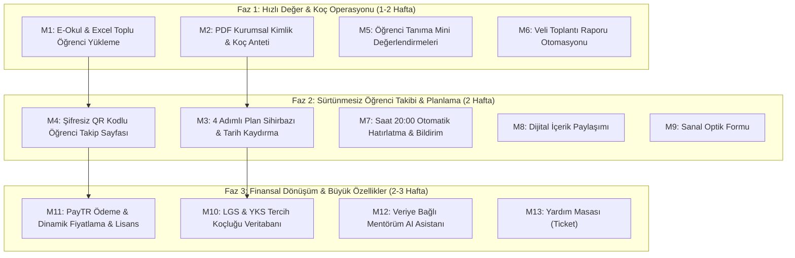

# 🚀 Mentörüm — V7 Ön Rapor & Görev Analiz Listesi (Z Koçluk İncelemesi & Enjeksiyon Planı)

> **Belge Adı:** `TASK_LIST_V7_ON_RAPOR_GEMINI.md`  
> **Tarih:** 12 Ekim 2026  
> **Hazırlayan:** Gemini (Google DeepMind - Antigravity Agent)  
> **Referans Kaynaklar:**  
> 1. `docs/zkocluk.com/EKRAN_ANALIZLERI_VE_TASVIRLER.md` (35 adet ekran görüntüsünün piksel seviyesinde analizi)  
> 2. `docs/zkocluk.com/sayfa kaynağı.html` (Z Koçluk web gateway & Flutter/Firestore kaynak kodları)  
> 3. Canlı sistem: `https://zkocluk.com/`  
> 4. Mentörüm Mimari Standartları: `URUN_PLANI.md`, `KOD_PLANI.md`, `TASK_LIST_V1-V6.md`, `.agents/AGENTS.md` (Strict IDOR, Idempotency, Scoped CSS Modules, Zero Hardcoded Text i18n, Capacitor Portability).

---

## 1. Yönetici Özeti ve Mimari Karşılaştırma

### 1.1. Z Koçluk Mimari Özeti (Ne Kullanmışlar?)
* **Frontend:** Karışık/Hibrit yapı. Landing ve auth gateway kısmı saf HTML/JS/CSS; koç yönetim paneli ise **Flutter Web (`flutter_bootstrap.js`, `main.dart.js`)** olarak derlenmiş. Öğrenci tarafı şifresiz, token bazlı hafif HTML/JS sayfası (`/student.html#token=...`).
* **Backend & Veritabanı:** Firebase Auth (`X-Firebase-Auth`, `idToken`) + Google Cloud **Firestore REST API** (NoSQL doküman tabanlı) + Firebase Cloud Functions (Node.js).
* **Güçlü Yönleri:**
  1. Koç için onboarding ve PDF kişiselleştirme (kurum adı/logo) çok hızlı.
  2. Öğrenciye hesap/şifre açtırmadan QR kod / token ile sıfır sürtünmeli görev takibi sunuyor.
  3. LGS (3.154 okul) ve YKS (21.493 program) YÖK Atlas veritabanı ile koçluk sürecini sınav sonrası tercihe kadar uzatıyor.
  4. E-Okul PDF ve Excel ile 10 saniyede toplu öğrenci aktarımı sağlıyor.
  5. PayTR ve dinamik süre/öğrenci çarpanlı esnek abonelik motoruna sahip.
* **Zayıf Yönleri:**
  1. Flutter Web canvas/DOM render kullandığı için ilk açılış (cold start) hantal (`startupLoad`, 30 saniye timeout fallback'leri koymak zorunda kalmışlar).
  2. NoSQL Firestore yapısı nedeniyle karmaşık ilişkisel sorgular, tenant izolasyonu ve IDOR denetimi istemci/fonksiyon seviyesinde kırılgan.
  3. Çok dilli (i18n) veya ton/üslup desteği yok (yalnızca Türkçe).

### 1.2. Mentörüm Avantajı ve Teknolojik Uyumumuz
Mentörüm'ün mevcut teknoloji yığını (**ASP.NET Core 9 Minimal API, PostgreSQL, Dapper, React 19 + Scoped CSS Modules, i18n 6 dil ve 3 üslup modu, Capacitor native uyumluluğu**) Z Koçluk'un tüm özelliklerini **katbekat daha hızlı, güvenli (IDOR korumalı, Idempotent) ve modern** bir şekilde çalıştırmak için biçilmiş kaftandır.

---

## 2. Enjekte Edilebilir Özellikler ve Zorluk Derecelendirme Matrisi

Aşağıdaki sınıflandırma; Mentörüm'ün mevcut veritabanı şeması, API uçları, UI bileşenleri ve kullanıcı kurallarımız (`AGENTS.md`) dikkate alınarak yapılmıştır.

| # | Modül / Özellik Adı | Mentörüm'e Katkısı / Değeri | Gerekli Efor / Zorluk | Tahmini Aşama |
|---|---|---|---|---|
| **M1** | **E-Okul PDF & Excel Toplu Öğrenci Yükleme** | 🔥 Çok Yüksek (Koçun en büyük zaman kaybını bitirir) | 🟡 **ORTA** | Aşama 1 |
| **M2** | **PDF Kurumsal Kimlik & Koç Anteti (Branding)** | 🔥 Çok Yüksek (Koç kendi markasını basar) | 🟢 **KOLAY** | Aşama 2 |
| **M3** | **4 Adımlı Planlama Sihirbazı & Tarih Kaydırma** | 🚀 Yüksek (Plan hazırlamayı standartlaştırır) | 🟡 **ORTA** | Aşama 3 |
| **M4** | **Şifresiz QR Kodlu Öğrenci Takip Ekranı** | 🔥 Çok Yüksek (Küçük yaş/veli sürtünmesini sıfırlar) | 🟡 **ORTA** | Aşama 4 |
| **M5** | **Öğrenci Tanıma & Mini Değerlendirme Testleri** | 🚀 Yüksek (Psikolojik takip, koçluk prestiji) | 🟢 **KOLAY** | Aşama 5 |
| **M6** | **Veli Toplantı Raporu (Otomatik Metin Üretimi)** | 🚀 Yüksek (Veliye tek tıkla profesyonel PDF sunar) | 🟢 **KOLAY** | Aşama 6 |
| **M7** | **Otomasyon & Bildirim Sistemi (20:00 Kuralı)** | 🚀 Yüksek (Öğrenciyi her akşam otomatik dürter) | 🟡 **ORTA** | Aşama 7 |
| **M8** | **Dijital İçerik & Kaynak Paylaşımı** | 💡 Orta-Yüksek (Video/PDF linki iletme) | 🟢 **KOLAY** | Aşama 8 |
| **M9** | **Sanal Optik Formu & Otomatik Deneme Okuma** | 🚀 Yüksek (Sınav sonuçlarını anında nete çevirir) | 🟡 **ORTA** | Aşama 9 |
| **M10**| **Tercih Koçluğu (LGS & YKS YÖK Atlas Veritabanı)**| 🏆 Dev Katma Değer (Yıl boyu koçluk satışı sağlar) | 🔴 **ZOR / KAPSAMLI** | Aşama 10 |
| **M11**| **PayTR Ödeme Alma & Dinamik Lisans/Fatura Motoru**| 💳 Kritik (Canlıda para kazanma ve otomasyon) | 🔴 **ZOR / KAPSAMLI** | Aşama 11 |
| **M12**| **Veriye Bağlı Akıllı Asistan (Mentörüm AI Widget)** | 🤖 İnovatif (Koçun verisini sorgulayan asistan) | 🔴 **ZOR / KAPSAMLI** | Aşama 12 |
| **M13**| **Yardım Masası (Destek Bileti / Ticket)** | 🛠️ Operasyonel (Koç sorunlarını içeriden çözer) | 🟢 **KOLAY** | Aşama 13 |

---

## 3. Detaylı Modül Analizleri ve Uygulama Yol Haritası

---

### M1: E-Okul PDF ve Excel Toplu Öğrenci İçe Aktarma
* **Referans Ekranlar:** `780.png`, `781.png`, `782.png`
* **Zorluk:** 🟡 **ORTA** (Frontend dosya okuma + Backend validasyon regex'leri)
* **Nasıl Çalışır?**
  1. **E-Okul PDF Modalı:** Koç, MEB E-Okul sisteminden aldığı "Sınıf Listesi" PDF dosyasını yükler. Sistem PDF text akışından Okul No, Ad Soyad ve Sınıf/Şube alanlarını regex ile yakalar.
  2. **Excel Yükleme Modalı:** Koç `[Örnek Excel İndir]` ile şablonu alır (Kolonlar: Sınıf/Şube, No, Ad Soyad, Telefon). Dosyayı yükleyince tablo önizlemesi gelir.
  3. **Çakışma Kontrolü:** Aynı okul numarasına veya isme sahip mevcut öğrenciler varsa "Güncelle / Atla" seçeneği sunulur.
* **Teknoloji & Uygulama Detayları:**
  * **Backend (.NET 9):** `PdfPig` (hafif, cross-platform PDF metin çıkarma) veya `MiniExcel` (yüksek performanslı Excel ayrıştırma). Endpoint: `POST /api/v1/students/import/pdf` ve `POST /api/v1/students/import/excel`. Mutasyon için `IdempotencyFilter` devrede olur.
  * **Frontend (React CSS Modules):** `StudentImportModal.jsx` + `StudentImportModal.module.css`. Dosya sürükle-bırak (Dropzone), eşleşen öğrenci sayısı göstergesi, tek tıkla toplu kayıt.
  * **i18n & Üslup:** Tüm hata ve onay metinleri 6 dilde ve 3 tonda (`formal`, `semi`, `buddy`).

---

### M2: PDF Kurumsal Kimlik & Koç Anteti (Branding)
* **Referans Ekranlar:** `803.png`, `804.png`, `Ekran görüntüsü 2026-10-12 011444.png`
* **Zorluk:** 🟢 **KOLAY** (Mevcut profil tablomuza birkaç alan + PDF render parametresi)
* **Nasıl Çalışır?**
  * Koç "Hesabım" veya "Profil" ekranında iki alanı doldurur:
    1. *Kurum Adı / PDF Başlığı* (Örn: "Hedef VIP Koçluk")
    2. *Programı Hazırlayan Kişi* (Örn: "Uzm. Koç Ahmet Yılmaz")
    3. *Kurum Logosu Yükleme* (PNG/JPEG)
  * Öğrenciye verilen haftalık ders/çalışma planı PDF'inde varsayılan "Mentörüm" logosu yerine koçun kendi kurumsal anteti basılır.
* **Teknoloji & Uygulama Detayları:**
  * **Veritabanı:** `coaches` tablosuna `brand_title VARCHAR(150)`, `coach_title VARCHAR(150)`, `brand_logo_url TEXT` kolonları.
  * **Backend:** `CoachProfileDto` güncellemesi ve PDF oluşturucu servise (`PdfReportService`) bu antet parametrelerinin geçirilmesi.
  * **Frontend:** `CoachProfilePage.jsx` altına "PDF Kurumsal Kimlik Ayarları" kartı.

---

### M3: 4 Adımlı Planlama Sihirbazı & Grup Tarih Düzenleme
* **Referans Ekranlar:** `783.png`, `784.png`, `785.png`, `786.png`, `787.png`
* **Zorluk:** 🟡 **ORTA** (Çok adımlı form state yönetimi ve toplu tarih öteleme sorguları)
* **Nasıl Çalışır?**
  * **4 Adımlı Stepper:**
    * *Adım 1 (Hedef):* Tek öğrenci mi, bir sınıf mı (10A), yoksa tüm öğrenciler mi?
    * *Adım 2 (İçerik Türü):* 
      - Kazanım Temelli (MEB kazanım kodları)
      - Ders Temelli (Matematik 30 soru, Fizik 2 test)
      - Serbest Çizelge (Koçun elle girdiği haftalık bloklar)
      - Müfredat Temelli (Haftalık otomatik MEB takvimi)
    * *Adım 3 (Plan Ayarları):* Başlangıç tarihi, günlük soru hedefi, zorluk seviyesi.
    * *Adım 4 (Önizleme & QR PDF):* Anında canlı PDF önizleme ve indirme.
  * **Plan Düzenleme & Tarih Öteleme (`787.png`):** Bir sınıfa aynı anda atanan plan grubunun tarihleri, öğrencilerin önceki çalışma kayıtları bozulmadan topluca 1 hafta ileri/geri kaydırılabilir.
* **Teknoloji & Uygulama Detayları:**
  * **Backend:** `PlanGroups` tablosu (`id`, `coach_id`, `plan_type`, `created_at`). `homeworks` tablosuna `plan_group_id` foreign key'i. Toplu tarih güncelleme için: `POST /api/v1/plans/groups/{groupId}/shift-dates` (`{ days: 7 }`).
  * **Frontend:** `PlanWizardModal.jsx` (Global navigation modal kuralına uygun, root düzeyde tetiklenen stepper).

---

### M4: Şifresiz QR Kodlu Öğrenci Takip Ekranı (Zero-Friction Student Access)
* **Referans Ekranlar:** `783.png`, `sayfa kaynağı.html` (`openStudentPanel`, `static-student-token`)
* **Zorluk:** 🟡 **ORTA** (Güvenli token üretimi, PWA optimize mobil görünüm, IDOR/yetki koruması)
* **Nasıl Çalışır?**
  * Koçun ürettiği her haftalık plan PDF'inin sağ üstünde öğrenciye özel bir QR kod ve altında kısa bir Token yer alır.
  * Öğrenci telefon kamerasıyla QR'ı taratır (`mentorum.dersmatris.com/p/{token}`).
  * Şifre, e-posta veya kayıt zorunluluğu olmadan açılan hafif PWA ekranında:
    - Günün görevleri listelenir (Checkbox: Yapıldı, Kısmen, Yapılmadı).
    - Çözülen soru sayısı ve yanlış sayısı tek tıkla girilir.
    - Anında kaydedilir ve koçun radarına (`778.png`) canlı veri olarak düşer.
* **Teknoloji & Güvenlik:**
  * **Güvenlik (IDOR & Abuse Koruması):** Token kriptografik olarak imzalanır (`HMAC-SHA256` veya `Guid` + hash). Token yalnızca o öğrencinin ilgili haftalık planına erişebilir; koçun diğer öğrencilerine veya başka verilere asla erişemez (Strict server-side scope). Rate limiting uygulanır.
  * **Frontend:** `QuickStudentTaskPage.jsx` (`.module.css`). 100dvh, mobil dokunmatik kartlar, offline senkronizasyon (Local storage fallback).

---

### M5: Öğrenci Tanıma & Mini Değerlendirme Testleri (Envanterler)
* **Referans Ekranlar:** `792.png`, `793.png`, `795.png`, `796.png`, `801.png`
* **Zorluk:** 🟢 **KOLAY** (Statik anket şablonları, JSON formatında yanıtlar, puanlama algoritması)
* **Nasıl Çalışır?**
  * Koç menüden 4 mini değerlendirmeden birini seçer:
    1. *Sınav Kaygısı Ölçeği*
    2. *Çalışma Alışkanlığı Değerlendirmesi*
    3. *Zaman Yönetimi Testi*
    4. *Motivasyon ve Hedef Belirleme*
  * Koç testi öğrenciye veya sınıfa gönderir. Öğrenci linke tıklayıp 10-15 likert tipi soruyu cevaplar.
  * Sonuç koçun kokpitine (`801.png`) düşer: "Riskli / İncelenmeli / Yeterli".
  * **KVKK Maskeleme Kuralı:** Sınıf bazlı genel rapor indirildiğinde öğrencilerin kimlik bilgileri maskelenir (`801.png`).
* **Teknoloji & Uygulama Detayları:**
  * **Veritabanı:** `student_assessments` (`id`, `student_id`, `coach_id`, `assessment_type`, `score`, `risk_level`, `answers_json`, `created_at`).
  * **Backend:** `AssessmentEndpoints.cs` (`GetAssessmentSummaryAsync`, `SubmitAssessmentAnswersAsync`).
  * **Frontend:** `StudentAssessmentsPage.jsx` ve değerlendirme doldurma formu.

---

### M6: Veli Toplantı Raporu (Akıllı Değerlendirme Metni Üretimi)
* **Referans Ekran:** `800.png`
* **Zorluk:** 🟢 **KOLAY** (Kural tabanlı veri analizi veya hafif Gemini API metin sentezi + PDF şablonu)
* **Nasıl Çalışır?**
  * Koç sınıf ve tarih aralığı seçip "Rapor Oluştur" der.
  * Sistem öğrencinin son 30 gündeki ödev tamamlama oranını, çözdüğü soru sayısını, deneme net trendini analiz eder.
  * Otomatik bir değerlendirme paragrafı yazar (Örn: *"Ozan bu dönemde %85 tamamlama oranına ulaşmış olup Matematik dersinde belirgin bir yükseliş trendi yakalamıştır. Deneme sınavlarında süre yetiştirme konusunda desteklenmesi önerilir."*).
  * Koç dilerse metni düzenleyebilir ve tek tıkla şık bir "Veli Bilgilendirme Raporu PDF" indirir.
* **Teknoloji & Uygulama Detayları:**
  * **Backend:** `ReportService.GenerateParentReportAsync` (Dapper ile özet metrikler çekilir, kural şablonu veya Gemini API ile paragraf oluşturulur).
  * **Frontend:** `ParentMeetingReportsPage.jsx` (`.module.css`).

---

### M7: Akıllı Otomasyon & Bildirim Sistemi (20:00 Hatırlatma Kuralı)
* **Referans Ekranlar:** `797.png`, `798.png`, `sayfa kaynağı.html` (notification script)
* **Zorluk:** 🟡 **ORTA** (Arka plan zamanlayıcı - Background Worker + Web Push VAPID / Firebase)
* **Nasıl Çalışır?**
  * **Otomatik Hatırlatıcı:** Her akşam Türkiye saatiyle 20:00'de arka plan servisi çalışır. O gün henüz görev/soru girişi yapmamış öğrencileri tespit eder ve cihazlarına push bildirimi gönderir: *"Merhaba {ad}, bugünkü çalışma kayıtlarını tamamlamanı bekliyoruz."*
  * **Manuel Şablonlu Gönderim:** Koç panelden "Bugün yapmayanlar" veya "10A Sınıfı" seçip dinamik değişkenlerle (`{ad}`, `{sinif}`, `{no}`) anlık bildirim atabilir.
* **Teknoloji & Uygulama Detayları:**
  * **Backend:** ASP.NET Core `IHostedService` (BackgroundService) veya `Quartz.NET` cron görevi (`0 20 * * * Europe/Istanbul`). Web Push için VAPID kütüphanesi veya Firebase Cloud Messaging.
  * **Frontend:** `CoachNotificationsPage.jsx` (`.module.css`), Push bildirim izni isteme prompt'u.

---

### M8: Dijital İçerik & Kaynak Paylaşımı
* **Referans Ekran:** `788.png`
* **Zorluk:** 🟢 **KOLAY** (CRUD bağlantı tablosu + öğrenci panelinde listeleme)
* **Nasıl Çalışır?**
  * Koç bir YouTube video linki, PDF linki, Google Drive dokümanı veya web bağlantısını başlık ve opsiyonel not ile birlikte bir öğrenciye, sınıfa veya tüm öğrencilerine tek tıkla gönderir.
  * Öğrenci panelinde "Koçumdan Gelen Materyaller" sekmesinde listelenir.
* **Teknoloji & Uygulama Detayları:**
  * **Veritabanı:** `shared_resources` (`id`, `coach_id`, `target_type`, `target_id`, `title`, `url`, `notes`, `created_at`).

---

### M9: Sanal Optik Formu & Otomatik Deneme Okuma
* **Referans Ekranlar:** `789.png`, `802.png`
* **Zorluk:** 🟡 **ORTA** (Optik form veri yapısı, cevap anahtarı eşleme ve net hesabı)
* **Nasıl Çalışır?**
  * Koç sınav tanımlar: Dersler, soru sayıları (Türkçe 40, Mat 40 vb.) ve cevap anahtarını girer (A, B, C, D, E).
  * Öğrenciye sanal optik form linki gider. Öğrenci ekranda gerçek optik form gibi daireleri tıklar.
  * "Sınavı Bitir" dediğinde anında Doğru, Yanlış, Boş ve Net hesaplanıp `exam_results` tablosuna işlenir; öğrencinin gelişim grafiğine yansır.
* **Teknoloji & Uygulama Detayları:**
  * **Backend:** `VirtualOpticalEndpoints.cs`, Net hesaplama motoru (LGS için 3 yanlış 1 doğru, YKS için 4 yanlış 1 doğru kuralı).
  * **Frontend:** `VirtualOpticalSheet.jsx` (Mobil uyumlu yuvarlak şık optik butonları).

---

### M10: Tercih Koçluğu Modülü (LGS & YKS YÖK Atlas Veritabanı)
* **Referans Ekranlar:** `790.png`, `791.png`
* **Zorluk:** 🔴 **ZOR / KAPSAMLI** (25.000 satırlık resmi veritabanı, çoklu filtreleme indeksleri ve PDF tercih listesi motoru)
* **Nasıl Çalışır?**
  * **LGS Tercih Ekranı:** 3.154 Anadolu, Fen, Sosyal Bilimler lisesi; il, ilçe, taban puan, 2026 yüzdelik dilim ve kontenjan verisi.
  * **YKS Tercih Ekranı:** 21.493 üniversite lisans/önlisans programı; YÖK Atlas taban başarı sırası, puan türü (SAY/EA/SÖZ/DİL), burs durumu, şehir.
  * Koç öğrencinin puanını veya başarı sırasını girer; sistem tolerans aralığındaki (örneğin ±%20 dilim) okulları listeler.
  * Koç `[+]` butonuyla tercih sepetine ekler (maksimum 24 veya 30 tercih).
  * Tek tıkla resmi tercih listesi formatında **"2026 Tercih Listesi PDF"** indirilir.
* **Teknoloji & Uygulama Detayları:**
  * **Veritabanı:** `lgs_schools` ve `yks_programs` tabloları. PostgreSQL GIN index ve Trigram (`pg_trgm`) tam metin arama optimizasyonu.
  * **Backend:** Hızlı sayfalanmış (Paged) arama endpoint'leri (`GET /api/v1/advisory/yks/search`, `GET /api/v1/advisory/lgs/search`).
  * **Frontend:** `PreferenceCoachPage.jsx` (`.module.css`), Sepet state'i, sıralama sürükle-bırak desteği.

---

### M11: PayTR Ödeme Alma & Dinamik Lisans/Fatura Motoru
* **Referans Ekranlar:** `805.png`, `806.png`, `807.png`, `808.png`, `809.png`, `sayfa kaynağı.html` (purchase settings)
* **Zorluk:** 🔴 **ZOR / KAPSAMLI** (Dış finansal servis entegrasyonu, webhook güvenliği, idempotency, yasal fatura alanları ve lisans süresi denetimi)
* **Nasıl Çalışır?**
  1. **Dinamik Fiyatlama Hesaplayıcı (`809.png`):**
     * Koç öğrenci sayısını (örn: 10) ve kullanım süresini (örn: 10 ay) seçer.
     * Algoritma öğrenci başı birim fiyatı hacme göre iskonto ederek toplam tutarı hesaplar (Örn: 16.920 TL).
  2. **Fatura Bilgileri Kaydı (`805.png`):**
     * Mesafeli Satış Sözleşmesi gereği: Fatura Ad Soyad / Şirket Unvanı, T.C. Kimlik / Vergi No, Telefon, İl, İlçe, Açık Adres zorunlu tutulur.
  3. **PayTR iFrame Ödeme Akışı:**
     * Backend PayTR API'sine token isteği atar (`POST https://www.paytr.com/odeme/api/get-token`).
     * Dönen token frontend'e iletilir ve güvenli iframe içinde kredi kartı formu açılır.
  4. **Webhook & Lisans Aktivasyonu:**
     * PayTR ödeme başarılı olunca backend webhook'una (`POST /api/v1/payments/paytr-callback`) POST atar.
     * Backend hash doğrulaması yapar, Idempotency kontrolüyle mükerrerliği engeller, `subscriptions` tablosunda koçun lisans bitiş tarihini uzatır ve PayTR'a `"OK"` yanıtı döner.
  5. **Lisans Sayacı & Kısıtlama Middleware:**
     * Lisansı biten koçun PDF üretimi ve yeni öğrenci kaydı salt-okunur (read-only) moda alınır.
* **Teknoloji & Güvenlik Detayları:**
  * **Finansal Güvenlik (Idempotency):** `AGENTS.md` kurallarımıza uygun olarak `IdempotencyKeys` tablosu ve `IdempotencyFilter` şarttır.
  * **Webhook Güvenliği:** IP filtreleme (PayTR IP'leri) + HMAC-SHA256 hash imzası kontrolü.
  * **Backend:** `PaymentEndpoints.cs`, `SubscriptionRepository.cs`, `PayTrService.cs`.
  * **Frontend:** `CoachBillingPage.jsx` (`.module.css`), Dinamik fiyat hesaplama reaktif slider'ı, PayTR iframe wrapper.

---

### M12: Veriye Bağlı Akıllı Asistan (Mentörüm AI Widget)
* **Referans Ekran:** `811.png`
* **Zorluk:** 🔴 **ZOR / KAPSAMLI** (LLM API entegrasyonu + Tool-Calling / RAG ile koçun kendi veritabanını sorgulama)
* **Nasıl Çalışır?**
  * Ekranın sağ altında sabit duran `✨ Mentörüm Asistan` butonu.
  * Tıklandığında açılan pencerede hazır rehber sorular:
    - *"Hangi plan türünü seçmeliyim?"*
    - *"10A sınıfında bu hafta kimler görev aksattı?"*
    - *"Deneme neti en çok düşen 3 öğrencimi listele."*
  * Asistan genel bir sohbet botu değil; koçun kendi öğrenci verilerine erişen (Strict CoachId filtreli) bir **analiz ortağıdır**.
* **Teknoloji & Güvenlik Detayları:**
  * **Model:** Gemini 2.0 Flash / Pro API (Google DeepMind).
  * **Tool Calling (Function Calling):** Asistan koç adına `GetMissingTasksAsync`, `GetStudentSummaryAsync` gibi güvenli C# fonksiyonlarını çalıştırır.
  * **Multi-tenant / IDOR Koruma:** Model asla başka bir koçun verisini sorgulayamaz; context'e sadece oturum açmış koçun ID'si enjekte edilir.
  * **Frontend:** `MentorumAiChatWidget.jsx` (`.module.css`).

---

### M13: Yardım Masası (Destek Bileti / Ticket Sistemi)
* **Referans Ekran:** `810.png`
* **Zorluk:** 🟢 **KOLAY** (Standart mesajlaşma / talep CRUD'u)
* **Nasıl Çalışır?**
  * Koç sistem içinden kategori seçerek (Teknik Destek, Lisans/Ödeme, Öneri) talep açar.
  * Admin panelinden yöneticiler talebi yanıtlar; koç aynı sayfa içinde yanıtları görür.
* **Teknoloji:** `support_tickets` ve `ticket_messages` tabloları, `HelpDeskPage.jsx`.

---

## 4. Kodlama ve Uygulama Öncelik Sıralaması (Roadmap)

Tüm modülleri değer/efor oranına göre mantıksal paketlere ayırıyoruz:

---

## 5. Doğrulama ve Güvenlik Denetim Kriterleri

1. **IDOR ve Çoklu Kiracı İzolasyonu:**
   * Eklenen tüm yeni tablolarda (`subscriptions`, `student_assessments`, `shared_resources`, `plan_groups`) `coach_id` kolonu zorunlu olacak ve Dapper sorgularında `WHERE coach_id = @CoachId` filtresi enjekte edilecek.
2. **Finansal Idempotency:**
   * PayTR ödeme başlatma ve webhook geri çağırma uçları `IdempotencyFilter` ile korunacak; aynı işlem anahtarıyla gelen ikinci istekler kesinlikle çift işlem yaratmayacak.
3. **Sıfır Sabit Metin & Çoklu Dil (i18n):**
   * Yeni eklenen tüm ekranlarda, modallarda ve hata mesajlarında hardcoded Türkçe metin yazılmayacak; `useTranslation` ile `tr`, `en`, `es`, `fr`, `de`, `ro` dil dosyalarına eklenecek ve 3 üslup (`formal`, `semi`, `buddy`) desteklenecek.
4. **CSS Kapsülleme (Scoped CSS Modules):**
   * Tüm yeni UI bileşenleri yalnızca `.module.css` ile stillendirilecek; global DOM'u kirleten inline veya global sınıflar kullanılmayacak.
5. **Capacitor & Mobil Portatiflik:**
   * QR kodlu öğrenci takip sayfası ve sanal optik formu doğrudan native mobil cihazlarda kusursuz çalışacak şekilde `100dvh` ve güvenli alan (`env(safe-area-inset-*)`) standartlarına uygun kodlanacak.

---

> **Sonuç:** Bu ön rapor, Z Koçluk platformunun en can alıcı yönlerini Mentörüm'ün modern ve güvenli mimarisine minimum efor ve maksimum etkiyle nasıl aktaracağımızın eksiksiz planıdır. Onayınız doğrultusunda Faz 1'deki ilk görev paketinden kodlamaya başlanabilir.
