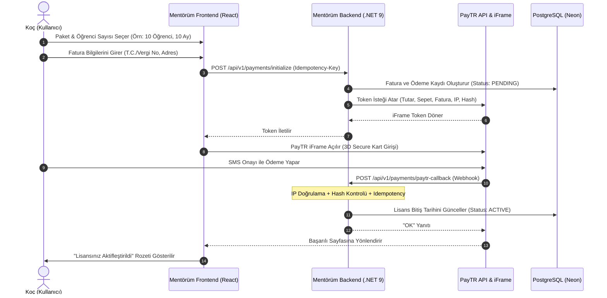

# ⚡ Mentörüm — V7 Ön Rapor & Uyarlama Görev Listesi (Gemini 3.8 Flash Analizi)

> **Belge Adı:** `TASK_LIST_V7_ON_RAPOR_GEMINI_FLASH_3.8.md`  
> **Tarih:** 12 Ekim 2026  
> **Model / Analiz Motoru:** Gemini 3.8 Flash (High Fidelity)  
> **Referans Kaynaklar:**  
> - `docs/zkocluk.com/EKRAN_ANALIZLERI_VE_TASVIRLER.md` (35 ekran görüntüsünün ayrıntılı tasvirleri)  
> - `docs/zkocluk.com/sayfa kaynağı.html` (Z Koçluk gateway & Flutter/Firestore kaynak kodları)  
> - Canlı Sistem: `https://zkocluk.com/`  
> - Mentörüm Mimari Standartları: `.agents/AGENTS.md`, `TASK_LIST_V1-V6.md`, `URUN_PLANI.md`, `KOD_PLANI.md`

---

## 1. Yönetici Özeti ve Mimari Karşılaştırma

### 1.1 Z Koçluk'un Gerçek Mimari Röntgeni
1. **Frontend Hibrit Mimarisi:** Giriş ve karşılama (gateway) saf HTML5/JS (`sayfa kaynağı.html`); oturum açıldıktan sonraki koç yönetim paneli ise **Flutter Web (`flutter_bootstrap.js`, `main.dart.js`)** olarak derlenmiştir. Öğrenci tarafı ise uygulamayı indirmeden, PDF'teki QR kodu okutarak `/student.html#token=...` üzerinden şifresiz, token bazlı çalışan hafif bir web arayüzüdür.
2. **Backend & Veritabanı:** Doğrudan Google Cloud **Firestore REST API (NoSQL)** doküman modeli ve **Firebase Auth** (`idToken`, `X-Firebase-Auth`) kullanılmaktadır. Bildirimler ve sunucu tarafı işler Firebase Cloud Functions üzerinden yürütülmektedir.
3. **Ödeme Altyapısı:** Satın alma ayarları Firestore dokümanında (`settings/purchase`) tutulmakta; kredi kartı tahsilatı **PayTR iFrame API** ile yapılmakta ve süre bazlı lisans anahtarı üretilmektedir.
4. **Zayıf Noktaları:** Flutter Web'in getirdiği ağır DOM/Canvas ilk yükleme süresi (cold start 30s timeout koymuşlar), Firestore'un ilişkisel veri ve tenant IDOR güvenliğindeki kırılganlığı ve sıfır i18n/üslup desteği (yalnızca Türkçe).

### 1.2 Mentörüm'ün Teknoloji Yığını ve Üstünlükleri
Mentörüm'ün mevcut mimarisi Z Koçluk'un tüm yeteneklerini çok daha hızlı, güvenli ve ölçeklenebilir şekilde karşılamaya hazırdır:
* **Backend:** C# ASP.NET Core 9 Minimal API, Dapper, PostgreSQL (Neon/Fly.io), `BaseRepository<T>` ile otomatik `coach_id` tenant izolasyonu, `IdempotencyFilter` + `IdempotencyKeys` tablosu (mükerrer ödeme ve mutasyon engeli), JWT (HttpOnly refresh cookie), Resend e-posta, Serilog.
* **Frontend:** React 19, Vite, React Router v7, Zustand, React Query, **Scoped CSS Modules (`*.module.css`)** (kesinlikle DOM kirleten global CSS/Tailwind yok), **i18n Sistemi (6 Dil: TR, EN, ES, FR, DE, RO + 3 Üslup Modu: Resmi `formal`, Samimi `semi`, Kanka `buddy`)** (Sıfır Sabit Metin Kuralı).
* **Mobil/PWA:** Capacitor hazır (`utils/storage.js`, `apiClient.js`, relative birimler, `100dvh`, safe-area insets, `sw.js`).

---

## 2. Uyarlanabilir İçerik ve Yeteneklerin Zorluk Matrisi

Aşağıdaki sınıflandırma; Mentörüm'ün mevcut veritabanı şeması, C# backend API'leri, React Scoped CSS bileşenleri ve katı `AGENTS.md` güvenlik kurallarımız göz önüne alınarak yapılmıştır:

| # | Modül / Özellik Adı | Mentörüm'de Durumu | Zorluk Sınıfı | Tahmini Süre | Enjeksiyon Değeri |
|---|---|---|---|---|---|
| **1** | **PDF Kurumsal Kimlik & Koç Anteti (Branding)** | Yok | 🟢 **KOLAY** | 1 Gün | 🔥 Çok Yüksek |
| **2** | **Öğrenci Tanıma & Mini Değerlendirmeler (4 Test)**| Yok | 🟢 **KOLAY** | 1-2 Gün | 🚀 Yüksek |
| **3** | **Dijital İçerik & Link Gönderimi** | Kısmi (`course_resources`) | 🟢 **KOLAY** | 1 Gün | 💡 Orta |
| **4** | **Kurumsal Yasal Sayfalar (Satış/KVKK/İade)** | Yok | 🟢 **KOLAY** | 1 Gün | ⚖️ Yasal Zorunluluk |
| **5** | **Yardım Masası (Destek Bileti / Ticket)** | Yok | 🟢 **KOLAY** | 1-2 Gün | 🛠️ Operasyonel |
| **6** | **Öğrenci Takip Radarı (Bugün Yapan/Yapmayan)** | Zayıf Dashboard | 🟡 **ORTA** | 2-3 Gün | 🔥 Çok Yüksek |
| **7** | **Excel'den Toplu Öğrenci Yükleme** | Yok | 🟡 **ORTA** | 2-3 Gün | 🔥 Çok Yüksek |
| **8** | **PDF + QR Kodlu Haftalık Plan Çıktısı** | Yok | 🟡 **ORTA** | 3-4 Gün | 🔥 Çok Yüksek |
| **9** | **Şifresiz QR/Token Hafif Öğrenci Ekranı** | Yok | 🟡 **ORTA** | 2-3 Gün | 🔥 Çok Yüksek |
| **10**| **Veli Toplantı Raporu (Otomatik Değerlendirme)** | Yok | 🟡 **ORTA** | 2 Gün | 🚀 Yüksek |
| **11**| **Web Push Bildirim (Saat 20:00 Otomasyonu)** | PWA `sw.js` var, cron yok | 🟡 **ORTA** | 3 Gün | 🚀 Yüksek |
| **12**| **Grup Plan Düzenleme & Tarih Kaydırma** | Yok | 🟡 **ORTA** | 2-3 Gün | 🚀 Yüksek |
| **13**| **Üyelik/Paket & Dinamik Fiyat Hesaplayıcı** | Yok | 🟡 **ORTA** | 2-3 Gün | 💳 Ticari Kritik |
| **14**| **E-Okul PDF'den Sınıf/Öğrenci Okuma** | Yok | 🔴 **ZOR** | 4-5 Gün | 🚀 Yüksek |
| **15**| **Plan Hazırlama Sihirbazı (12 Farklı Plan Türü)**| Yok | 🔴 **ZOR** | 1-2 Hafta | 🏆 Temel Ürün |
| **16**| **PayTR Sanal POS & Webhook & Lisans Motoru**| Yok | 🔴 **ZOR** | 5-7 Gün | 💳 Ticari Kritik |
| **17**| **Sanal Optik Formu & Otomatik Net Analizi** | Yok | 🔴 **ZOR** | 1 Hafta | 🚀 Yüksek |
| **18**| **Tercih Koçluğu (LGS & YKS YÖK Atlas Veritabanı)**| Yok | 🔴 **ZOR** | 1-2 Hafta | 🏆 Yıllık Bağımlılık |
| **19**| **Veriye Bağlı Akıllı Asistan (Mentörüm AI Widget)**| Yok | 🔴 **ZOR** | 1 Hafta | 🤖 İnovasyon |

---

## 3. Adım Adım Detaylı Modül Analizi

---

### 3.1. PDF Kurumsal Kimlik & Koç Anteti (Branding) — 🟢 KOLAY
* **Z Koçluk Analizi (`803.png`, `804.png`):** Koç profilinde "Kurum Adı / PDF Başlığı" ve "Programı Hazırlayan Kişi" alanları yer alır. Burası doldurulduğunda, öğrenciye verilen tüm PDF çıktılarında varsayılan logo yerine koçun kendi kurumsal anteti yer alır.
* **Mentörüm Enjeksiyonu:**
  1. **Veritabanı:** `coaches` tablosuna `brand_title VARCHAR(150)`, `coach_title VARCHAR(150)`, `brand_logo_url TEXT` eklenir.
  2. **Backend:** `CoachProfileDto` bu alanları kapsar. `QuestPDF` servisimize parametre olarak aktarılır.
  3. **Frontend:** `CoachProfilePage.jsx` içerisine "PDF Kurumsal Kimlik" kartı eklenir (`CoachProfilePage.module.css`).
  4. **i18n:** 6 dil ve 3 tona uygun çeviriler eklenir.

---

### 3.2. Öğrenci Tanıma & Mini Değerlendirmeler — 🟢 KOLAY
* **Z Koçluk Analizi (`792.png`, `795.png`, `801.png`):** 4 standart değerlendirme: *Sınav Kaygısı, Çalışma Alışkanlığı, Zaman Yönetimi, Motivasyon ve Hedef*. Koç öğrenciye/sınıfa gönderir; öğrenci yanıtlar; koç kokpitinde risk düzeyi (İncelenmeli / Yeterli) görünür. Sınıf PDF'inde kimlik maskeleme rozeti bulunur.
* **Mentörüm Enjeksiyonu:**
  1. **Veritabanı:** `student_assessments` tablosu (`id`, `student_id`, `coach_id`, `type`, `score`, `risk_level`, `answers_json`, `created_at`).
  2. **Backend:** `AssessmentEndpoints.cs` (`POST /api/v1/assessments/send`, `POST /api/v1/assessments/submit`, `GET /api/v1/assessments/summary`). `BaseRepository` ile `coach_id` filtrelemesi zorunludur.
  3. **Frontend:** `StudentAssessmentsPage.jsx` (`.module.css`) 4 kartlı dashboard + anket çözme modalı.

---

### 3.3. Dijital İçerik & Link Gönderimi — 🟢 KOLAY
* **Z Koçluk Analizi (`788.png`):** Video, PDF veya web bağlantısı; başlık ve URL ile bir öğrenciye, sınıfa veya tüm kuruma gönderilir.
* **Mentörüm Enjeksiyonu:**
  1. **Veritabanı:** Mevcut `course_resources` tablosu veya genel `shared_resources` tablosu (`coach_id`, `target_type`, `target_id`, `title`, `url`, `notes`).
  2. **Backend:** `ResourceEndpoints.cs` üzerinden `POST /api/v1/resources/share`.
  3. **Frontend:** `CoachResourcesPage.jsx` (`.module.css`) form ve geçmiş paylaşımlar sekmesi.

---

### 3.4. Kurumsal Yasal Sayfalar — 🟢 KOLAY
* **Z Koçluk Analizi (`sayfa kaynağı.html` 3400-3490 satırlar, `810.png`):** Mesafeli Satış Sözleşmesi, İptal ve İade Koşulları, KVKK Aydınlatma Metni, Teslimat Koşulları, Firma İletişim Bilgileri (PayTR sanal POS onayı için zorunlu yasal metinler).
* **Mentörüm Enjeksiyonu:**
  1. **Frontend:** `/legal/terms`, `/legal/kvkk`, `/legal/sales-agreement`, `/legal/cancellation` rotaları (`LegalLayout.jsx` + `.module.css`).
  2. **Admin:** Bu metinlerin şirket unvanı ve adres değişkenlerini veritabanından (`system_settings`) dinamik okuma.

---

### 3.5. Yardım Masası (Ticket Sistemi) — 🟢 KOLAY
* **Z Koçluk Analizi (`810.png`):** Yeni talep formu (Konu, Kategori: Teknik Destek / Lisans / vb., Mesaj) ve önceki talepler listesi.
* **Mentörüm Enjeksiyonu:**
  1. **Veritabanı:** `support_tickets` (`id`, `user_id`, `category`, `subject`, `status`, `created_at`) ve `ticket_messages` (`id`, `ticket_id`, `sender_id`, `message`).
  2. **Backend:** `SupportEndpoints.cs` + Admin yanıtlayınca koça Resend üzerinden bildirim e-postası.
  3. **Frontend:** `HelpDeskPage.jsx` (`.module.css`).

---

### 3.6. Öğrenci Takip Radarı — 🟡 ORTA
* **Z Koçluk Analizi (`778.png`):** `[Yapmayanlar]` ve `[Yapanlar]` toggle'ı; `[Bugün]`, `[Dün]`, `[1 Hafta]`, `[1 Ay]`, `[Kitap]` hap filtreleri. Görev aksatan öğrenci listesi.
* **Mentörüm Enjeksiyonu:**
  1. **Backend:** `ReportsRepository.GetCoachRadarAsync(coachId, filterPeriod, status)`: `homework_assignments` tablosunda o gün bekleyen görevi olup teslim etmeyen öğrencileri tek sorguda agrege eder.
  2. **Frontend:** `CoachDashboard.jsx` üst kısmına radar bileşeni (`CoachRadar.jsx` + `.module.css`).

---

### 3.7. Excel'den Toplu Öğrenci Yükleme — 🟡 ORTA
* **Z Koçluk Analizi (`782.png`):** "Örnek Excel Dosyasını İndir" butonu. Format: Sınıf/Şube (5A, 6B), Okul No, Ad Soyad, Telefon (isteğe bağlı).
* **Mentörüm Enjeksiyonu:**
  1. **Backend:** `ClosedXML` kütüphanesi ile `POST /api/v1/students/import/excel`. Tek transaction'da `users` + `students` + `program_students` kayıtları oluşturulur.
  2. **Güvenlik (Idempotency):** `IdempotencyFilter` ile mükerrer dosya yüklemeleri engellenir.
  3. **Frontend:** `ExcelImportModal.jsx` (`.module.css`), dosya sürükle-bırak, hata/başarı satır listesi önizlemesi.

---

### 3.8. PDF + QR Kodlu Haftalık Plan Çıktısı — 🟡 ORTA
* **Z Koçluk Analizi (`779.png`, `783.png`):** Öğrenci çalışma planı hazırlandığında tek tıkla şık A4 PDF üretilir; üstünde koçun logosu, haftalık gün matrisi ve benzersiz bir QR kod bulunur.
* **Mentörüm Enjeksiyonu:**
  1. **Backend:** `QuestPDF` kütüphanesi (C# native, ultra hızlı PDF motoru) + `QRCoder` (QR barkod jeneratörü).
  2. **Endpoint:** `GET /api/v1/plans/{planId}/pdf` -> Doğrudan binary `application/pdf` döner.
  3. **Tasarım:** A4 yatay/dikey, günlere bölünmüş görev kutuları, kontrol kutucukları (checkbox), sayfa altı motivasyon sözü.

---

### 3.9. Şifresiz QR/Token Hafif Öğrenci Ekranı — 🟡 ORTA
* **Z Koçluk Analizi (`sayfa kaynağı.html` 3662-3677 satırlar):** Öğrenci QR okuttuğunda veya linke tıkladığında (`/student.html#token=...`) şifresiz, sadece bugünün görevlerini (Yapıldı / Kısmen / Yapılmadı) işaretleyip kaç soru çözdüğünü girebildiği hafif bir arayüz açılır.
* **Mentörüm Enjeksiyonu:**
  1. **Güvenlik Mimarisi (Server-Side Token):** `student_plan_tokens` tablosu (`token VARCHAR(64) UNIQUE`, `student_id`, `plan_id`, `expires_at`). Token kriptografik hash ile üretilir.
  2. **Backend:** `QuickStudentEndpoints.cs` -> `GET /api/v1/p/{token}` ve `POST /api/v1/p/{token}/submit`. Endpoint asla koçun diğer öğrencilerini ifşa etmez (Strict IDOR).
  3. **Frontend:** `QuickStudentTaskPage.jsx` (`.module.css`). 100dvh, büyük mobil dokunmatik butonlar, offline storage senkronizasyonu.

---

### 3.10. Veli Toplantı Raporu (Otomatik Değerlendirme) — 🟡 ORTA
* **Z Koçluk Analizi (`800.png`):** Sınıf/öğrenci seçildiğinde son 30 günün çalışma verilerini derleyip hazır bir pedagojik değerlendirme paragrafı üretir ve PDF indirir.
* **Mentörüm Enjeksiyonu:**
  1. **Algoritma:** Kural tabanlı metin şablonu (Ödev tamamlama oranı > %80 ise tebrik, < %50 ise uyarı; deneme net trendi hesaplanır). Koç metni elle düzenleyebilir.
  2. **Çıktı:** QuestPDF ile "Veli Bilgilendirme Bülteni".

---

### 3.11. Web Push Bildirim & Saat 20:00 Otomasyonu — 🟡 ORTA
* **Z Koçluk Analizi (`797.png`, `798.png`):** Saat 20:00'de o gün çalışma kaydı girmeyenlere otomatik push bildirimi atma anahtarı. Manuel bildirimde şablon değişkenleri: `{ad}`, `{sinif}`, `{no}`.
* **Mentörüm Enjeksiyonu:**
  1. **Background Worker:** ASP.NET Core `IHostedService` (BackgroundService) cron'u. Her akşam 20:00'de (Europe/Istanbul) çalışır; o gün `study_logs` kaydı olmayan öğrencileri tespit eder.
  2. **Push Altyapısı:** `WebPush` C# kütüphanesi (VAPID anahtarları) + mevcut `sw.js` servis işçisi.
  3. **Frontend:** `CoachNotificationsPage.jsx` (`.module.css`).

---

### 3.12. Grup Plan Düzenleme & Tarih Kaydırma — 🟡 ORTA
* **Z Koçluk Analizi (`787.png`):** Sınıfa toplu atanan bir plan grubunun tarihleri, öğrencilerin önceki verileri bozulmadan topluca ileri/geri kaydırılabilir.
* **Mentörüm Enjeksiyonu:**
  1. **Veritabanı:** `study_plan_groups` tablosu. `homework_assignments` tablosuna `plan_group_id` foreign key'i.
  2. **Endpoint:** `POST /api/v1/plans/groups/{groupId}/shift-dates` (`{ daysToAdd: 7 }`).

---

### 3.13. Üyelik/Paket & Dinamik Fiyat Hesaplayıcı — 🟡 ORTA
* **Z Koçluk Analizi (`808.png`, `809.png`):** Koç öğrenci sayısını (1-500) ve kullanım süresini (1-10 ay) girer; algoritma öğrenci başı maliyeti kademeli düşürerek anlık toplam TL hesaplar (Örn: 10 öğrenci × 10 ay = 16.920 TL).
* **Mentörüm Enjeksiyonu:**
  1. **Algoritma (Formül):** `Toplam = OgrenciSayisi * Ay * TabanFiyat * İskontoCarpani(Ay, OgrenciSayisi)`.
  2. **Frontend:** `CoachPricingCalculator.jsx` (`.module.css`) interaktif reaktif slider ve kart bileşeni.

---

### 3.14. E-Okul PDF'den Sınıf/Öğrenci Okuma — 🔴 ZOR
* **Z Koçluk Analizi (`781.png`):** MEB E-Okul sisteminden indirilen sınıf listesi PDF'ini yükleyip okul no, ad ve soyadı regex ile ayıklama.
* **Mentörüm Enjeksiyonu:**
  1. **Backend:** `UglyToad.PdfPig` kütüphanesi ile PDF metin bloğu analizi. MEB formatındaki tablolara özel regex desenleri (`\d{1,5}\s+[A-ZÇĞİÖŞÜ\s]+`).
  2. **Risk / Zorluk Nedir?** MEB E-Okul PDF şablonu güncellendiğinde regex kırılabilir. Bu nedenle kullanıcıya önce tablo önizlemesi sunulup onaylatılmalıdır.

---

### 3.15. Çok Türlü Plan Hazırlama Sihirbazı (12 Tür) — 🔴 ZOR
* **Z Koçluk Analizi (`783-786.png`):** Kazanım Temelli, Ders Temelli, Konu Temelli, Serbest Çizelge, MEB Müfredat Temelli, Ders Kitabı Temelli, LGS Müfredat, YKS Müfredat, LGS Temelli, YKS Temelli, Sınav Karnesi Temelli, Yanlış Analizi Temelli planlama.
* **Mentörüm Enjeksiyonu (Fazlı Yaklaşım):**
  * *Faz 1 (Temel):* Serbest Çizelge + Ders Temelli + Konu Temelli plan sihirbazı.
  * *Faz 2 (Müfredat):* MEB haftalık müfredat kazanım havuzuyla eşleşen otomatik planlama.
  * *Faz 3 (Akıllı):* Deneme sınavındaki yanlış analizinden zayıf konulara göre otomatik telafi planı üretme.
  * **Frontend:** `PlanWizardModal.jsx` (Global Navigation Modal kuralımıza uygun, root seviyede yönetilen 4 adımlı modal).

---

### 3.16. PayTR Sanal POS & Webhook & Lisans Motoru — 🔴 ZOR
* **Z Koçluk Analizi (`805.png`, `807.png`, `sayfa kaynağı.html`):** Fatura bilgileri zorunluluğu, PayTR iFrame üzerinden kart tahsilatı, webhook ile anında lisans aktivasyonu.
* **Mentörüm Enjeksiyonu:**
  1. **Veritabanı:**
     * `coaches` -> `subscription_expires_at TIMESTAMP`, `student_quota INT`, `license_status VARCHAR(20)`.
     * `invoices` -> Fatura unvanı, T.C./Vergi no, adres, tutar, durum.
     * `payment_transactions` -> PayTR sipariş numarası, hash, webhook logları.
     * `IdempotencyKeys` -> Çift ödemeyi kesin olarak engelleyen tablo.
  2. **PayTR iFrame Akışı:**
     * `POST /api/v1/payments/paytr/token` -> Backend PayTR API'sine token sorar, frontend'e iFrame token döner.
     * `POST /api/v1/payments/paytr/callback` -> PayTR'ın 3D Secure sonrası çağırdığı webhook. IP kontrolü + HMAC-SHA256 doğrulaması yapılır. Lisans süresi uzatılır ve PayTR'a `"OK"` dönülür.
  3. **Lisans Middleware Kısıtı:**
     * Lisansı biten koç için `RequireActiveSubscriptionFilter` devreye girer: Mevcut veriler okunabilir ancak yeni öğrenci veya PDF üretimi engellenir.

---

### 3.17. Sanal Optik Formu & Otomatik Net Analizi — 🔴 ZOR
* **Z Koçluk Analizi (`789.png`, `802.png`):** Sınav için sanal optik form tanımlama, öğrencinin ekrandan optik işaretlemesi, sınav bitince net ve sıralama analizi.
* **Mentörüm Enjeksiyonu:**
  1. **Veritabanı:** `virtual_optical_exams` (`exam_id`, `answer_key_json`, `duration_minutes`) ve `student_optical_submissions` (`exam_id`, `student_id`, `selected_answers_json`, `correct_count`, `wrong_count`, `net_score`).
  2. **Frontend:** `VirtualOpticalSheet.jsx` (A-B-C-D-E yuvarlak optik form balonları, mobil uyumlu, süre sayacı).

---

### 3.18. Tercih Koçluğu (LGS & YKS YÖK Atlas Veritabanı) — 🔴 ZOR
* **Z Koçluk Analizi (`790.png`, `791.png`):** 3.154 LGS lisesi ve 21.493 YKS üniversite programı. Puan, yüzdelik dilim, şehir filtreleri ve PDF Tercih Listesi çıktısı.
* **Mentörüm Enjeksiyonu:**
  1. **Veri Kümesi:** YÖK Atlas 2026 ve MEB 2026 taban puan/başarı sırası verisi PostgreSQL tablolarına aktarılır (`yks_programs`, `lgs_schools`).
  2. **PostgreSQL Tam Metin İndeksi:** `pg_trgm` ve GIN indeksleri ile 25.000 kayıt milisaniyeler içinde filtrelenir.
  3. **Frontend:** `PreferenceCoachPage.jsx` (`.module.css`), Aday filtre paneli, arama sonuçları ve sağda "Tercih Sepetim" (Maksimum 24/30 tercih listesi) + PDF İndir.

---

### 3.19. Veriye Bağlı Akıllı Asistan (Mentörüm AI Widget) — 🔴 ZOR
* **Z Koçluk Analizi (`811.png`):** Ekranın sağ altındaki widget. Koçun öğrenci verilerine erişerek soruları cevaplar (*"Örn: 6A sınıfında kimler görev aksattı?"*).
* **Mentörüm Enjeksiyonu:**
  1. **Model:** Google DeepMind Gemini API (Gemini 2.0 Flash / Pro).
  2. **Tool-Calling Mimarisi:** Model doğrudan veritabanına bağlanmaz; güvenli C# fonksiyonlarını çağırır (`GetCoachUnfinishedTasksAsync(coachId, date)`, `GetStudentExamSummaryAsync(coachId, studentId)`).
  3. **Strict IDOR Koruması:** Asistan context'ine yalnızca JWT'deki aktif `CoachId` enjekte edilir. Asla diğer koçların öğrencilerini göremez.
  4. **Frontend:** `MentorumAiChatWidget.jsx` (`.module.css`).

---

## 4. Ödeme Alma ve Fatura Altyapısı (Derinlemesine İnceleme)

Türkiye'de koçluk yazılımı satışı için en uygun ve yasal akış Z Koçluk'un kurguladığı modeldir:

* **Havale/EFT Seçeneği (Opsiyonel Kolay Yol):** Sanal POS onaylanana kadar "IBAN ile Havale" seçeneği sunulup, dekont yükleme ve yönetici panelinden tek tıkla onaylama akışı eklenebilir.

---

## 5. Uygulama ve Geliştirme Yol Haritası (Fazlar)

### 🟢 Faz 1: Hızlı Kazanımlar & Kurumsal Kimlik (1. Hafta)
- [ ] **M1.1:** `coaches` tablosuna PDF antet alanlarının (`brand_title`, `coach_title`, `brand_logo_url`) eklenmesi ve profil arayüzü.
- [ ] **M1.2:** `student_assessments` tablosu ve 4 Öğrenci Tanıma testinin (Sınav Kaygısı vb.) kodlanması.
- [ ] **M1.3:** Kurumsal yasal sayfaların (`/legal/*`) ve Yardım Masası (`support_tickets`) modülünün eklenmesi.
- [ ] **M1.4:** Havale/EFT ve manuel onay ile Üyelik/Paket ön gösteriminin açılması.

### 🟡 Faz 2: Çekirdek Takip & Otomasyon Altyapısı (2. Hafta)
- [ ] **M2.1:** Öğrenci Takip Radarı (`CoachRadar.jsx`) ve bugün ödev yapmayanları listeleyen backend agregasyonu.
- [ ] **M2.2:** `ClosedXML` ile Excel'den toplu öğrenci içe aktarma motoru.
- [ ] **M2.3:** `QuestPDF` + `QRCoder` ile haftalık plan PDF motoru.
- [ ] **M2.4:** Şifresiz QR/Token hafif öğrenci takip PWA ekranı (`/p/{token}`).
- [ ] **M2.5:** Veli Toplantı Raporu otomatik paragraf motoru ve PDF çıktısı.
- [ ] **M2.6:** Saat 20:00 otomatik çalışma hatırlatma background worker'ı ve push bildirim.

### 🔴 Faz 3: Gelir Modeli & İleri Özellikler (3-4. Hafta)
- [ ] **M3.1:** PayTR iFrame sanal POS entegrasyonu, webhook doğrulaması ve lisans middleware motoru.
- [ ] **M3.2:** Dinamik fiyat hesaplama reaktif slider arayüzü ve fatura formu.
- [ ] **M3.3:** Çok türde planlama sihirbazı (Faz A: Ders + Konu + Serbest plan).
- [ ] **M3.4:** Sanal Optik Formu ve otomatik net hesaplama motoru.
- [ ] **M3.5:** Tercih Koçluğu modülü (LGS 3.154 okul + YKS 21.493 program veritabanı).
- [ ] **M3.6:** Veriye bağlı Gemini destekli "Mentörüm Asistan" widget'ı.

---

## 6. Doğrulama, Test ve Güvenlik Kriterleri (AGENTS.md Kuralları)

1. **Sıfır Sabit Metin (Zero Hardcoded Text):** Tüm yeni arayüz metinleri, butonlar ve uyarılar `tr`, `en`, `es`, `fr`, `de`, `ro` dosyalarına eklenecek ve `formal`, `semi`, `buddy` ton varyantlarıyla tanımlanacak.
2. **Kapsüllü UI (CSS Modules):** Hiçbir bileşende genel Tailwind veya global CSS sınıfları kullanılmayacak; yalnızca `.module.css` scoped CSS uygulanacak.
3. **IDOR ve Multi-Tenant:** `WHERE coach_id = @id` filtresi `BaseRepository` üzerinden otomatik işletilecek; öğrenci token'ları asla diğer öğrencilerin verisini okuyamayacak.
4. **Finansal Idempotency:** PayTR webhook ve ödeme başlatma istekleri `IdempotencyFilter` ve `IdempotencyKeys` tablosuyla %100 mükerrer işlem korumalı olacak.
5. **Derleme ve Test Garantisi:** Backend değişiklikleri yerel `dotnet build` ve `dotnet test` (Testcontainers) ile; frontend `npm run build` ile doğrulanmadan canlıya alınmayacak.

---

> **Sonuç:** Z Koçluk'un sektörde başarı yakaladığı kritik omurga; **"Zahmetsiz Toplu Öğrenci Ekleme + Markalı PDF Plan + Şifresiz QR Takip + Dinamik Üyelik Motoru"** bileşimidir. Bu yol haritası ile Mentörüm, rakibinin Flutter Web hantallığını geride bırakıp çok daha hızlı, güvenli ve çok dilli bir deneyim sunacaktır.
